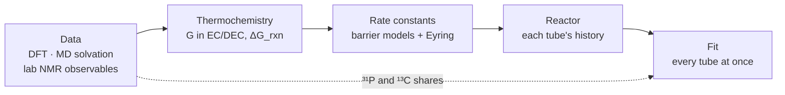

# atom-to-reactor · branch `M5-full`

Multiscale kinetics of the TMSPA water scavenger in ethylene carbonate: from DFT energies to reactor concentrations, fitted to the lab NMR spectra.

Master's thesis project, Department of Chemistry – Ångström Laboratory, Uppsala University.

> [!WARNING]
> **Research code, under active development.** No model is calibrated yet; APIs may change without notice.

## The branches

| Branch | What it holds |
|---|---|
| `M1-steps` (the default) | The model M1 fitted to one lab tube at a time, each step tested on the tubes not used yet (eighth fit). Notebook `05_fitting_rev08_(M1_steps)` |
| **`M5-full`** (this one) | The fit of every tube at once: M1 ⊂ M5 ⊂ M5-first, each with Marcus barriers and with the capped BEP rule (`+BEP`), at ages of 0, 5 and 10 min (seventh fit). Notebook `05_fitting_rev07_(M1_all fitted)`. Also the setup of a run at 10 min and free ages, prepared and not run |
| `main` | The history up to the sixth fit: notebooks 01–05 rev05, the spectroscopy and experiment-design modules. Closed at the tag `historico-261027` |

This branch drops the files the full fit does not use; the files it keeps are whole. Anything removed is in `main`.

## What it does



TMSPA (tris(trimethylsilyl) phosphate) reacts with water and with the solvent through a cascade of silyl transfers: R1–R9 and the six steps N10–N15 between the same species. Energies belong to species, so every cycle closes; every rate obeys detailed balance. The barriers are not computed: each class of reaction has an intrinsic barrier, and the fit determines it from the spectra.

## Quick start

Requires Python 3.10+ (developed on 3.11).

```bash
git clone -b M5-full https://github.com/yralcaraz/atom-to-reactor.git
cd atom-to-reactor
pip install -r requirements.txt
cp .env.example .env              # then set the two data folders (see Data)
```

| Task | Command |
|---|---|
| Tests | `python tests/run_all.py` |
| Check that the code still reproduces a stored fit (reads only) | `python scripts/check_stored_fits.py notebooks/results/05_fit7` |
| A stage of the fit (registered, throughput, recovery, baselines, extended, refit, night, traces, predictions) | `python scripts/run_fit.py STAGE --results DIR` |
| The notebook | `jupyter lab notebooks/` |

`--results` is required: every job is written there, and a folder that already holds results returns its fits as they are. The setup of the run is `DIR/fit_config.json`; [docs/reference-fitting_system.md](docs/reference-fitting_system.md) describes the stages.

## Layout

```text
atom-to-reactor/
├── kinetics/            the package
│   ├── data/            snapshot, species, network, lab observables, solvation medium
│   ├── thermo/          G in solution, solvation σ, ΔG_rxn
│   ├── microkinetics/   barrier models, rate constants, model registry
│   ├── reactor/         mass-action engine, batch and protocol reactors, sample histories
│   └── fitting/         residuals, candidate structures, fits and profiles, stored fits run forward, run setup
├── demo/                figures and display tables of the fit notebooks
├── notebooks/           05_fitting_rev07_(M1_all fitted)
├── scripts/             run_fit.py (the staged runner) · check_stored_fits.py · build_observables.py
├── tests/               test scripts (run_all.py runs them)
├── data/                reference data and the data inventory (data/README.md)
├── docs/                theory and references
└── MODULES.md           module reference, written for main: it also describes modules that are only there
```

## Data

| File | Content | Origin |
|---|---|---|
| `data/experimental_gogoi2024.json` | Measured shifts, barrier windows, control experiments | Gogoi et al., *J. Phys. Chem. C* 2024, 128, 1654 |
| `tank_api_snapshot_2026-09-24.json` | Gas-phase DFT (ωB97M-V/def2-TZVPD) and MACE-OMol MD solvation in EC; the default, used by the tests | Computed; offline snapshot of the Tank dataset API |
| `tank_api_snapshot_2026-10-08.json` | The same for 27 species, with MD solvation in DEC; chosen by the fits in their `fit_config.json` | Computed; later capture of the same API |
| `lab_observables.json` | Area shares, uncertainties and histories of the NMR tubes | NMR data from experiments; built by `scripts/build_observables.py` |
| NMR spectra | JEOL Delta `.jdf` files | NMR data from experiments |

The last four are not in the repository. They are read from the folders set by `ATOM_DATA_DIR` and `LAB_NMR_DIR` (see [.env.example](.env.example) and [kinetics/paths.py](kinetics/paths.py)). The fit results under `notebooks/results/` are derived from the lab data and are not in the repository either, except the early ones kept in `notebooks/results/01`, `03` and `05`.

## Context

- **Project:** Multiscale Modelling of EMC Transesterification as a Degradation Pathway in Li-ion Battery Electrolytes, Master's thesis
- **Author:** Yeray Alcaraz Galván
- **Supervision:** Prof. Peter Broqvist
- **Affiliation:** Department of Chemistry - Ångström Laboratory, Uppsala University, Sweden

No licence file is included yet.
