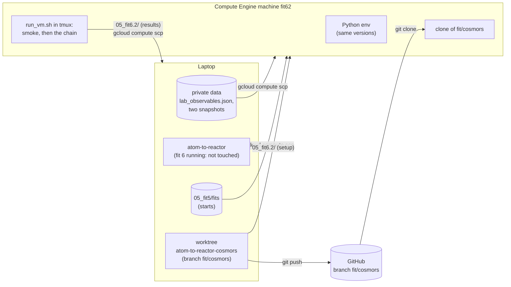

# Running a fit on Google Cloud

| | |
|---|---|
| **Status** | Draft, written for fit 6.2 (2026-10-22); not yet run |
| **Source** | Y. Alcaraz Galván |
| **Scope** | How a fit chain of `scripts/run_fit.py` runs on a Compute Engine machine while the laptop runs another one: what goes to the machine, the commands, monitoring, bringing the results back, deleting the machine |
| **Applies to** | Branch `fit/cosmors`; Google Cloud project `atom-to-reactor-512413`, region `europe-west1` (set by `gcloud init`) |

## 1. The whole



- The machine starts empty (Ubuntu only). It needs what the laptop has: the Python environment, the code, the private data and the folder of the run.
- The code comes from GitHub (the repository is public). Only the branch of the run is pushed; `main` is not touched.
- The private data go by `gcloud compute scp`, never through git: `lab_observables.json` and the two snapshots (about 0.5 MB). The raw spectra are not needed by the fit. **They leave the laptop** for a machine of the project, which is private but outside the laptop.
- The fifth fit's fits (2.4 MB) go too: the run starts from them (`start_from`).
- Results come back by `gcloud compute scp` and, like every results folder, stay out of git.

## 2. Machine

| Choice | Value | Why |
|---|---|---|
| Type | `c2d-highcpu-32` (32 processors, 64 GB) | The search and the profiles run up to 32 polishes in parallel; each worker needs about 100 MB. `c2d-highcpu-16` halves cost and roughly doubles time |
| Provisioning | `SPOT`, stopped (not deleted) if Google takes it back | Much cheaper; `run_vm.sh` resumes from the files already written, so a stop costs only the job in progress |
| Disk | 30 GB, Ubuntu 24.04 | The run writes a few hundred MB |
| Quota | C2D 100 per region, 64 processors per project | Enough for one 32-processor machine |

Set a budget alert in the console (Billing → Budgets and alerts) before the first run. Prices are in the console; a spot machine of this size costs on the order of tens of cents per hour.

## 3. Steps

Commands are run where each block says. `WT=/home/yeray/projects/atom-to-reactor-cosmors`, `DATA=/home/yeray/data/atom_to_reactor_private/data`.

**3.1 Laptop: push the branch** (after review)
```
git -C $WT push origin fit/cosmors
```

**3.2 Laptop: create the machine**
```
gcloud compute instances create fit62 --zone=europe-west1-c --machine-type=c2d-highcpu-32 \
    --provisioning-model=SPOT --instance-termination-action=STOP \
    --image-family=ubuntu-2404-lts-amd64 --image-project=ubuntu-os-cloud --boot-disk-size=30GB
```

**3.3 Machine: environment and code** (`gcloud compute ssh fit62 --zone=europe-west1-c` opens a terminal on it)
```
sudo apt-get update && sudo apt-get install -y git tmux
curl -L -O https://github.com/conda-forge/miniforge/releases/latest/download/Miniforge3-Linux-x86_64.sh
bash Miniforge3-Linux-x86_64.sh -b
~/miniforge3/bin/conda create -y -n atom-to-reactor python=3.11.16 numpy=2.4.6 scipy=1.17.1 pandas=3.0.6 matplotlib=3.11.2
git clone -b fit/cosmors https://github.com/yralcaraz/atom-to-reactor.git
printf 'ATOM_DATA_DIR=%s\nLAB_NMR_DIR=%s\n' "$HOME/private" "$HOME/nmr_raw" > atom-to-reactor/.env
mkdir -p ~/private/data atom-to-reactor/notebooks/results/05_fit5
```
The versions are those of the laptop's environment, so both runs compute with the same libraries.

**3.4 Laptop: data, starts and the run folder**
```
gcloud compute scp $DATA/lab_observables.json $DATA/tank_api_snapshot_2026-09-24.json \
    $DATA/tank_api_snapshot_2026-10-08.json fit62:~/private/data/ --zone=europe-west1-c
gcloud compute scp --recurse /home/yeray/projects/atom-to-reactor/notebooks/results/05_fit5/fits \
    /home/yeray/projects/atom-to-reactor/notebooks/results/05_fit5/fit_config.json \
    fit62:~/atom-to-reactor/notebooks/results/05_fit5/ --zone=europe-west1-c
gcloud compute scp --recurse $WT/notebooks/results/05_fit6.2 fit62:~/atom-to-reactor/notebooks/results/ --zone=europe-west1-c
```

**3.5 Machine: check, then launch**
```
cd ~/atom-to-reactor
~/miniforge3/envs/atom-to-reactor/bin/python tests/test_medium.py
tmux new -d -s fit62 "WORKERS=30 bash notebooks/results/05_fit6.2/run_vm.sh"
```
`run_vm.sh` first runs every stage on a tiny search in `/tmp/fit62_smoke` (1 day only) and starts the chain only if all of them pass. Its own log: `notebooks/results/05_fit6.2/run_vm.log`.

**3.6 Laptop: monitoring**
```
gcloud compute ssh fit62 --zone=europe-west1-c --command "tail -3 ~/atom-to-reactor/notebooks/results/05_fit6.2/run_vm.log ~/atom-to-reactor/notebooks/results/05_fit6.2/run.log"
gcloud compute instances describe fit62 --zone=europe-west1-c --format="value(status)"
```
If the status is `TERMINATED` (a spot stop): `gcloud compute instances start fit62 --zone=europe-west1-c`, then on the machine the launch line of 3.5 again; the chain resumes.

**3.7 Laptop: results back, machine deleted**
```
gcloud compute scp --recurse fit62:~/atom-to-reactor/notebooks/results/05_fit6.2 \
    /home/yeray/projects/atom-to-reactor/notebooks/results/ --zone=europe-west1-c
gcloud compute instances delete fit62 --zone=europe-west1-c
```
A stopped machine still pays for its disk: delete it once the results are on the laptop.

## 4. Things to know

- **The laptop's fit is not touched.** The code of fit 6.2 is in a separate worktree; the folder where fit 6 runs keeps its branch and commit (each stage of a chain reads the code of its own folder when it starts).
- **Same code, two machines.** The run records the commit and any uncommitted change (`provenance.txt`, `code_vs_commit.patch`), as on the laptop.
- **Merging later.** When both fits are done, `fit/cosmors` is merged into `main` once (through a pull request: `main` is protected).
