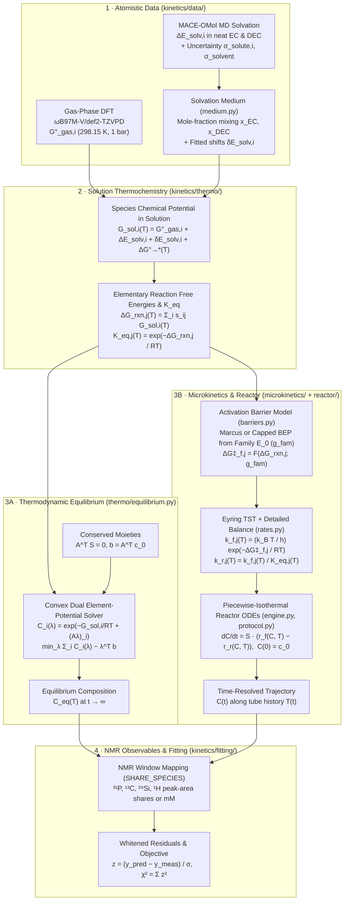

# Atom-to-Reactor: Complete Mathematical & Computational Model Reference

This document provides a complete, equation-by-equation explanation of the **Atom-to-Reactor** multiscale framework implemented in the `kinetics/` package. It traces the full calculation pipeline from gas-phase Density Functional Theory (DFT) and Molecular Dynamics (MD) solvation energies to:

1. **Equilibrium concentrations** $C_i^{\text{eq}}(T)$ via convex thermodynamic Gibbs free-energy minimization (`kinetics/thermo/equilibrium.py`),
2. **Time-resolved concentration trajectories** $C_i(t)$ via transition-state theory, Marcus/BEP activation barrier laws, and stiff mass-action ODE integration (`kinetics/microkinetics/` and `kinetics/reactor/`), and
3. **Experimental NMR observables** ($^{31}\text{P}$, $^{13}\text{C}$, $^{29}\text{Si}$, and $^1\text{H}$ window shares and millimolar concentrations) used in the thermodynamic and kinetic parameter fits (`kinetics/fitting/`).

---

## 1. High-Level Architecture

### Codebase Map by Module

| Package / Module | Role in the Mathematical Pipeline |
|---|---|
| [`kinetics/constants.py`](../kinetics/constants.py) | CODATA 2018 fundamental constants ($R, k_B, h, N_A$), standard states ($P^\circ = 1\text{ bar}, c^* = 1\text{ M}$), and unit conversions ($\text{E}_\text{h} \to \text{eV} \to \text{kJ/mol}$). |
| [`kinetics/data/species.py`](../kinetics/data/species.py) | Loads gas-phase DFT energies (`G_gas_eV`, `H_gas_eV`, `E_scf_eV`) and MD solvation energies (`dE_solv_eV`, `dE_solv_sigma_eV`) from the Tank snapshot. |
| [`kinetics/data/medium.py`](../kinetics/data/medium.py) | Defines [`SolvationMedium`](../kinetics/data/medium.py#L33-L78), converting solvent volume fractions into mole fractions $x_s$ and combining neat MD solvation energies. |
| [`kinetics/data/network.py`](../kinetics/data/network.py) | Defines the elementary reaction network (`R1`–`R9` and optional `N10`–`N15`), tracked species, stoichiometric matrix $S$, and mass-action order matrices. |
| [`kinetics/thermo/gas.py`](../kinetics/thermo/gas.py) | Gas-phase thermochemistry: stored RRHO Gibbs energy at $298.15\text{ K}$ (`wb97mv`) or Grimme quasi-RRHO statistical mechanics (`qRRHO`). |
| [`kinetics/thermo/standard_state.py`](../kinetics/thermo/standard_state.py) | Standard-state compression shift $\Delta G^{\circ \to *}(T)$ from $1\text{ bar}$ ideal gas to $1\text{ mol/L}$ solution. |
| [`kinetics/thermo/solution.py`](../kinetics/thermo/solution.py) | Solution-phase Gibbs free energy $G_{\text{sol}, i}(T)$ (`calculate_solution_gibbs`). |
| [`kinetics/thermo/reaction.py`](../kinetics/thermo/reaction.py) | Reaction free energies $\Delta G_{\text{rxn}, j}(T)$ and equilibrium constants $K_{\text{eq}, j}(T)$ (`calculate_reaction_thermo`). |
| [`kinetics/thermo/uncertainty.py`](../kinetics/thermo/uncertainty.py) | Propagates solute and shared pure-solvent MD uncertainties into reaction covariance $\Sigma$ and maps reaction shifts to species shifts. |
| [`kinetics/thermo/equilibrium.py`](../kinetics/thermo/equilibrium.py) | Algebraic closed-tube equilibrium solver via convex dual element potentials (`calculate_equilibrium`). |
| [`kinetics/microkinetics/barriers.py`](../kinetics/microkinetics/barriers.py) | Maps $\Delta G_{\text{rxn}, j}$ and family intrinsic barrier $g$ ($E_0$) to forward activation barrier $\Delta G_{f,j}^\ddagger$ (`marcus`, `bep_cap`). |
| [`kinetics/microkinetics/rates.py`](../kinetics/microkinetics/rates.py) | Eyring transition-state theory for $k_{f,j}(T)$, optional Collins–Kimball diffusion ceiling $k_D$, and detailed balance $k_{r,j}(T) = k_{f,j}(T)/K_{\text{eq}, j}(T)$. |
| [`kinetics/reactor/engine.py`](../kinetics/reactor/engine.py) | [`MassActionSystem`](../kinetics/reactor/engine.py#L25-L90): net reaction rates $\mathbf{r}(\mathbf{C})$, ODE right-hand side $\frac{d\mathbf{C}}{dt} = S\,\mathbf{r}$, exact analytical Jacobian, and stiff ODE integration (`Radau`/`BDF`). |
| [`kinetics/reactor/protocol.py`](../kinetics/reactor/protocol.py) | Piecewise-isothermal multi-stage integration along experimental sample histories (`simulate_history`, `simulate_protocol`). |
| [`kinetics/fitting/residuals.py`](../kinetics/fitting/residuals.py) | Maps simulated concentrations to NMR window shares (`SHARE_SPECIES`), applies the noise/baseline/floor error model, and computes whitened residuals. |
| [`kinetics/fitting/thermo_fit.py`](../kinetics/fitting/thermo_fit.py) | [`ThermoProblem`](../kinetics/fitting/thermo_fit.py#L109-L262): equilibrium spectrum selection, replicate compatibility, and fitting species solvation shifts $\delta E_{\text{solv}, i}$ to equilibrium NMR data. |
| [`kinetics/fitting/candidates.py`](../kinetics/fitting/candidates.py) & [`estimation.py`](../kinetics/fitting/estimation.py) | [`FitStructure`](../kinetics/fitting/candidates.py#L89-L201) and [`FitProblem`](../kinetics/fitting/estimation.py#L45-L108): kinetic candidate structures (`M0`, `M1`, `M1-split`, `M3-split`), Sobol + TRF optimization, and profile likelihoods. |

---

## 2. Chemical System & Reaction Network (`kinetics/data/network.py`)

### 2.1 Tracked Species

When tris(trimethylsilyl) phosphate (**TMSPA**, $\text{OP(OSiMe}_3)_3$) scavenges trace water in a carbonate electrolyte (ethylene carbonate **EC** or an **EC:DEC** mixture), it undergoes a cascade of hydrolysis, silanol condensation, trans-silylation, and solvent ring-opening steps. The network tracks $N_{\text{sp}} = 11$ reactive species (`NETWORK_SPECIES`):

| Group | Species ID | Chemical Formula / Identity | Silyl Groups ($-\text{SiMe}_3$) | Phosphorus Atoms |
|---|---|---|:---:|:---:|
| **Phosphate ester ladder** | `TMSPA` | $\text{OP(OSiMe}_3)_3$ — tris(trimethylsilyl) phosphate | 3 | 1 |
| | `BMSPA` | $\text{OP(OH)(OSiMe}_3)_2$ — bis(trimethylsilyl) mono-acid phosphate | 2 | 1 |
| | `MMSPA` | $\text{OP(OH)}_2(\text{OSiMe}_3)$ — mono(trimethylsilyl) di-acid phosphate | 1 | 1 |
| | `H3PO4` | $\text{OP(OH)}_3$ — orthophosphoric acid | 0 | 1 |
| **Water & free silyl species** | `H2O` | $\text{H}_2\text{O}$ — water | 0 | 0 |
| | `TMSOH` | $\text{Me}_3\text{SiOH}$ — trimethylsilanol | 1 | 0 |
| | `HMDSO` | $\text{Me}_3\text{SiOSiMe}_3$ — hexamethyldisiloxane | 2 | 0 |
| **Solvent & ring-opening products** | `EC` | $(\text{CH}_2\text{O})_2\text{CO}$ — ethylene carbonate (solvent) | 0 | 0 |
| | `TMSOEG` | $\text{Me}_3\text{SiOCH}_2\text{CH}_2\text{OH}$ — 2-(trimethylsiloxy)ethanol | 1 | 0 |
| | `TMSOdiEG` | $\text{Me}_3\text{SiOCH}_2\text{CH}_2\text{OSiMe}_3$ — 1,2-bis(trimethylsiloxy)ethane | 2 | 0 |
| | `CO2` | $\text{CO}_2$ — carbon dioxide | 0 | 0 |

*(Note: Diethyl carbonate **DEC** in 1:1 EC:DEC mixtures is chemically inert in this network and acts as a co-solvent that modifies the solvation medium and dilutes initial molarities.)*

### 2.2 Elementary Reactions (`R1`–`R9` and `N10`–`N15`)

The default reaction network (`NETWORK` in [`kinetics/data/network.py`](../kinetics/data/network.py#L23-L33)) comprises 9 elementary reversible steps grouped into 4 reaction families:

| ID | Elementary Reaction | Reaction Family (`class`) | Linear Dependency / Cycle Relation |
|---|---|---|---|
| **R1** | $\text{TMSPA} + \text{H}_2\text{O} \rightleftharpoons \text{BMSPA} + \text{TMSOH}$ | `hydrolysis` | Independent basis reaction |
| **R2** | $\text{BMSPA} + \text{H}_2\text{O} \rightleftharpoons \text{MMSPA} + \text{TMSOH}$ | `hydrolysis` | Independent basis reaction |
| **R3** | $\text{MMSPA} + \text{H}_2\text{O} \rightleftharpoons \text{H}_3\text{PO}_4 + \text{TMSOH}$ | `hydrolysis` | Independent basis reaction |
| **R4** | $2\,\text{TMSOH} \rightleftharpoons \text{HMDSO} + \text{H}_2\text{O}$ | `condensation` | Independent basis reaction |
| **R5** | $\text{TMSPA} + \text{TMSOH} \rightleftharpoons \text{BMSPA} + \text{HMDSO}$ | `transfer` | $\text{R5} = \text{R1} + \text{R4}$ |
| **R6** | $\text{BMSPA} + \text{TMSOH} \rightleftharpoons \text{MMSPA} + \text{HMDSO}$ | `transfer` | $\text{R6} = \text{R2} + \text{R4}$ |
| **R7** | $\text{MMSPA} + \text{TMSOH} \rightleftharpoons \text{H}_3\text{PO}_4 + \text{HMDSO}$ | `transfer` | $\text{R7} = \text{R3} + \text{R4}$ |
| **R8** | $\text{EC} + \text{TMSOH} \rightleftharpoons \text{TMSOEG} + \text{CO}_2$ | `solvent_attack` | Independent basis reaction |
| **R9** | $\text{EC} + \text{TMSOEG} \rightleftharpoons \text{TMSOdiEG} + \text{CO}_2$ | `solvent_attack` | Independent basis reaction |

In the extended network variants (`'R1-R9+N10-N15'` and `'R1-R9+N10-N15, fixed 1.15 eV'`), 6 additional reactions (`EXTRA_REACTIONS`) between the same 11 species are included:

- **N10** ($\text{exchange}$): $2\,\text{BMSPA} \rightleftharpoons \text{MMSPA} + \text{TMSPA}$ ($\text{N10} = \text{R2} - \text{R1}$)
- **N11** ($\text{exchange}$): $2\,\text{TMSOEG} \rightleftharpoons \text{TMSOH} + \text{TMSOdiEG}$ ($\text{N11} = \text{R9} - \text{R8}$, when coupled with $\text{R4}$)
- **N12** ($\text{hydrolysis}$, follows $\text{R2}$): $\text{BMSPA} + \text{H}_2\text{O} \rightleftharpoons \text{H}_3\text{PO}_4 + \text{HMDSO}$ ($\text{N12} = \text{R2} + \text{R7}$)
- **N13** ($\text{exchange}$): $\text{BMSPA} + \text{H}_3\text{PO}_4 \rightleftharpoons 2\,\text{MMSPA}$ ($\text{N13} = \text{R2} - \text{R3}$)
- **N14** ($\text{exchange}$): $\text{BMSPA} + \text{MMSPA} \rightleftharpoons \text{H}_3\text{PO}_4 + \text{TMSPA}$ ($\text{N14} = \text{R3} - \text{R1}$)
- **N15** ($\text{hydrolysis}$, follows $\text{R1}$): $\text{TMSPA} + \text{H}_2\text{O} \rightleftharpoons \text{MMSPA} + \text{HMDSO}$ ($\text{N15} = \text{R1} + \text{R6}$)

### 2.3 Stoichiometric Matrix $S$ and Reaction Order Matrices

For a network of $N_{\text{sp}}$ species and $N_{\text{rxn}}$ reactions, [`build_stoichiometric_matrix`](../kinetics/data/network.py#L101-L112) constructs the matrix $S \in \mathbb{R}^{N_{\text{sp}} \times N_{\text{rxn}}}$ with entries:

$$
s_{i,j} = \nu_{i,j}^{\text{prod}} - \nu_{i,j}^{\text{react}}
$$

where $\nu_{i,j}^{\text{react}} \ge 0$ and $\nu_{i,j}^{\text{prod}} \ge 0$ are the forward and reverse molecularities returned by [`build_order_matrices`](../kinetics/data/network.py#L115-L125).

---

## 3. From Atomistic Energies (DFT & MD) to Reaction Thermodynamics (`kinetics/thermo/`)

Both the thermodynamic equilibrium solver and the microkinetic ODE solver start from the exact same species chemical potentials in solution $G_{\text{sol}, i}(T)$ and elementary reaction free energies $\Delta G_{\text{rxn}, j}(T)$.

### Step 3.1 · Gas-Phase DFT Gibbs Energy (`kinetics/thermo/gas.py`)

For each species $i$, the Tank dataset snapshot stores gas-phase DFT calculations at the **$\omega\text{B97M-V/def2-TZVPD}$** level of theory ($T_{\text{std}} = 298.15\text{ K}$, $P^\circ = 1\text{ bar} = 10^5\text{ Pa}$). Two thermochemical modes (`thermo_mode`) are supported in [`calculate_gas_thermo`](../kinetics/thermo/gas.py#L30-L45):

1. **`'wb97mv'` (Default across fits):** Uses the stored rigid-rotor harmonic-oscillator (RRHO) Gibbs free energy converted from Hartree to eV and kJ/mol ($1\text{ E}_{\text{h}} = 27.211386\text{ eV}$, $1\text{ eV} = 96.485332\text{ kJ/mol}$):
   $$
   G_{\text{gas}, i}^\circ = E_{\text{gas}, i}^{\text{Eh}} \times 27.211386\text{ eV/E}_{\text{h}}
   $$
2. **`'qRRHO'` (Grimme quasi-RRHO):** When vibrational frequencies $\{\tilde{\nu}_m\}$ and principal moments of inertia are present, computes translational (Sackur–Tetrode at $P^\circ = 1\text{ bar}$), rigid-rotor rotational, and damped quasi-RRHO vibrational enthalpies and entropies at temperature $T$ with damping frequency $\tilde{\nu}_0 = 100\text{ cm}^{-1}$:
   $$
   w(\tilde{\nu}_m) = \frac{1}{1 + (\tilde{\nu}_0 / \tilde{\nu}_m)^4}, \qquad S_{\text{vib}} = \sum_m \left[ w(\tilde{\nu}_m) S_{\text{HO}}(\tilde{\nu}_m, T) + \big(1 - w(\tilde{\nu}_m)\big) S_{\text{free-rot}}(\tilde{\nu}_m, T) \right]
   $$

### Step 3.2 · Solvation Energy in Neat or Mixed Solvents (`kinetics/data/medium.py`)

Molecular dynamics (MD) simulations using the MACE-OMol machine-learned interatomic potential provide the solvation energy $\Delta E_{\text{solv}, i}^{(s)}$ of each solute $i$ in neat solvent $s \in \{\text{EC}, \text{DEC}\}$.

For a solvent mixture specified by volume fractions $\{f_s\}$ (such as **EC:DEC 1:1 by volume** in the lab NMR tubes), [`SolvationMedium.mole_fractions`](../kinetics/data/medium.py#L57-L61) converts volume fractions into mole fractions $x_s$ using the neat liquid densities ($\rho_{\text{EC}} = 1.321\text{ g/mL}$, $\rho_{\text{DEC}} = 0.975\text{ g/mL}$) and molar masses $M_s$:

$$
n_s = \frac{f_s \, \rho_s}{M_s}, \qquad x_s = \frac{n_s}{\sum_{s'} n_{s'}} \qquad \big(\text{for EC:DEC 1:1 v/v: } x_{\text{EC}} \approx 0.645,\; x_{\text{DEC}} \approx 0.355\big)
$$

Under the linear ideal-mixing rule ([`_cached_medium_database`](../kinetics/data/species.py#L41-L57)), the raw solvation energy of species $i$ in the mixture is the mole-fraction-weighted sum:

$$
\Delta E_{\text{solv}, i}^{\text{raw}} = \sum_{s} x_s \, \Delta E_{\text{solv}, i}^{(s)}
$$

When species free-energy shifts $\delta E_{\text{solv}, i}$ are introduced (either during a thermodynamic fit in `thermo_fit.py` or via freed reaction energies in `candidates.py`), the effective solvation energy becomes:

$$
\Delta E_{\text{solv}, i} = \Delta E_{\text{solv}, i}^{\text{raw}} + \delta E_{\text{solv}, i}
$$

### Step 3.3 · Standard-State Compression Shift (`kinetics/thermo/standard_state.py`)

Gas-phase DFT quantities are referenced to an ideal gas at $P^\circ = 1\text{ bar}$ with molar concentration $c_{\text{gas}}^\circ(T) = \frac{P^\circ}{RT}$, whereas solution-phase thermodynamics and mass-action kinetics use a $c^* = 1\text{ mol/L} = 1000\text{ mol/m}^3$ reference state. Compressing 1 mole of ideal gas into 1 L of solution adds the entropic concentration shift ([`calculate_standard_state_shift`](../kinetics/thermo/standard_state.py#L11-L15)):

$$
\Delta G^{\circ \to *}(T) = R T \ln\!\left(\frac{c^*}{P^\circ / (R T)}\right) = R T \ln\!\left(\frac{R T c^*}{P^\circ}\right) \qquad \big(+7.96\text{ kJ/mol} = +0.0825\text{ eV at } 298.15\text{ K}\big)
$$

*(In `'wb97mv'` mode, $\Delta G^{\circ \to *}(T)$ is omitted from individual species energies because every reaction in the default network `R1`–`R9` and `N10`–`N15` is a $2 \to 2$ bimolecular step with $\Delta \nu_j = \sum_i s_{i,j} = 0$, so $\Delta G^{\circ \to *}(T)$ cancels out identically in every $\Delta G_{\text{rxn}, j}$.)*

### Step 3.4 · Solution-Phase Chemical Potential $G_{\text{sol}, i}(T)$ (`kinetics/thermo/solution.py`)

Combining the gas-phase Gibbs energy, the solvation energy (plus any fitted shift $\delta E_{\text{solv}, i}$), and the standard-state shift yields the standard-state Gibbs energy (standard chemical potential $\mu_i^\circ(T)$) of species $i$ in solution ([`calculate_solution_gibbs`](../kinetics/thermo/solution.py#L15-L31)):

$$
\mu_i^\circ(T) \equiv G_{\text{sol}, i}(T) = G_{\text{gas}, i}^\circ(T) + \Delta E_{\text{solv}, i}^{\text{raw}} + \delta E_{\text{solv}, i} + \Delta G^{\circ \to *}(T)
$$

### Step 3.5 · Elementary Reaction Free Energy $\Delta G_{\text{rxn}, j}(T)$ and Equilibrium Constant $K_{\text{eq}, j}(T)$ (`kinetics/thermo/reaction.py`)

For each elementary reaction $j$, [`calculate_reaction_thermo`](../kinetics/thermo/reaction.py#L17-L48) evaluates the standard reaction Gibbs free energy by multiplying $G_{\text{sol}, i}(T)$ by the stoichiometric coefficients $s_{i,j} = \nu_{i,j}^{\text{prod}} - \nu_{i,j}^{\text{react}}$:

$$
\Delta G_{\text{rxn}, j}(T) = \sum_{i=1}^{N_{\text{sp}}} s_{i,j} \, G_{\text{sol}, i}(T) = \big(S^T \mathbf{G}_{\text{sol}}(T)\big)_j
$$

From $\Delta G_{\text{rxn}, j}(T)$, the dimensionless thermodynamic equilibrium constant at temperature $T$ is:

$$
K_{\text{eq}, j}(T) = \exp\!\left(-\frac{\Delta G_{\text{rxn}, j}(T)}{R T}\right)
$$

**Automatic Wegscheider Cycle Closure:** Because $\Delta G_{\text{rxn}, j}(T)$ is computed from **species** energies $\mathbf{G}_{\text{sol}}(T)$ via $\Delta \mathbf{G}_{\text{rxn}} = S^T \mathbf{G}_{\text{sol}}$, any closed thermodynamic cycle of reactions $\sum_j c_j s_{i,j} = 0$ automatically satisfies:

$$
\sum_j c_j \Delta G_{\text{rxn}, j}(T) = 0 \quad \Longleftrightarrow \quad \prod_j \big(K_{\text{eq}, j}(T)\big)^{c_j} = 1
$$

In particular, since $\text{R5} = \text{R1} + \text{R4}$, $\text{R6} = \text{R2} + \text{R4}$, and $\text{R7} = \text{R3} + \text{R4}$:

$$
\Delta G_{\text{rxn}, 5} = \Delta G_{\text{rxn}, 1} + \Delta G_{\text{rxn}, 4}, \qquad K_{\text{eq}, 5}(T) = K_{\text{eq}, 1}(T) \cdot K_{\text{eq}, 4}(T)
$$

and similarly for R6, R7, and all extra steps N10–N15.

### Step 3.6 · Solvation Uncertainty Propagation & Reaction Covariance (`kinetics/thermo/uncertainty.py`)

Each MD solvation calculation estimates $\Delta E_{\text{solv}, i}^{(s)} = \langle E_{\text{solution}, i}^{(s)} \rangle - \langle E_{\text{gas}, i} \rangle - \langle E_{\text{solvent}}^{(s)} \rangle$ from three MD trajectories with standard errors of the mean $\sigma_{\text{gas}, i}$, $\sigma_{\text{solution}, i}^{(s)}$, and $\sigma_{\text{solvent}}^{(s)}$.

1. **Per-species independent vs. shared uncertainty ([`calculate_solvation_sigma_components`](../kinetics/thermo/uncertainty.py#L40-L52)):**
   The gas and solution-box trajectories are independent for each solute $i$, whereas the pure-solvent reference trajectory $\langle E_{\text{solvent}}^{(s)} \rangle$ is shared across all solutes:
   $$
   \sigma_{\text{solute}, i}^{(s)} = \sqrt{\big(\sigma_{\text{gas}, i}\big)^2 + \big(\sigma_{\text{solution}, i}^{(s)}\big)^2}, \qquad \sigma_{\text{tot}, i}^{(s)} = \sqrt{\big(\sigma_{\text{solute}, i}^{(s)}\big)^2 + \big(\sigma_{\text{solvent}}^{(s)}\big)^2}
   $$
   In a solvent mixture with mole fractions $x_s$, these combine as $\sigma_{\text{solute}, i} = \sqrt{\sum_s (x_s \sigma_{\text{solute}, i}^{(s)})^2}$ and $\sigma_{\text{solvent}} = \sqrt{\sum_s (x_s \sigma_{\text{solvent}}^{(s)})^2}$.
2. **Reaction solvation covariance matrix ([`calculate_solvation_covariance`](../kinetics/thermo/uncertainty.py#L89-L107)):**
   Two reactions $j$ and $k$ share species (for example, `BMSPA` and `TMSOH` appear in both R1 and R2), making their solvation errors correlated:
   $$
   \Sigma_{j,k} = \text{Cov}\big(\Delta\Delta E_{\text{solv}, j},\, \Delta\Delta E_{\text{solv}, k}\big) = \sum_{i=1}^{N_{\text{sp}}} s_{i,j} \, s_{i,k} \, \sigma_{\text{solute}, i}^2 + \left(\sum_i s_{i,j}\right)\!\left(\sum_i s_{i,k}\right) \sigma_{\text{solvent}}^2
   $$
   For all $2 \to 2$ reactions ($\sum_i s_{i,j} = 0$), the shared pure-solvent error cancels out completely!

---

## 4. Thermodynamics: From $\Delta G_{\text{rxn}, j}$ to Equilibrium Concentrations $C_i^{\text{eq}}(T)$ (`kinetics/thermo/equilibrium.py`)

> [!IMPORTANT]
> **What Thermodynamics Computes:** The thermodynamic equilibrium model has **no time variable $t$** and **no activation barriers $E_0$**. Given the initial concentrations $\mathbf{c}_0$ mixed in a closed NMR tube and a set of reactions that have reached equilibrium at temperature $T$, it finds the unique composition vector $\mathbf{C}^{\text{eq}}(T)$ at $t \to \infty$ that minimizes the solution Gibbs free energy while conserving all atomic/group moieties.

### Step 4.1 · Counting Unknowns vs. Equations (Worked Example: `2 % H2O` Tube)

Suppose we mix the **`2 % H2O`** tube at $t = 0$ with initial concentrations $\mathbf{c}_0$:
- $C_{\text{TMSPA}, 0} \approx 0.146\text{ M}$ (or the tube's exact recipe molarity),
- $C_{\text{H}_2\text{O}, 0} \approx 1.05\text{ M}$,
- $C_{\text{EC}, 0} \approx 7.1\text{ M}$ (and $C_{\text{DEC}, 0} \approx 4.1\text{ M}$ in EC:DEC 1:1),
- All reaction products start at $0\text{ M}$.

#### Case A: Phosphate + Silanol Equilibrium (`R1`–`R4`, and therefore `R5`–`R7` and `N10`, `N12`–`N15`)
In the room-temperature thermodynamic fit (`kinetics/fitting/thermo_fit.py`, where EC ring-opening `R8`–`R9` does not run at room temperature), the active species set spanned by `R1`–`R7` has **$N_{\text{sp}} = 7$ reactive species**:

$$
\text{Species} = \{ \text{TMSPA},\; \text{BMSPA},\; \text{MMSPA},\; \text{H}_3\text{PO}_4,\; \text{H}_2\text{O},\; \text{TMSOH},\; \text{HMDSO} \}
$$

To determine these **7 unknown equilibrium concentrations**, we need **7 independent algebraic equations**:
1. **4 Independent Mass-Action Equilibrium Equations (`R1`–`R4`):**
   $$
   \begin{aligned}
   \text{R1:} \quad & \frac{C_{\text{BMSPA}} \cdot C_{\text{TMSOH}}}{C_{\text{TMSPA}} \cdot C_{\text{H}_2\text{O}}} = K_{\text{eq}, 1}(T) = \exp\!\left(-\frac{\Delta G_{\text{rxn}, 1}}{RT}\right) \\[4pt]
   \text{R2:} \quad & \frac{C_{\text{MMSPA}} \cdot C_{\text{TMSOH}}}{C_{\text{BMSPA}} \cdot C_{\text{H}_2\text{O}}} = K_{\text{eq}, 2}(T) = \exp\!\left(-\frac{\Delta G_{\text{rxn}, 2}}{RT}\right) \\[4pt]
   \text{R3:} \quad & \frac{C_{\text{H}_3\text{PO}_4} \cdot C_{\text{TMSOH}}}{C_{\text{MMSPA}} \cdot C_{\text{H}_2\text{O}}} = K_{\text{eq}, 3}(T) = \exp\!\left(-\frac{\Delta G_{\text{rxn}, 3}}{RT}\right) \\[4pt]
   \text{R4:} \quad & \frac{C_{\text{HMDSO}} \cdot C_{\text{H}_2\text{O}}}{\big(C_{\text{TMSOH}}\big)^2} = K_{\text{eq}, 4}(T) = \exp\!\left(-\frac{\Delta G_{\text{rxn}, 4}}{RT}\right)
   \end{aligned}
   $$
   *(Why aren't R5, R6, R7 extra equations? Because $\text{R5} = \text{R1} + \text{R4}$, multiplying the equilibrium expressions for R1 and R4 yields $\frac{C_{\text{BMSPA}} \cdot C_{\text{HMDSO}}}{C_{\text{TMSPA}} \cdot C_{\text{TMSOH}}} = K_{\text{eq}, 1} K_{\text{eq}, 4} = K_{\text{eq}, 5}$, which is already satisfied!)*

2. **3 Independent Atom/Group Conservation Equations ($\text{rank}(S) = 4 \implies \dim(\text{null}(S^T)) = 7 - 4 = 3$):**
   Because the tube is closed, the total concentrations of phosphorus cores ($-\text{PO}_4$), trimethylsilyl groups ($-\text{SiMe}_3$), and water/hydroxyl oxygen equivalents are invariant:
   $$
   \begin{aligned}
   \text{(1) Total Phosphorus } (b_{\text{P}}): \quad & C_{\text{TMSPA}} + C_{\text{BMSPA}} + C_{\text{MMSPA}} + C_{\text{H}_3\text{PO}_4} = C_{\text{TMSPA}, 0} \\[4pt]
   \text{(2) Total Silyl Groups } (b_{\text{Si}}): \quad & 3\,C_{\text{TMSPA}} + 2\,C_{\text{BMSPA}} + 1\,C_{\text{MMSPA}} + 1\,C_{\text{TMSOH}} + 2\,C_{\text{HMDSO}} = 3\,C_{\text{TMSPA}, 0} \\[4pt]
   \text{(3) Total Water/O Equivalents } (b_{\text{O}}): \quad & C_{\text{BMSPA}} + 2\,C_{\text{MMSPA}} + 3\,C_{\text{H}_3\text{PO}_4} + C_{\text{H}_2\text{O}} + C_{\text{TMSOH}} + C_{\text{HMDSO}} = C_{\text{H}_2\text{O}, 0}
   \end{aligned}
   $$
   *(Note: Any invertible linear combination of these 3 moiety balances spans the same 3D left nullspace $A = \text{null}(S^T)$.)*

   **Total:** $4\text{ equilibrium laws} + 3\text{ conservation laws} = \mathbf{7\text{ equations for } 7\text{ unknowns}}$.

#### Case B: Full 11-Species Network Including Solvent Attack (`R1`–`R9`)
If solvent ring-opening reactions `R8` and `R9` also equilibrate, 4 additional species (`EC`, `TMSOEG`, `TMSOdiEG`, `CO2`) enter, giving **$N_{\text{sp}} = 11$ unknowns**:
- **6 independent equilibrium laws:** $K_{\text{eq}, 1}, K_{\text{eq}, 2}, K_{\text{eq}, 3}, K_{\text{eq}, 4}, K_{\text{eq}, 8}, K_{\text{eq}, 9}$,
- **5 conservation laws ($\dim(\text{null}(S^T)) = 11 - 6 = 5$):** total phosphorus $b_{\text{P}}$, total silyl groups $b_{\text{Si}}$ (now including $+1\,C_{\text{TMSOEG}} + 2\,C_{\text{TMSOdiEG}}$), total oxygen equivalents $b_{\text{O}}$, total ethylene glycol rings $C_{\text{EC}} + C_{\text{TMSOEG}} + C_{\text{TMSOdiEG}} = C_{\text{EC}, 0}$, and decarboxylation stoichiometry $C_{\text{TMSOEG}} + C_{\text{TMSOdiEG}} - C_{\text{CO}_2} = 0$.
- **Total:** $6 + 5 = \mathbf{11\text{ equations for } 11\text{ unknowns}}$.

---

### Step 4.2 · Convex Dual Element-Potential Solver ([`calculate_equilibrium`](../kinetics/thermo/equilibrium.py#L63-L125))

Solving the polynomial mass-action equations directly in concentration space is numerically fragile when some equilibrium constants are very large (e.g., $K_{\text{eq}, 1} \gg 1$, where $C_{\text{TMSPA}}^{\text{eq}} \sim 10^{-12}\text{ M}$ in wet tubes). Instead, [`calculate_equilibrium`](../kinetics/thermo/equilibrium.py#L63-L125) formulates the problem as the **constrained minimization of the ideal-solution Gibbs free energy** in dimensionless units $\tilde{\mu}_i = G_{\text{sol}, i}(T) / (RT)$:

$$
\min_{\mathbf{C} > \mathbf{0}} \; \sum_{i=1}^{N_{\text{sp}}} C_i \big( \tilde{\mu}_i + \ln C_i - 1 \big) \qquad \text{subject to} \qquad A^T \mathbf{C} = A^T \mathbf{c}_0 \equiv \mathbf{b}
$$

where the columns of $A = \text{null}(S^T) \in \mathbb{R}^{N_{\text{sp}} \times N_{\text{cons}}}$ form an orthonormal basis for the left nullspace of the stoichiometric matrix ($S^T A = \mathbf{0}$, $A^T A = I$).

1. **Lagrangian & Dual Parameterization via Element Potentials $\boldsymbol{\lambda}$:**
   Introducing Lagrange multipliers (element potentials) $\boldsymbol{\lambda} \in \mathbb{R}^{N_{\text{cons}}}$ for the conservation constraints $A^T \mathbf{C} = \mathbf{b}$:
   $$
   \mathcal{L}(\mathbf{C}, \boldsymbol{\lambda}) = \sum_{i=1}^{N_{\text{sp}}} C_i \big( \tilde{\mu}_i + \ln C_i - 1 \big) - \boldsymbol{\lambda}^T \big( A^T \mathbf{C} - \mathbf{b} \big)
   $$
   Setting $\frac{\partial \mathcal{L}}{\partial C_i} = \tilde{\mu}_i + \ln C_i - (A\boldsymbol{\lambda})_i = 0$ yields the exact exponential representation of every species concentration:
   $$
   C_i(\boldsymbol{\lambda}) = \exp\!\big( -\tilde{\mu}_i + (A\boldsymbol{\lambda})_i \big) > 0
   $$

2. **Why $C_i(\boldsymbol{\lambda})$ Satisfies Every Equilibrium Constant Automatically:**
   Taking the reaction stoichiometric combination $\sum_i s_{i,j} \ln C_i(\boldsymbol{\lambda})$ for any reaction $j$:
   $$
   \sum_{i=1}^{N_{\text{sp}}} s_{i,j} \ln C_i(\boldsymbol{\lambda}) = -\sum_{i=1}^{N_{\text{sp}}} s_{i,j} \tilde{\mu}_i + \big(S^T A \boldsymbol{\lambda}\big)_j = -\frac{\Delta G_{\text{rxn}, j}(T)}{R T} + 0 = \ln K_{\text{eq}, j}(T)
   $$
   Because $S^T A = \mathbf{0}$, **all mass-action equilibrium equations hold identically for every $\boldsymbol{\lambda} \in \mathbb{R}^{N_{\text{cons}}}$**!

3. **Unconstrained Strictly Convex Dual Optimization:**
   Substituting $C_i(\boldsymbol{\lambda})$ into the dual objective gives an unconstrained, smooth, strictly convex minimization over only $N_{\text{cons}}$ variables ($3$ variables for `R1`–`R4`, or $5$ for `R1`–`R9`):
   $$
   \min_{\boldsymbol{\lambda} \in \mathbb{R}^{N_{\text{cons}}}} \; \Phi(\boldsymbol{\lambda}) = \sum_{i=1}^{N_{\text{sp}}} \exp\!\big( -\tilde{\mu}_i + (A\boldsymbol{\lambda})_i \big) - \boldsymbol{\lambda}^T \mathbf{b}
   $$
   with analytical gradient (the conservation residual) and symmetric positive-definite Hessian:
   $$
   \nabla \Phi(\boldsymbol{\lambda}) = A^T \mathbf{C}(\boldsymbol{\lambda}) - \mathbf{b}, \qquad \nabla^2 \Phi(\boldsymbol{\lambda}) = A^T \, \text{diag}\big(\mathbf{C}(\boldsymbol{\lambda})\big) \, A \succ 0
   $$
   [`calculate_equilibrium`](../kinetics/thermo/equilibrium.py#L105-L124) solves $\nabla \Phi(\boldsymbol{\lambda}^*) = \mathbf{0}$ using damped Newton steps with Armijo backtracking line search until $\|\nabla \Phi\|_\infty \le 10^{-8} \|\mathbf{b}\|_\infty$.

---

## 5. Microkinetics & Reactor ODEs: From $\Delta G_{\text{rxn}, j}$ and $E_0$ to Time Trajectories $C_i(t)$ (`kinetics/microkinetics/` & `kinetics/reactor/`)

> [!IMPORTANT]
> **What Kinetics Adds Beyond Thermodynamics:** Thermodynamics tells us **where** the system ends up at $t \to \infty$ using only energy differences $\Delta G_{\text{rxn}, j}$. Microkinetics introduces **activation barriers** $\Delta G_{f,j}^\ddagger$ (parameterized by an intrinsic barrier $g_{\text{fam}} \equiv E_{0,\text{fam}}$ per reaction family) to compute **how fast** each elementary reaction runs at temperature $T(t)$, integrating $\frac{d\mathbf{C}}{dt}$ from $t = 0$ across the experimental temperature history of each NMR tube.

### Step 5.1 · Activation Barrier Laws $\Delta G_{f,j}^\ddagger$ (`kinetics/microkinetics/barriers.py`)

Let $x_j = \Delta G_{\text{rxn}, j}(T)$ (in eV) be the reaction free energy of step $j$, and let $g_j = E_{0,\text{fam}(j)} > 0$ be the intrinsic barrier of its reaction family (the barrier when $\Delta G_{\text{rxn}} = 0$). If a family has a non-zero activation entropy $\Delta S^\ddagger$, the intrinsic barrier at temperature $T$ is:

$$
g_j(T) = g_j(T_{\text{ref}}) - (T - T_{\text{ref}}) \, \Delta S_{\text{fam}(j)}^\ddagger
$$

Two barrier shapes are registered in [`BARRIER_MODELS`](../kinetics/microkinetics/barriers.py#L50-L53):

1. **Marcus Group-Transfer Law (`'marcus'`, Default in `level1`, `M0-Marcus`, `M1`, `M1-split`, `M3-split`):**
   With reorganization energy $\lambda_j = 4 g_j$, the quadratic Marcus barrier and its effective Brønsted/Leffler slope $\alpha_{\text{eff}} = \frac{\partial \Delta G_f^\ddagger}{\partial x}$ are ([`marcus`](../kinetics/microkinetics/barriers.py#L40-L44) and [`calculate_barrier`](../kinetics/microkinetics/barriers.py#L63-L76)):
   $$
   \Delta G_{f,j}^\ddagger(x_j, g_j) = \max\!\left( 0,\; x_j,\; g_j \left(1 + \frac{x_j}{4 g_j}\right)^2 \right) = \begin{cases}
   0 & \text{if } x_j \le -4 g_j \text{ (barrierless exergonic)} \\[4pt]
   g_j + \dfrac{x_j}{2} + \dfrac{x_j^2}{16 g_j} & \text{if } |x_j| < 4 g_j \\[6pt]
   x_j & \text{if } x_j \ge +4 g_j \text{ (endergonic floor)}
   \end{cases}
   $$
   *(Optional work terms $w_R, w_P$ shift the parabola via $\Delta G_{f,j}^\ddagger = \max(0,\, x_j,\, w_R + F_{\text{Marcus}}(x_j - w_R + w_P; g_j))$. Notice that Marcus satisfies reversal invariance $F(-x; g) = F(x; g) - x$, meaning forward and reverse barriers always differ by $x_j = \Delta G_{\text{rxn}, j}$ regardless of the direction in which the reaction is written.)*

2. **Capped Bell–Evans–Polanyi Law (`'bep_cap'`, Used in `reference_bep` / `M0-BEP` and `+BEP` Structures):**
   ([`bep_cap`](../kinetics/microkinetics/barriers.py#L29-L34)):
   $$
   \Delta G_{f,j}^\ddagger(x_j, g_j) = \max\!\big( g_j,\; g_j + \alpha \, x_j \big)
   $$
   - In **`M0-BEP` (`reference_bep`)**: $\alpha = 0.5$ and $g = 1.15\text{ eV}$ for all 9 reactions.
   - In **`+BEP` structures (`with_bep_rule`)**: $\alpha = 1.0$, so every downhill step ($\Delta G_{\text{rxn}, j} \le 0$) has barrier $\Delta G_{f,j}^\ddagger = g_j$, and every uphill step ($\Delta G_{\text{rxn}, j} > 0$) has barrier $\Delta G_{f,j}^\ddagger = g_j + \Delta G_{\text{rxn}, j}$, restoring reversal invariance.

### Step 5.2 · Forward Rate Constant $k_{f,j}(T)$ via Eyring Transition-State Theory (`kinetics/microkinetics/rates.py`)

In [`calculate_rate_constants`](../kinetics/microkinetics/rates.py#L34-L102), the forward rate constant at temperature $T$ is calculated from $\Delta G_{f,j}^\ddagger(T)$ via the Eyring equation (with transmission coefficient $\kappa = 1$):

$$
k_{f,j}^{\text{TST}}(T) = \frac{k_B T}{h} \exp\!\left(-\frac{\Delta G_{f,j}^\ddagger(T)}{R T}\right)
$$

where $\frac{k_B T}{h} \approx 6.212 \times 10^{12}\text{ s}^{-1}$ at $298.15\text{ K}$ (and concentration standard-state powers $(c^*)^{1 - m_j}$ equal $1\text{ M}^{1-m_j}$ in molar units).

If a solvent viscosity $\eta$ (`viscosity_Pa_s`) is provided, bimolecular reactions ($\sum_i \nu_{i,j}^{\text{react}} = 2$) are placed in series with the Smoluchowski diffusion limit $k_D(T) = \frac{8 R T}{3 \eta}$ (in $\text{M}^{-1}\text{s}^{-1}$) via the **Collins–Kimball rule**:

$$
k_{f,j}(T) = \left( \frac{1}{k_{f,j}^{\text{TST}}(T)} + \frac{1}{k_D(T)} \right)^{-1}
$$

### Step 5.3 · Reverse Rate Constant $k_{r,j}(T)$ via Thermodynamic Detailed Balance

The reverse rate constant $k_{r,j}(T)$ is **never** parameterized independently. It is strictly fixed by thermodynamic detailed balance using $K_{\text{eq}, j}(T) = \exp(-\Delta G_{\text{rxn}, j}(T) / RT)$:

$$
k_{r,j}(T) = \frac{k_{f,j}(T)}{K_{\text{eq}, j}(T)} = \frac{k_B T}{h} \exp\!\left(-\frac{\Delta G_{f,j}^\ddagger(T) - \Delta G_{\text{rxn}, j}(T)}{R T}\right) = \frac{k_B T}{h} \exp\!\left(-\frac{\Delta G_{r,j}^\ddagger(T)}{R T}\right)
$$

Because $k_{r,j}(T) = k_{f,j}(T) / K_{\text{eq}, j}(T)$ holds for every reaction $j$, the net rate $r_j(\mathbf{C}, T)$ vanishes if and only if $\prod_i C_i^{s_{i,j}} = K_{\text{eq}, j}(T)$. Consequently, **any isothermal trajectory $\mathbf{C}(t)$ integrated as $t \to \infty$ is mathematically guaranteed to converge to the exact same equilibrium composition $\mathbf{C}^{\text{eq}}(T)$ computed by the thermodynamic solver**.

### Step 5.4 · Elementary Net Reaction Rates and Coupled ODE System (`kinetics/reactor/engine.py`)

In [`MassActionSystem`](../kinetics/reactor/engine.py#L25-L90), concentrations are clamped to non-negative values $\tilde{C}_i = \max(C_i, 0)$ (with buffered species such as neat `EC` held at their initial concentration $\tilde{C}_{\text{EC}} = C_{\text{EC}, 0}$ when `buffered_species=('EC',)`).

1. **Net rate of elementary step $j$ ([`calculate_net_rates`](../kinetics/reactor/engine.py#L49-L52)):**
   $$
   r_j(\mathbf{C}, T) = k_{f,j}(T) \prod_{i=1}^{N_{\text{sp}}} \tilde{C}_i^{\,\nu_{i,j}^{\text{react}}} - k_{r,j}(T) \prod_{i=1}^{N_{\text{sp}}} \tilde{C}_i^{\,\nu_{i,j}^{\text{prod}}} \qquad [\text{mol L}^{-1}\text{ s}^{-1}]
   $$
   For instance, for $\text{R1}$ ($\text{TMSPA} + \text{H}_2\text{O} \rightleftharpoons \text{BMSPA} + \text{TMSOH}$) and $\text{R4}$ ($2\,\text{TMSOH} \rightleftharpoons \text{HMDSO} + \text{H}_2\text{O}$):
   $$
   \begin{aligned}
   r_1(t) &= k_{f,1}(T)\, C_{\text{TMSPA}}(t)\, C_{\text{H}_2\text{O}}(t) - k_{r,1}(T)\, C_{\text{BMSPA}}(t)\, C_{\text{TMSOH}}(t) \\
   r_4(t) &= k_{f,4}(T)\, \big(C_{\text{TMSOH}}(t)\big)^2 - k_{r,4}(T)\, C_{\text{HMDSO}}(t)\, C_{\text{H}_2\text{O}}(t)
   \end{aligned}
   $$

2. **Coupled Species ODE System ([`rhs`](../kinetics/reactor/engine.py#L54-L55)):**
   $$
   \frac{d\mathbf{C}}{dt} = S \, \mathbf{r}(\mathbf{C}, T), \qquad \mathbf{C}(0) = \mathbf{c}_0
   $$
   (For any buffered species $b$, row $b$ of $S$ is zeroed out so $\frac{dC_b}{dt} = 0$.)

3. **Exact Analytical Jacobian ([`jacobian`](../kinetics/reactor/engine.py#L57-L67)):**
   Because elementary rate constants $k_{f,j}(T)$ across different reaction families can span 10–15 orders of magnitude, the ODE system is stiff. To avoid finite-difference overflow during implicit integration (`BDF` or `Radau`), `MassActionSystem` supplies the exact analytical Jacobian $J(\mathbf{C}) = \frac{\partial (S\mathbf{r})}{\partial \mathbf{C}} = S \frac{\partial \mathbf{r}}{\partial \mathbf{C}}$:
   $$
   \frac{\partial r_j}{\partial C_i} = k_{f,j} \, \nu_{i,j}^{\text{react}} \, \tilde{C}_i^{\,\nu_{i,j}^{\text{react}} - 1} \prod_{m \ne i} \tilde{C}_m^{\,\nu_{m,j}^{\text{react}}} - k_{r,j} \, \nu_{i,j}^{\text{prod}} \, \tilde{C}_i^{\,\nu_{i,j}^{\text{prod}} - 1} \prod_{m \ne i} \tilde{C}_m^{\,\nu_{m,j}^{\text{prod}}}
   $$

### Step 5.5 · Piecewise-Isothermal Tube History Integration (`kinetics/reactor/protocol.py`)

Each experimental NMR tube $s$ undergoes a sequence of isothermal segments $\big((T_1, \Delta t_1),\, (T_2, \Delta t_2),\, \dots,\, (T_M, \Delta t_M)\big)$ starting from mixing ($t = 0$):
- An initial room-temperature pre-history of duration $t_{\text{age}}$ (the time between sample mixing and the first NMR acquisition, e.g., scenario readings `'10 min'`, `'1 h'`, or `'8 h'` when unrecorded),
- Alternating room-temperature storage intervals and elevated-temperature heating holds (e.g., $50\text{ }^\circ\text{C}$ or $80\text{ }^\circ\text{C}$ water/oil bath episodes).

[`simulate_history`](../kinetics/reactor/protocol.py#L148-L203) integrates segment-by-segment using `scipy.integrate.solve_ivp`:
1. At the start of segment $m$ $[t_{m-1}, t_m]$ with $t_m = t_{m-1} + \Delta t_m$, rate constants $(\mathbf{k}_f(T_m), \mathbf{k}_r(T_m))$ are evaluated (and cached by temperature $T_m$).
2. The ODE system is integrated from the terminal state of the previous segment $\mathbf{C}(t_{m-1})$, evaluating $\mathbf{C}(t_{s,k})$ at every NMR spectrum acquisition timestamp $t_{s,k} \in (t_{m-1}, t_m]$.

### Step 5.6 · Summary Comparison: Thermodynamics vs. Kinetics

| Aspect | Thermodynamics (`kinetics/thermo/equilibrium.py`) | Microkinetics (`kinetics/microkinetics/` + `reactor/`) |
|---|---|---|
| **Physical question** | What is the final equilibrium composition $\mathbf{C}^{\text{eq}}(T)$ as $t \to \infty$? | What is the instantaneous composition $\mathbf{C}(t)$ at every second $t$ along $T(t)$? |
| **Energy parameters** | Species free energies $G_{\text{sol}, i}(T) \implies \Delta G_{\text{rxn}, j}(T)$ only | $\Delta G_{\text{rxn}, j}(T)$ **plus** intrinsic barriers $g_{\text{fam}} = E_{0,\text{fam}} \implies \Delta G_{f,j}^\ddagger(T)$ |
| **Mathematical problem** | Algebraic system: mass-action laws + moiety conservation (solved via 3D/5D convex dual $\boldsymbol{\lambda}$) | Dynamical system: coupled stiff ODEs $\frac{d\mathbf{C}}{dt} = S\,\mathbf{r}(\mathbf{C}, T(t))$ from $\mathbf{C}(0) = \mathbf{c}_0$ |
| **Dependence on sample age $t_{\text{age}}$** | None (independent of time and heating history) | Directly depends on $t_{\text{age}}$ and the timing/duration of every heating episode |
| **Role of redundant cycles (`R5`–`R7`, `N10`–`N15`)** | Algebraically redundant ($K_5 = K_1 K_4$ adds no new constraint on $\mathbf{C}^{\text{eq}}$) | Active parallel kinetic pathways that accelerate silyl transfer and hydrolysis fluxes |

---

## 6. Mapping Concentrations to NMR Observables & Error Models (`kinetics/fitting/residuals.py`)

### 6.1 NMR Window Definitions (`SHARE_SPECIES`)

An NMR spectrum of nucleus $\mathcal{N} \in \{ {}^{31}\text{P},\, {}^{13}\text{C},\, {}^{29}\text{Si},\, {}^{1}\text{H} \}$ does not measure molar concentrations directly; it measures the integrated peak area within chemical-shift windows $w \in \mathcal{W}_{\mathcal{N}}$. Each species $i$ contributes $n_{\mathcal{N}, w, i}$ magnetically equivalent nuclei (or silyl groups) per molecule to window $w$ as defined in [`SHARE_SPECIES`](../kinetics/fitting/residuals.py#L48-L60):

| Nucleus $\mathcal{N}$ | Window Name $w$ | Contributing Species & Multiplicity $n_{\mathcal{N}, w, i}$ | Physical Meaning of Window |
|---|---|---|---|
| **$^{31}\text{P}$** | `TMSPA` | `TMSPA`: 1 | Intact tris(trimethylsilyl) phosphate |
| | `BMSPA` | `BMSPA`: 1 | Mono-hydrolyzed phosphate ester |
| | `MMSPA` | `MMSPA`: 1 | Di-hydrolyzed phosphate ester |
| | `H3PO4` | `H3PO4`: 1 | Fully hydrolyzed phosphoric acid |
| **$^{13}\text{C}$** *(and $^{29}\text{Si}$)* | `TMSOH` | `TMSOH`: 1 | Trimethylsilanol $-\text{Si(CH}_3)_3$ |
| | `HMDSO` | `HMDSO`: 2 | Hexamethyldisiloxane (2 $-\text{Si(CH}_3)_3$ groups per molecule) |
| | `TMSOEG` | `TMSOEG`: 1, `TMSOdiEG`: 1 | Ring-opened ethylene glycol silyl ethers |
| | `P-silyl` | `TMSPA`: 3, `BMSPA`: 2, `MMSPA`: 1 | Total silyl groups still bound to phosphorus |
| **$^1\text{H}$** | `P-bound silyl` | `TMSPA`: 3, `BMSPA`: 2, `MMSPA`: 1 | Silyl $-\text{Si(CH}_3)_3$ protons on phosphate esters |
| | `free silyl` | `TMSOH`: 1, `HMDSO`: 2, `TMSOEG`: 1, `TMSOdiEG`: 1 | Silyl $-\text{Si(CH}_3)_3$ protons cleaved from phosphate |

### 6.2 Predicted Window Shares vs. Millimolar Concentrations

Given a concentration vector $\mathbf{C}$ (either $\mathbf{C}^{\text{eq}}(T)$ from the thermodynamic solver or $\mathbf{C}(t_k)$ from the kinetic reactor at spectrum time $t_k$), the nuclear abundance in window $w \in \mathcal{W}_{\mathcal{N}}$ is:

$$
A_{\mathcal{N}, w}(\mathbf{C}) = \sum_{i \in w} n_{\mathcal{N}, w, i} \, \max(C_i, 0)
$$

Two observable conventions are supported:

1. **Normalized Window Shares (`error_model='kinetic'`, [`_shares_from_state`](../kinetics/fitting/residuals.py#L300-L308)):**
   Divides each window's nuclear abundance by the sum over all active windows $\mathcal{W}_{\text{block}}$ measured in that spectrum:
   $$
   \hat{y}_{w}(\mathbf{C}) = \frac{A_{\mathcal{N}, w}(\mathbf{C})}{\sum_{w' \in \mathcal{W}_{\text{block}}} A_{\mathcal{N}, w'}(\mathbf{C})}
   $$
   - For **$^{31}\text{P}$**, $\sum_{w'} A_{{}^{31}\text{P}, w'} = C_{\text{TMSPA}} + C_{\text{BMSPA}} + C_{\text{MMSPA}} + C_{\text{H}_3\text{PO}_4} = C_{\text{TMSPA}, 0}$, so $\hat{y}_w = C_w / C_{\text{TMSPA}, 0}$ is the exact mole fraction of phosphorus in ester $w$.
   - For **$^{13}\text{C}$ / $^{29}\text{Si}$ / $^1\text{H}$**, $\sum_{w'} A_{\mathcal{N}, w'} = 3\,C_{\text{TMSPA}, 0}$ (total silyl groups), so $\hat{y}_w$ is the fraction of all $-\text{SiMe}_3$ groups residing in window $w$.

2. **Millimolar Concentrations (`error_model='nmr'` in `fit_thermo_rev01`, [`_concentration_block`](../kinetics/fitting/thermo_fit.py#L354-L376)):**
   Converts the experimental shares $y_{\text{NMR}, w}$ and model predictions into millimolar ($\text{mM}$) concentrations using the known total nuclear concentration at mixing $A_{\mathcal{N}, \text{tot}}(\mathbf{c}_0) = \sum_{w \in \mathcal{W}_{\text{block}}} \sum_{i \in w} n_{\mathcal{N}, w, i} c_{0, i}$ and window divisor $d_w$ ($d_w = n_{\mathcal{N}, w, i}$ for a single-species window such as $d_{\text{HMDSO}} = 2$, or $d_w = 1$ for a multi-species group window):
   $$
   \hat{c}_w(\mathbf{C}) = 1000 \cdot \frac{A_{\mathcal{N}, w}(\mathbf{C})}{d_w} \quad [\text{mM}], \qquad c_{\text{NMR}, w} = 1000 \cdot y_{\text{NMR}, w} \cdot \frac{A_{\mathcal{N}, \text{tot}}(\mathbf{c}_0)}{d_w} \quad [\text{mM}]
   $$

### 6.3 Measurement Error Model & Residual Whitening (`_lab_block`, `_whiten`)

Each integrated window $w$ in spectrum $k$ carries two raw spectral uncertainty estimates from `scripts/build_observables.py`:
- $\sigma_{\text{noise}, k, w}$: thermal spectral noise propagated through the integration window width,
- $\sigma_{\text{baseline}, k, w}$: variation of the window integral under alternative baseline corrections.

In addition, the kinetic error model defines a regularizing error floor (`DEFAULT_ERROR_FLOOR`):

$$
\sigma_{\text{floor}}(y) = s_{\text{floor}} \cdot \max\!\big( \sigma_{\text{abs}},\; \sigma_{\text{rel}} \cdot \max(y, 0) \big)
$$

1. **Single / Non-Replicate Spectra:**
   All error components are independent across spectra:
   $$
   \sigma_{\text{ind}, k, w} = \sqrt{ \sigma_{\text{noise}, k, w}^2 + \sigma_{\text{baseline}, k, w}^2 + \sigma_{\text{floor}}(y_{k,w})^2 }
   $$
   *(In `error_model='nmr'`, $\sigma_{\text{floor}} = 0$, so $\sigma_{\text{tot}, k, w} = \sqrt{\sigma_{\text{noise}, k, w}^2 + \sigma_{\text{baseline}, k, w}^2}$ scaled to $\text{mM}$.)*

2. **Replicate Room-Temperature Spectra ($N_{\text{rep}} \ge 3$ at $T < 30\text{ }^\circ\text{C}$):**
   Repeated room-temperature spectra of the same tube represent 1 measurement of the mean composition plus $N_{\text{rep}} - 1$ measurements of drift. The independent noise is scaled by the empirical Birge ratio $B = \max(1, B_{\text{rep}})$, while the baseline uncertainty and floor form a shared covariance component $\sigma_{\text{common}, w}^2$:
   $$
   \Sigma_w = \text{diag}\big(\sigma_{\text{ind}, 1, w}^2, \dots, \sigma_{\text{ind}, N_{\text{rep}}, w}^2\big) + \sigma_{\text{common}, w}^2 \, \mathbf{1}\mathbf{1}^T = L_w L_w^T
   $$
   where $L_w$ is the lower-triangular Cholesky factor used to whiten the residual vector via $L_w^{-1} (\hat{\mathbf{y}}_w - \mathbf{y}_w)$.

3. **Simplex Sum-Constraint Scaling:**
   Because the $K = |\mathcal{W}_{\text{block}}|$ window shares of a spectrum sum to $1$ ($\sum_{w=1}^K y_{k,w} = 1$), there are only $K - 1$ independent degrees of freedom per spectrum. In [`_whiten`](../kinetics/fitting/residuals.py#L345-L352), the $K$ standardized residuals are multiplied by $\sqrt{\frac{K - 1}{K}}$ so their sum of squares equals the exact $\chi^2$ of $K - 1$ independent variables.

---

## 7. Parameter Estimation & Two-Stage Fitting Workflow (`kinetics/fitting/`)

### 7.1 Stage 1: Thermodynamic Fit at Equilibrium (`kinetics/fitting/thermo_fit.py`)

When an NMR tube has finished reacting at room temperature, its spectrum stops changing over time. Because an equilibrium state depends **only on the reaction free energies $\Delta G_{\text{rxn}, j}$** (and is completely independent of activation barriers $E_0$ and unknown mixing-to-acquisition ages $t_{\text{age}}$), `thermo_fit.py` calibrates the solvation energies first using the algebraic equilibrium solver:

1. **Automatic Equilibrium Plateau Detection ([`find_equilibrium_points`](../kinetics/fitting/thermo_fit.py#L409-L467)):**
   A room-temperature, quantitative spectrum ($^{31}\text{P}$ with NOE off and $d_1 \ge 5\text{ s}$; $^{29}\text{Si}$ non-INEPT) with $\ge 2$ windows is classified as being at equilibrium if it belongs to a trailing plateau of at least `min_spectra = 2` spectra spanning at least `min_span_h = 24 h` whose window shares agree within `max_abs_z = 3.0` of the noise-weighted mean of the others.
2. **Parameters & Box Constraints ([`ThermoProblem`](../kinetics/fitting/thermo_fit.py#L109-L262)):**
   The free parameters are the solvation energy shifts $\delta_i \equiv \delta E_{\text{solv}, i}$ for the 7 species of `R1`–`R4`:
   $$
   \text{free\_species} = \{\text{TMSPA},\, \text{BMSPA},\, \text{MMSPA},\, \text{H}_3\text{PO}_4,\, \text{H}_2\text{O},\, \text{TMSOH},\, \text{HMDSO}\}
   $$
   bounded within $\pm \xi$ MD standard errors ($\xi \in \{1, 2, 3\}$):
   $$
   -\xi \, \sigma_{i} \le \delta E_{\text{solv}, i} \le +\xi \, \sigma_{i}
   $$
   where $\sigma_i = \sigma_{\text{solute}, i}$ (`sigma_solv='solute'`) or $\sigma_i = \sqrt{\sigma_{\text{solute}, i}^2 + \sigma_{\text{solvent}}^2}$ (`sigma_solv='total'`), plus any unrecorded initial water concentration (`c0 H2O <tube>`).
3. **Identifiability of $\Delta G_{\text{rxn}, j}$ vs. Individual $\delta E_{\text{solv}, i}$:**
   Because equilibrium concentrations depend only on $\Delta G_{\text{rxn}, j} = \Delta G_{\text{rxn}, j}^{\text{comp}} + \sum_i s_{i,j} \delta E_{\text{solv}, i}$ for the 4 independent reactions `R1`–`R4`, the data constrain at most **4 linear combinations** of the 7 species shifts $\delta E_{\text{solv}, i}$ (the remaining $7 - 4 = 3$ directions lie in the nullspace $A = \text{null}(S^T)$ and do not change any concentration). Therefore, [`tabulate_reaction_energies`](../kinetics/fitting/thermo_fit.py#L277-L289) and [`calculate_energy_ranges`](../kinetics/fitting/thermo_fit.py#L292-L305) report the fitted reaction energies $\Delta G_{\text{rxn}, j}$ and equilibrium constants $K_{\text{eq}, j}$ along with their profile confidence envelopes.

### 7.2 Stage 2: Microkinetic Fit Across Candidate Structures (`kinetics/fitting/candidates.py` & `estimation.py`)

With the thermodynamics established, [`FitStructure`](../kinetics/fitting/candidates.py#L89-L201) defines a nested hierarchy of kinetic models tested against the time-resolved NMR spectra:

| Structure Name | Barrier Law | Barrier Parameters Fitted | Reaction Energies $\Delta G_{\text{rxn}}$ |
|---|---|---|---|
| **`M0-BEP`** | Capped BEP ($\alpha = 0.5$) | 1 shared barrier (`g all reactions`) | Fixed at computed values |
| **`M0-Marcus`** | Marcus ($\lambda = 4g$) | 1 shared barrier (`g all reactions`) | Fixed at computed values |
| **`M1`** | Marcus ($\lambda = 4g$) | 4 family barriers (`g hydrolysis`, `g transfer`, `g condensation`, `g solvent_attack`) | Fixed (or handed over from `thermo_fit`) |
| **`M1-split`** | Marcus ($\lambda = 4g$) | 5 barriers (`R1` split from `R2, R3`: `g hydrolysis_R1`, `g hydrolysis_R23`, `g transfer`, `g condensation`, `g solvent_attack`) | Fixed |
| **`M3-split`** | Marcus ($\lambda = 4g$) | Same 5 barriers as `M1-split` | $\Delta G_{\text{rxn}}$ of `R1`–`R4` freed with Gaussian covariance prior $\mathbf{d}^T \Sigma^{-1} \mathbf{d}$ |
| **`<Name>+BEP`** | Capped BEP ($\alpha = 1.0$) | Same barrier grouping as `<Name>` | Same as `<Name>` |

*(When $\Delta G_{\text{rxn}}$ of `R1`–`R4` are freed by shifts $\mathbf{d} = (\Delta G_1 - \Delta G_1^{\text{comp}}, \dots, \Delta G_4 - \Delta G_4^{\text{comp}})^T$ in `M3-split`, [`calculate_species_shifts`](../kinetics/thermo/uncertainty.py#L123-L159) maps $\mathbf{d}$ onto minimum-norm species shifts $\boldsymbol{\delta} = S_{\text{sp}} A^T (A S_{\text{sp}} A^T)^{-1} \mathbf{d}$ so `R5`–`R7` automatically follow by Wegscheider cycle closure and `R8`–`R9` retain their computed $\Delta G_{\text{rxn}}$.)*

### 7.3 Global-to-Local Optimization and Profile Likelihoods ([`estimation.py`](../kinetics/fitting/estimation.py))

1. **Box Coordinate Transformation:**
   Every free parameter $\theta_p \in [\theta_p^{\min}, \theta_p^{\max}]$ is mapped to unit box coordinates $u_p = 1 + \frac{\theta_p - \theta_p^{\min}}{\theta_p^{\max} - \theta_p^{\min}} \in [1, 2]$ so finite-difference Jacobian steps (`DIFF_STEP = 1e-3`) correspond to the same relative fraction ($0.1\%$) of every parameter's search interval.
2. **Two-Phase Optimization ([`fit_structure`](../kinetics/fitting/estimation.py#L160-L219)):**
   - **Global Sobol Screen:** Evaluates $\chi^2(\mathbf{u})$ across $N_{\text{screen}}$ scrambled Sobol quasi-random points in $[1, 2]^n$ (with loose ODE tolerance `rtol = 1e-6`, `atol = 1e-13`) and selects the $N_{\text{starts}}$ lowest-$\chi^2$ points separated by at least $0.05\sqrt{n}$ in box distance.
   - **Local Trust-Region Reflective (`trf`) Polish:** Launches bounded nonlinear least squares (`scipy.optimize.least_squares`) on the whitened residual vector $\mathbf{r}(\mathbf{u})$ from each start point, followed by a final high-precision polish using `REPORT_SOLVER` (`rtol = 1e-8`, `atol = 1e-14`).
3. **Acceptance Criterion & Confidence Intervals ([`calculate_profile`](../kinetics/fitting/estimation.py#L262-L283), [`find_confidence_interval`](../kinetics/fitting/estimation.py#L286-L315)):**
   - A candidate model **fits** a sample set if every standardized residual satisfies $|z_k| \le 3.0$ (`FIT_RULE_MAX_Z = 3.0`).
   - 1D profile likelihoods fix one parameter $\theta_p$ along a grid around $\hat{\theta}_p$ and re-minimize $\chi^2$ over all remaining parameters; the $95\%$ profile confidence interval is bounded by the crossings where $\Delta \chi^2(\theta_p) = \chi^2_{\text{profile}}(\theta_p) - \chi^2_{\min} = 3.84$ (`DELTA_CHI2_95`).
