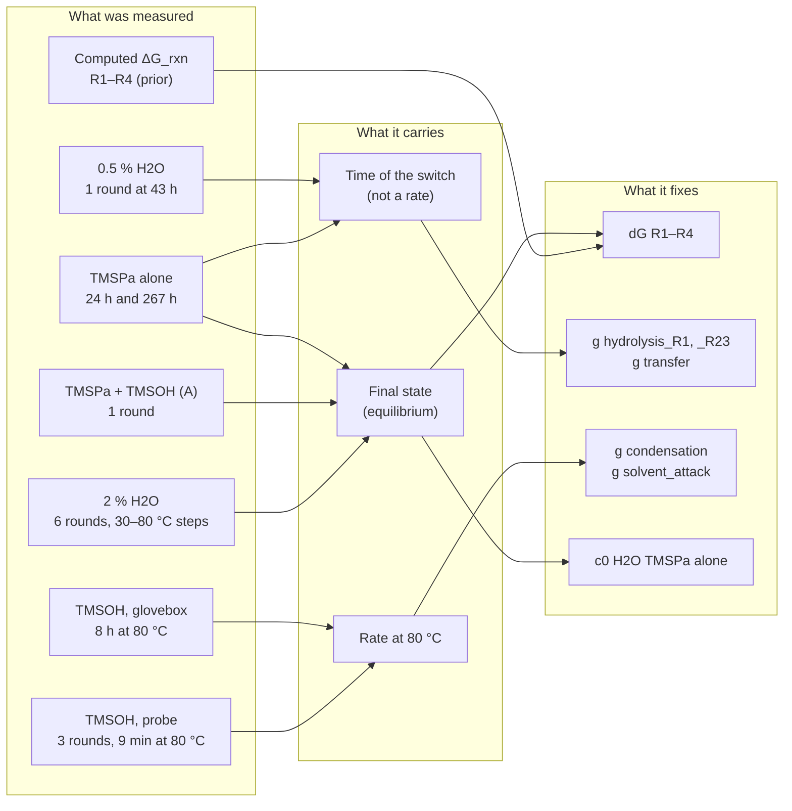
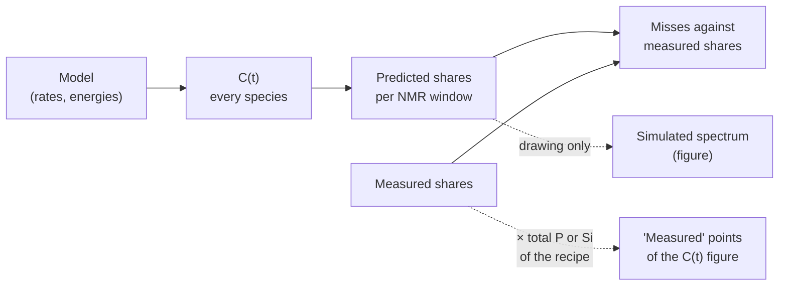
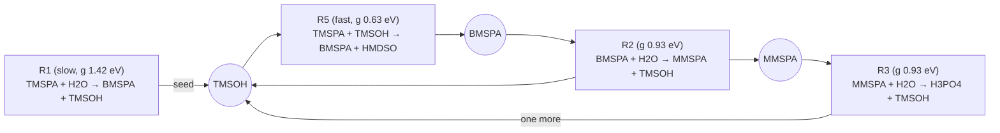
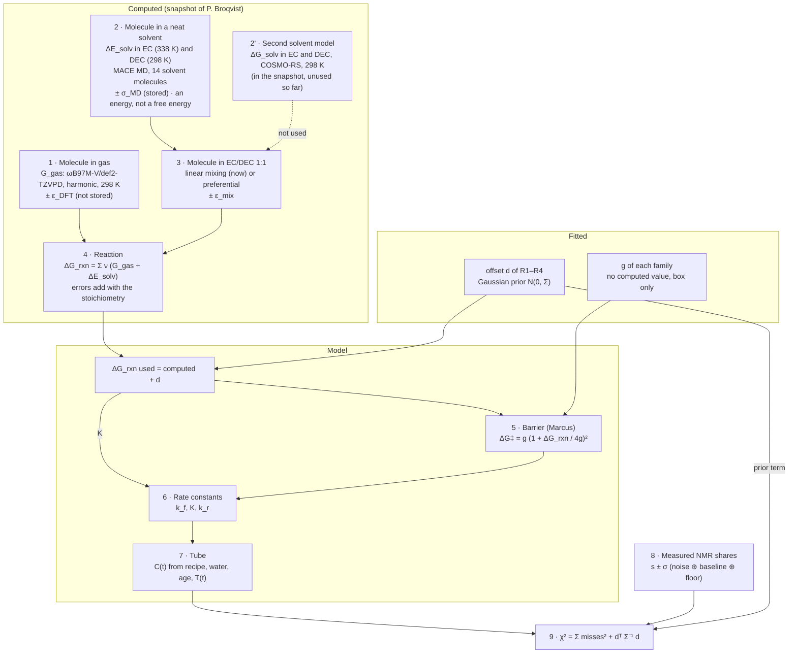
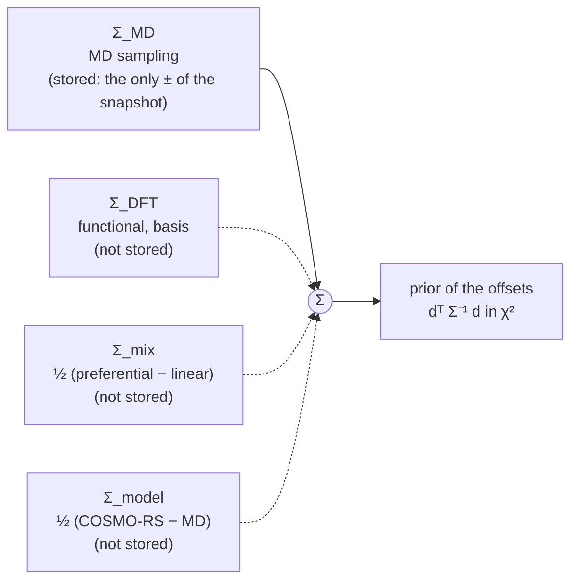
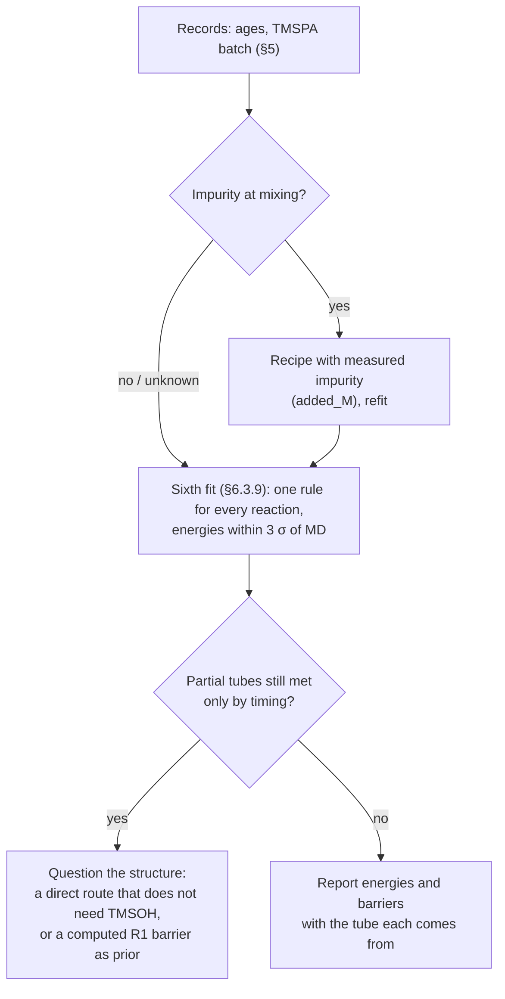

# Fit results: what the fifth fit shows and what it does not

| | |
|---|---|
| **Status** | Review of the fifth fit, written 2026-10-22. The chain ran from 2026-10-20 18:11 to 2026-10-21 11:05, all stages done. §6.3 rewritten the same day with the questions, decisions and limitations of the sixth fit (scratch fits in §6.3.3–6.3.4); the sixth fit is set up in `notebooks/results/05_fit6/` and not started |
| **Source** | Y. Alcaraz Galván |
| **Scope** | What the fifth fit settles, what only looks settled, and why: the information each tube carries, the "all or nothing" behaviour of the model, a contradiction between two tubes, the reaction-energy prior, the solvation mixing rule, and the experiments and computing work that would help. The setup of the fit is in `reference-fitting_improvements.md` §2 |
| **Applies to** | Branch `fit/first-fit`, commit `d1125a2` plus the uncommitted fifth-fit code (`code_vs_commit.patch` in the results folder) |
| **Evidence** | `notebooks/results/05_fit5/` (`fits_summary.csv`, `fits_residuals.csv`, `intervals.csv`, `leave_one_out.csv`, `sensitivities.csv`, `trace_verdict.csv`, `recovery_summary.csv`, `prediction_storage.csv`); forward runs of the M3-split fits made for this review, between the spectra (§4); the 2026-10-08 snapshot (neat EC and neat DEC solvation, §7; its COSMO-RS rows, §6.3.4) and the EC 298 K MD of the 2026-09-24 snapshot; short fits with the reaction energies held, made for this review (scratch, §6.3.4) |
| **Confidentiality** | Quotes numbers derived from the lab NMR spectra (private repository) |

Words used here, as in `reference-fitting_improvements.md`: **age** (time from adding TMSPa to a tube's first acquisition; not recorded), **reading** (an assumption about the ages: 1 day, 7 days or free ages), **miss** (standardised residual z), **χ²** (sum of squared misses), **share** (fraction of the area of one NMR window among the windows of its nucleus). Also: **switch** (the stretch of time in which a tube goes from almost unreacted to almost final, §4), **prior** (the term of χ² that keeps the reaction energies near their computed values), **offset** (fitted ΔG_rxn minus computed, d), **source** (a part of a computed energy with its own error: DFT, MD sampling, mixing rule, solvent model).

Unless said otherwise, numbers are for the main structure M3-split under the 1 day reading.

---

## 0. The picture as a whole

The fit compares the model with seven sources. They do not all say the same kind of thing:

The main points:

1. The fit to the spectra is good (χ² 57.9 over 84 values, worst miss 2.96). But most of the data describe final states, not how the tubes got there (§2).
2. The kinetics of hydrolysis rest on two tubes measured once each, and the model meets them by timing a switch of a few hours just after the spectrum (§4). That is fine-tuning, not a measured rate.
3. Under the assumed ages, the tube without added water has reacted further at 24 h than the 0.5 % tube at 43 h. No model where water speeds up hydrolysis can explain that (§5).
4. The prior on the reaction energies carries only the MD sampling error. The fit pulls all four energies by 2.2–2.7 σ (§6).

---

## 1. Outcome in numbers

| Check | Result |
|---|---|
| Structures that fit (no miss above 3) | M3-split at 1 day (χ² 57.9, worst 2.96, TMSPa alone at 24 h) and free ages (χ² 47.0, worst 2.64, prior on R2). M3-split at 7 days just fails (worst 3.09). M0, M1 and M3 fail in every reading |
| Trace rule (1 µM and 1 mM TMSOH at mixing) | Fails in both: at 1 day χ² 57.9 → 1540 with 1 µM; with free ages it survives 1 µM (47.4) but not 1 mM (1518). Selection rule: no structure |
| Sensitivities (1 day) | Fail: `floor x0` (86.5), `covariance x0.5` (69.4), `Peter barriers` (101.6, worst on 0.5 % MMSPA). The rest fit. `covariance x2` and `x4` lower χ² to 51.7 and 48.6 |
| Synthetic recovery | 45 intervals, the truth is outside 5 of them; the optimiser always finds a χ² at least as low as the truth's. In case C seed 2, g transfer comes out 0.99 eV (interval 0.83–1.06) for a truth of 0.70, with a lower χ² than the truth |
| Hold-out tube B | Worst miss 2.77–2.80 for M3-split |
| Storage, 90 % of the water gone | 256 h at 1 day (band 227–361 h), 1207 h at 7 days, 179 h with free ages (band 127–6666 h) |

The recovery result matters for everything below. On synthetic data with a known answer, intervals miss the truth one time in nine, and in one case a different set of barriers fits better than the truth does. The profile intervals are narrower than the information really allows.

---

## 2. What the data constrain

### 2.1 Tube by tube

| Tube | Spectra | State when measured | Information |
|---|---|---|---|
| 2 % H2O | 6 rounds (³¹P + ¹³C), 24–169 h | Final from the first round on; the 30–80 °C steps move nothing that is measured | The final composition (dG R1–R4); that nothing drifts at 80 °C for 8 h (an upper limit on the slow reactions) |
| 0.5 % H2O | 1 round, 43 h | 93 % TMSPA (σ 0.05): at the very start | That little has happened at 43 h |
| TMSPa alone | 24 h, 267 h | 19 % reacted at 24 h, final at 267 h | One point mid-way and the final state; with the end state it fixes the water of the tube (c0 H2O ≈ 62 mM) |
| TMSPa + TMSOH (A) | 1 round | Final | Final state with TMSOH added |
| TMSOH, probe | 24, 163, 168 h | Little change; 9 min at 80 °C | Room-temperature limits on condensation and solvent attack |
| TMSOH, glovebox | 8 h at 80 °C | TMSOH 0.42, HMDSO 0.16, TMSOEG 0.43 | The one real rate measurement: condensation and solvent attack at 80 °C |

### 2.2 The 2 % tube is one final state, and the fit already counts it as one

The six rounds of the 2 % tube are the same equilibrium measured six times; the temperature steps do not move it measurably. The error model already handles that (`kinetics/fitting/residuals.py`, `_lab_block`). Repeated room-temperature spectra share one common error (baseline spread and floor) and are read as one composition plus five "no drift" checks, not as six independent compositions. Collapsing them to their mean, which was proposed during the review, would change nothing; the proposal is withdrawn.

### 2.3 Leaving one tube out

Leave-one-out of the free-age M3-split fit (`leave_one_out.csv`):

| Left out | χ² | dG R1 / R2 / R3 / R4 (eV) | g hydrolysis_R1 | g hydrolysis_R23 | g transfer |
|---|---|---|---|---|---|
| none | 47.0 | +0.23 / +0.25 / +0.17 / −0.31 | 1.43 | 0.93 | 0.67 |
| 0.5 % H2O | 43.8 | +0.22 / +0.25 / +0.17 / −0.31 | 1.25 | 0.89 | 0.79 |
| 2 % H2O | 5.8 | +0.01 / +0.03 / −0.01 / +0.01 | 1.27 | 1.18 | 0.63 |

- Without the 2 % tube, the energy shifts fall back to about zero: it is the only source for the thermodynamics. It also contributes most of χ² (47.0 → 5.8).
- Without the 0.5 % tube, the hydrolysis barriers move by up to 0.18 eV. A barrier that leans on one tube measured once is weak, however narrow its profile interval looks.

---

## 3. Questions settled during the review

### 3.1 Which way the fit goes: concentrations to NMR, not the other way round

The fit already goes from the model to the spectrum:

- The simulated spectrum in the ¹³C figure is a drawing made from the predicted shares with a fixed peak shape. It is not part of the fit.
- The "measured" points of the C(t) figure are measured shares times the total P (or Si) of the recipe. Fitting in mM or in shares is the same comparison multiplied by a known constant, so fitting C(t) first would not give an odd-looking spectrum.
- The two figures look different only because of scale. A share of 0.02 is invisible in the spectrum and large on the zoomed C(t) axis. The C(t) figure has no error bars: the TMSOH share of the 2 % tube is measured 0.063 against 0.010 predicted, with σ 0.043 (miss −1.2), which is not a gross misfit. **Action:** add error bars to the C(t) figures of notebook 05.

### 3.2 Can the model wiggle at equilibrium to chase the noise?

No. Forward and reverse rate constants are tied by detailed balance (k_f / k_r = e^(−ΔG/RT)). The free energy of a closed tube then falls monotonically, and near equilibrium every concentration relaxes as a sum of decaying exponentials, with no oscillation. What moves in the 2 % tube in the model is real: the equilibrium constants change at each step, and the slow reactions with EC run at 70–80 °C. The "no drift" checks of §2.2 compare that motion with the measured spectra.

The risk of overfitting lies elsewhere: in timing the switch (§4) and in the free quantities nobody measured (ages, water of the dry tube).

### 3.3 Is the 0.5 % round, with the final states, enough?

No. That tube is not in the middle of its change: 93 % of its phosphorus is still TMSPA, about 1.5 σ from no reaction at all. One point could fix one rate constant if the shape of the curve were known. Here the shape is exactly what is in question (§4), and the point only says "the switch is after 43 h".

---

## 4. The model switches all at once

### 4.1 Mechanism

In the fitted model, TMSOH speeds up its own production:

R5 takes a TMSOH and turns TMSPA into BMSPA without the slow R1. R2 gives the TMSOH back, and R3 adds another. So the TMSOH count grows on each turn, and only the slow R1 sets when the loop starts. This was already noted after the fourth fit ("all or nothing"), and it is why the trace rule rejects every fit: a micromolar of TMSOH at mixing starts the loop early.

### 4.2 How sharp the switch is

Forward runs of M3-split (1 day) between the spectra, time from mixing:

| Tube | 1 % of the final conversion | 50 % | 99 % | Spectra |
|---|---|---|---|---|
| 0.5 % H2O | 42.2 h | 43.7 h | 44.7 h | ³¹P at 42.9 h |
| TMSPa alone | 117.8 h | 125.8 h | 134.1 h | 24 h and 267 h |

The 0.5 % tube goes from 1 % to 99 % in 2.5 h, and the fit places that window just after its only spectrum. The tube "TMSPa alone" switches between 118 and 134 h, so the model predicts nothing at all at 24 h.

With free ages the fit does the same for both tubes: it picks ages that put each spectrum at the start of its switch. The 0.5 % tube gets an age of 11 h (spectrum at 30 h, TMSPA 0.94 predicted against 0.93 measured), and TMSPa alone gets 86 h (TMSPA 0.84 predicted against 0.81). That is why the free-age fit has no large miss on TMSPa alone: the ages absorb what the rates cannot.

### 4.3 What it means

- The partial tubes are matched by timing, not by a rate. A model whose tubes sit still and then react within hours can catch a tube part-way through only by tuning the timing. Here two tubes are caught part-way (0.5 % at 7 %, TMSPa alone at 19 %), which would be unlikely if the real process switched like this. A gradual process explains partial states naturally.
- This is consistent with the recovery result (§1): when timing does the work, intervals come out too narrow and other barrier sets can fit as well.
- The storage predictions (§1) inherit the switch: their bands reach from days to months depending on when the loop starts.

---

## 5. The tube without water is ahead of the 0.5 % tube

| Tube | Water at mixing | Time of the spectrum (1 day reading) | TMSPA gone |
|---|---|---|---|
| TMSPa alone | ≈ 62 mM (fitted, fixed by its final state) | 24 h | 19 % |
| 0.5 % H2O | 263 mM | 43 h | 7 % |

The tube with a quarter of the water has reacted almost three times further in about half the time. **Under the assumed ages, no model in which water speeds up hydrolysis can explain this**, with or without the switch. That is why the 24 h round of TMSPa alone is the largest miss (2.96) and contributes about 12 of the 57.9 of χ². The fit is not ignoring it. Its structure and the other tube pull the other way, and giving that point more weight would only distort the rest.

Possible reasons, to check in the lab records before any more structure work:

1. **The ages differ from what is assumed.** If TMSPa alone was measured long after mixing, or the 0.5 % tube soon after, the order becomes possible. The free-age fit takes exactly this way out: TMSPa alone at 86 h, the 0.5 % tube at 11 h (§4.2). It is allowed, but nothing measured supports it, and it relies on timing the switch again.
2. **The reagent was not pure TMSPA.** The 24 h composition of TMSPa alone (12 % BMSPA, 5 % MMSPA, 4 % H3PO4) could be partly hydrolysed reagent, present at mixing. If so, much of the 7 % in the 0.5 % tube could be reagent too, and that tube would say even less. A different TMSPA batch for the two tubes would also do it.
3. **Something slows the 0.5 % tube**, or speeds up the dry one (an acid, another impurity).

The first two can be checked in the records (preparation dates, batch). If (2) holds, the fix is a recipe change: the measured impurity added at mixing, the same mechanism that `added_M` already provides.

---

## 6. Reaction energies (G) and intrinsic barriers (g)

### 6.1 What is fitted now

Three quantities enter the rate of each reaction:

| Quantity | Meaning | Where it comes from | Treatment in M3-split |
|---|---|---|---|
| ΔG_rxn (G) | How far downhill the reaction goes; sets the equilibrium | DFT (ωB97M-V, gas) + MD solvation | R1–R4 fitted as offsets from the computed value, with a Gaussian prior; R5–R7 follow through the species, R8–R9 stay as computed |
| g | Intrinsic barrier of a family: the barrier height when ΔG_rxn = 0 | Nothing computed | Free, one per family (hydrolysis split into R1 and R2/R3) |
| ΔG‡ | The barrier actually used | Marcus: ΔG‡ = g (1 + ΔG_rxn / 4g)² | Follows from the two above |

g does not compute G; G and g together give ΔG‡. Fitting G with its computed error is already what M3 does. Fitting ΔG‡ directly, one per reaction, would replace four g by about nine free barriers with no computed value to anchor them, and these data cannot carry that.

### 6.2 What is missing: the error of the computed energies

The prior's covariance holds only the MD standard errors (`kinetics/thermo/uncertainty.py`): σ about 0.08–0.12 eV for R1–R4. It leaves out:

- the error of the DFT functional (typically ~0.1 eV per reaction, but shared between R1, R2 and R3, which make and break the same bonds);
- the error of the solvent model: the mixing rule (§7), the EC run at 338 K used at every temperature, and an energy used where a free energy is meant (no solvation entropy). §6.3.4 sizes it with the second solvent model of the snapshot (COSMO-RS): 0.16–0.39 eV on R1–R4.

The fit pulls the four energies well away from those narrow errors:

| | R1 | R2 | R3 | R4 |
|---|---|---|---|---|
| Computed ΔG_rxn (eV) | −0.253 ± 0.104 | −0.182 ± 0.094 | −0.061 ± 0.081 | +0.097 ± 0.120 |
| Fitted offset (eV) | +0.23 | +0.25 | +0.18 | −0.33 |
| Miss of the prior | 2.2 | 2.7 | 2.2 | −2.7 |

The prior adds 12.3 to χ² (of 57.9). The three hydrolysis offsets are almost equal (+0.18 to +0.25 eV), which is what a shared (systematic) error would look like. The `covariance x2` and `x4` sensitivities, which simply widen the existing σ, lower χ² and still fit.

### 6.3 Proposal and decisions for the sixth fit

Discussed on 2026-10-22. Each subsection gives the question, what was found, the decision and what it leaves open. The scratch fits quoted were made during the discussion with the fifth fit's code; they are not in a results folder.

| # | Question | Decision | § |
|---|---|---|---|
| 1 | Which reaction energies are fitted? | Every independent reaction: R1–R4, R8 and R9. R5–R7 and N10–N15 follow through the species | 6.3.5 |
| 2 | One offset per reaction, or one per source (DFT, solvation)? | Per reaction. The split by source is only for reporting | 6.3.3 |
| 3 | How far may an energy move? | Gaussian cost around the computed value, inside a box of ±3σ | 6.3.6 |
| 4 | Which σ? | The MD standard error only, as now. No DFT error until a specific one exists | 6.3.2 |
| 5 | Which solvation? | MD with linear mixing. COSMO-RS goes into a later, separate fit | 6.3.4 |
| 6 | Which barriers? | One rule for every reaction: the first step of TMSPA is its own class (R1 with N15, and R5) | 6.3.5 |
| 7 | Which ages? | 1 h, 1 day and free ages | 6.3.7 |
| 8 | Water of "TMSPa alone"? | Declared at the least its last spectrum needs (65.6 mM), not fitted | 6.3.7 |
| 9 | Purity of the TMSPA? | Pure; the trace rule stays as a check | 6.3.7 |
| 10 | Does the 2 % tube weigh too much in χ²? | No change: the per-value fit rule protects the few important values | 6.3.8 |
| 11 | How to use the fifth fit? | Only as starting points of the search | 6.3.9 |

#### 6.3.1 From the molecule to the score: every number and its error

| Level | Quantity | Where it comes from | Error | Size | In the prior of fit 5 |
|---|---|---|---|---|---|
| 1 | G_gas of each species | ωB97M-V/def2-TZVPD, harmonic (RRHO) at 298 K, used at every temperature | functional and basis; harmonic treatment of the soft Si–CH₃ motions; no temperature dependence | not stored; ~0.05–0.1 eV per reaction (to agree with P. Broqvist); the missing temperature dependence is 0.02–0.05 eV between 22 and 80 °C (gas-phase ΔS of R1–R4: −53 to +81 J/(mol K)) | no |
| 2 | ΔE_solv in EC and in DEC | MACE MD, one solute in 14 solvent molecules; EC at 338 K, DEC at 298 K | standard error of the mean (stored, 0.03–0.11 eV per species); an energy used as a free energy (no solvation entropy); a different run temperature per solvent; drift between time windows of a run (EC records: up to 0.16 eV) | 6.3.4: another solvent model moves R1–R4 by 0.16–0.39 eV | standard error only |
| 3 | mixing EC/DEC | linear, x_EC 0.645 | the rule | R1 0.18 eV, R3 0.14 eV (§7) | no |
| 4 | ΔG_rxn | sum over the species of the reaction | all of the above, with correlations | 6.3.2 | — |
| 5 | ΔG‡ | Marcus, from g and ΔG_rxn | g has no computed value | — | g free in a box |
| 6 | k_f, K | from ΔG‡ and ΔG_rxn | inherited | 0.1 eV of ΔG_rxn: K × 51, k_f × 7 at 22.5 °C | — |
| 7 | C(t) | recipe, heating episodes, ages | ages and water of TMSPa alone not measured; purity of the reagent | readings and free parameters (§4, §5) | — |
| 8 | shares | the spectra | noise, baseline, declared floor | median 0.03 (³¹P), 0.05 (¹³C) | χ² |

The equations, level by level (s: species, j: reaction, ν_sj: stoichiometric coefficient, products positive):

1. Gas: $G_s^{gas} = E_s^{SCF} + G_s^{RRHO}(298\ \mathrm{K})$, true value $G_s^{gas} + \varepsilon_s^{DFT}$.
2. Neat solvent X: $\Delta E_s(X) = \langle E_{s+14X}\rangle - \langle E_{14X}\rangle - \langle E_s^{gas}\rangle$, with $\sigma_{MD,s}^2 = \sigma_{gas}^2 + \sigma_{solution}^2$ per species and $\sigma_{ref}^2$ of the pure-solvent box shared by all (it cancels in the 2 → 2 steps).
3. Mixture, linear: $\Delta E_s = x\,\Delta E_s(\mathrm{EC}) + (1-x)\,\Delta E_s(\mathrm{DEC})$. Preferential: $\Delta E_s = -k_BT \ln\left[x\,e^{-\Delta E_s(\mathrm{EC})/k_BT} + (1-x)\,e^{-\Delta E_s(\mathrm{DEC})/k_BT}\right]$.
4. Reaction: $\Delta G_j = \sum_s \nu_{sj}\left(G_s^{gas} + \Delta E_s\right)$, so its error is $\delta_j = \sum_s \nu_{sj}\,\varepsilon_s$: two reactions share an error when they share a species or a method.
5. Barrier: $\Delta G_j^\ddagger = g\left(1 + \Delta G_j/4g\right)^2$, so $\delta\Delta G_j^\ddagger = \tfrac12\left(1 + \Delta G_j/4g\right)\delta_j \approx 0.5\,\delta_j$ (0.50–0.52 for R1–R3 in the fifth fit).
6. Rates: $\ln K_j = -\Delta G_j/k_BT$ and $\ln k_{f,j} = \ln(k_BT/h) - \Delta G_j^\ddagger/k_BT$, so $\delta\ln K = -\delta_j/k_BT$ and $\delta\ln k_f \approx -\delta_j/2k_BT$. An error of 0.1 eV in an energy is a factor 51 in K and 7 in k_f at 22.5 °C.
7. Tube, spectrum and score, as in notebook 05 §3: $\chi^2 = \sum_i \left((s_i^{pred} - s_i^{meas})/\sigma_i\right)^2 + \mathbf d^\top \Sigma^{-1} \mathbf d$.

The energy errors reach the tubes twice: through K (where a tube stops, full weight) and through ΔG‡ (how fast it gets there, half weight).

#### 6.3.2 How the errors add up, and which σ the fit uses

Each error belongs to a species (or to a bond), and a reaction takes it with its stoichiometric coefficient. A source k with species covariance C_k gives the reactions N C_k Nᵀ (N: reactions × species). Independent sources add:

$$\Sigma = \Sigma_{MD} + \Sigma_{DFT} + \Sigma_{mix} + \Sigma_{model}$$

What is stored and what is not:

- **The only ± of the snapshot is the standard error of the MD solvation** (`uncertainty_kjmol` of each solvation record). It measures how well the average of a finite simulation is known, not whether the method is right.
- **The DFT energies carry no error.** The functional and basis error has to be declared from outside. A literature value (~0.05–0.1 eV for reaction energies with ωB97M-V) was judged too unspecific. A specific value would come from recomputing R1–R4 in the gas phase with a reference method (DLPNO-CCSD(T)): four reactions of small molecules, to ask P. Broqvist.
- **The solvent-model and mixing errors** can be sized from the snapshot itself (6.3.4), but they are differences between two methods, not errors of one.

What each source would add, for R1–R4 (eV; the DFT values are placeholders):

| Term | How it would be built | σ R1 / R2 / R3 / R4 |
|---|---|---|
| Σ_MD | standard errors per species, mole-fraction weights (as now) | 0.104 / 0.094 / 0.081 / 0.120 |
| Σ_DFT | bond model: R1–R3 make and break the same bonds (P–O–Si + H–OH → P–OH + Si–OH) and share one term; R4 (2 Si–OH → Si–O–Si + H–OH) its own; placeholders 0.07 shared + 0.04 own | 0.081 each, R1–R3 correlated 0.75 |
| Σ_mix | half the gap preferential − linear, with its sign | 0.091 / 0.004 / 0.069 / 0.029 |
| Σ_model | half the gap COSMO-RS − MD, with its sign | 0.194 / 0.155 / 0.082 / 0.117 |

The fifth fit's offsets (1 day: +0.23, +0.25, +0.18, −0.33 eV) scored against each prior, without refitting:

| Prior | Centre | z R1 / R2 / R3 / R4 | Prior term of χ² |
|---|---|---|---|
| Σ_MD (fifth fit) | MD, linear | 2.2 / 2.7 / 2.2 / −2.7 | 12.3 |
| Σ_MD + Σ_DFT | MD, linear | 1.8 / 2.1 / 1.5 / −2.3 | 7.5 |
| Σ_MD + Σ_DFT + Σ_mix | MD, linear | 1.4 / 2.1 / 1.3 / −2.2 | 7.1 |
| all four | halfway between MD and COSMO-RS | 0.2 / 0.5 / 0.6 / −1.1 | 2.0 |

**Decision:** the sixth fit keeps Σ_MD alone, centred on the MD values. A wider Σ would change how the offsets are read ("2.7 σ away" or "within 1 σ"), not where they are (6.3.3), and its extra terms would rest on placeholders. The limitation is stated instead: **the σ of the prior is the MD sampling error only, so it underestimates the true error of the computed energies.**

#### 6.3.3 One offset per reaction, or one per source?

The question: ΔG_rxn is E_DFT ± σ_DFT plus E_solv ± σ_solv. Should the fit move E_DFT and E_solv separately, each held by its own error, instead of one ΔG_rxn per reaction?

The spectra see only the sum. Splitting the offset into d = d_DFT + d_solv adds a direction (DFT up, solvation down by the same amount) along which nothing in the tubes changes. Along it only the prior decides, in closed form:

$$\min_{\mathbf d_{DFT} + \mathbf d_{solv} = \mathbf d}\left[\mathbf d_{DFT}^\top \Sigma_{DFT}^{-1} \mathbf d_{DFT} + \mathbf d_{solv}^\top \Sigma_{solv}^{-1} \mathbf d_{solv}\right] = \mathbf d^\top \left(\Sigma_{DFT} + \Sigma_{solv}\right)^{-1} \mathbf d, \qquad \hat{\mathbf d}_k = \Sigma_k\,\Sigma^{-1}\,\mathbf d$$

- Fitting the sources separately gives the same ΔG_rxn, χ² and intervals as one offset per reaction with the summed covariance, with twice the energy parameters.
- The split by source is read off after the fit with $\hat{\mathbf d}_k$. It is the prior's split, not the data's.
- The same holds for one weight shared by every reaction, such as a weight λ of COSMO-RS in the solvation: with λ and the offsets together there are more numbers than the tubes fix, so λ would come out of the prior's split. (Proposed earlier on 2026-10-22 and withdrawn.)

**The tubes fix the four energies on their own.** Scratch fits of M3-split with the composite prior of 6.3.2 (all four terms, centre halfway) reproduce the fifth fit's offsets to 0.01–0.02 eV:

| Prior | Reading | Offsets R1 / R2 / R3 / R4 (eV) | χ² spectra + prior | Worst miss |
|---|---|---|---|---|
| Σ_MD (fifth fit) | 1 day | +0.23 / +0.25 / +0.18 / −0.33 | 45.6 + 12.3 | 2.96, TMSPa alone |
| composite | 1 day | +0.23 / +0.26 / +0.18 / −0.33 | 45.4 + 1.9 | 2.96, TMSPa alone |
| Σ_MD (fifth fit) | free | +0.23 / +0.25 / +0.17 / −0.31 | 35.1 + 11.8 | 2.64, prior of R2 |
| composite | free | +0.25 / +0.27 / +0.18 / −0.34 | 33.9 + 2.0 | 1.93, 2 % H2O |

The profile intervals of the fifth fit are ±0.04–0.07 eV on each energy. The 2 % tube, with "TMSPa alone" and tube A, sets where the reactions stop. The prior only decides how far from the computed value that is called.

**Decision:** one offset per reaction. Sources enter only through the size of Σ (6.3.2), and a split by source, if reported, is labelled as the prior's.

#### 6.3.4 Which solvation: MD or COSMO-RS, linear or preferential

The snapshot holds two solvation methods for every species of the network:

- **MD** (the one in use): one molecule in a box of 14 solvent molecules (MACE potential), simulated and averaged. It gives an energy (no solvation entropy). EC was run at 338 K, DEC at 298 K.
- **COSMO-RS** (openCOSMO-RS 24a, not used so far): the solvent as a continuous medium with parameters fitted to experiment. It gives a solvation free energy at 298 K, in neat EC and neat DEC.

Contribution of the solvation to each reaction energy (eV):

| | MD EC 338 K | MD DEC 298 K | MD linear (now) | MD preferential | COSMO-RS EC | COSMO-RS DEC | COSMO-RS linear |
|---|---|---|---|---|---|---|---|
| R1 | −0.716 | +0.196 | −0.392 | −0.210 | −0.007 | −0.002 | −0.005 |
| R2 | −0.352 | −0.293 | −0.331 | −0.339 | −0.023 | −0.017 | −0.021 |
| R3 | −0.403 | +0.021 | −0.252 | −0.390 | −0.092 | −0.084 | −0.089 |
| R4 | +0.359 | −0.007 | +0.229 | +0.171 | −0.002 | −0.009 | −0.004 |

Shift of the reaction energies from MD linear, next to what the fifth fit wants:

| eV | Preferential | COSMO-RS | Fitted offset (1 day) |
|---|---|---|---|
| R1 | +0.18 | +0.39 | +0.23 |
| R2 | −0.01 | +0.31 | +0.25 |
| R3 | −0.14 | +0.16 | +0.18 |
| R4 | −0.06 | −0.23 | −0.33 |
| TMSPA + 1.5 H₂O → H₃PO₄ + 1.5 HMDSO (whole ΔG_rxn) | −0.40 | +0.16 | −0.18 (MD linear: −0.35) |

- **COSMO-RS moves all four energies the way the fit does; preferential mixing only R1** (§7).
- **The tubes sit between the two methods.** The last row is the whole hydrolysis of the 2 % tube. MD (linear, and preferential even more) makes it too favourable, which is why M1 sends that tube to H₃PO₄ alone. COSMO-RS makes it uphill. The scratch fits below confirm both ends: neither method fits as it is.
- **The mixing rule matters only inside the MD.** In MD the two solvents disagree strongly (R1: −0.72 in EC, +0.20 in DEC); in COSMO-RS they agree to 0.01 eV on R1–R4. Energies without entropy exaggerate such differences. The MD also repeats to about 0.1 eV per reaction: the EC runs at 298 K (24 Sept snapshot) and 338 K differ by up to 0.13 eV on R1–R8 and 0.56 eV on R9.
- **Caution.** The comparison was made after seeing the fifth fit; choosing a method because it lands closer to the fit would count the 2 % tube twice.

Scratch fits with R1–R4 held at a given solvation (barriers, water and ages free; fifth-fit setup):

| Energies of R1–R4 | Structure | χ² spectra, 1 day / free | Worst miss, 1 day / free |
|---|---|---|---|
| fitted, Σ_MD (fifth fit) | M3-split | 45.6 / 35.1 | 2.96 / 1.93 |
| held at DFT + COSMO-RS | M3-split | 2037 / 1807 | 33.4 / 32.3 (2 % H2O, TMSPA) |
| held at DFT + COSMO-RS | M3 | 2049 / 1802 | 32.6 / 32.1 (2 % H2O, TMSPA) |
| held halfway between MD and COSMO-RS | M3-split | 175 / 160 | 8.4 / 8.3 (2 % H2O, TMSOH) |
| held halfway between MD and COSMO-RS | M3 | 1627 / 300 | 33.7 / 8.5 (0.5 % H2O, MMSPA) |

**Decision:** one method per fit, with the other one used only to size the error. The sixth fit uses **MD with linear mixing**, the method the energies were computed with so far; its offsets are compared afterwards. **COSMO-RS is a separate, later fit** (centre on COSMO-RS, the MD difference as its error). Arguments for COSMO-RS when that fit is set up: it gives the free energy the equilibrium constants need, it is the more established method for organic solvents, and it removes the mixing question. Against: it is less reliable for strong hydrogen-bond donors (H₃PO₄, water), and P. Broqvist chose the MD.

"Mixed" can mean a rule between linear and preferential (n independent places in the solvation shell: n = 1 preferential, large n linear; for R1 +0.18 eV at n = 1, +0.13 at n = 5, +0.06 at n = 14), or a mix of methods. Neither enters the sixth fit.

#### 6.3.5 One rule for every reaction

**Which reactions have their ΔG_rxn fitted.** In the fifth fit: R1–R4 (offsets with prior); R5–R7 and N10–N15 follow through the species (R5 = R1 + R4, and so on); R8 and R9 stay at their computed values. The barrier split (R1 apart) is a different matter: it concerns g, not ΔG_rxn.

Only independent reactions can be given an offset: R1–R9 contain six (R1–R4, R8, R9), and every other reaction is a sum of them, so its energy must follow (Wegscheider). **Decision:** the offsets go to all six, with the same rule (cost and box, 6.3.6). R8 and R9 are seen only by the TMSOH tubes, through solvent attack; where the tubes cannot separate their ΔG_rxn from g solvent_attack, the prior holds them.

**Barriers.** Where the fifth fit treats reactions differently:

| Reactions | Barrier in M3-split | Sixth fit (M3-R1R5-G6) |
|---|---|---|
| R1, N15 | own class | own class |
| R2, R3, N12 | one shared class | one shared class |
| R5 | transfer, shared with R6, R7 | own class |
| R6, R7 | transfer | one shared class |
| R4 | condensation | condensation |
| R8, R9 | solvent attack | solvent attack |
| N10, N11, N13, N14 | declared 1.15 eV | declared 1.15 eV |

- The data need R1 apart. With one g, Marcus lets the barrier of R1 exceed that of R2 by only about half the difference of their reaction energies (level 5 of 6.3.1). The fifth fit has ΔG‡ of R1 0.42 eV above R2 (1.40 against 0.98 eV), which one g could give only with R1 about 0.85 eV more uphill than R2. M3 (one hydrolysis barrier) still fails with the composite prior of 6.3.3: worst miss 18.5 at 1 day, 4.2 with free ages.
- **Rule:** the first silyl group leaving a phosphate with no P–OH yet (TMSPA) is its own mechanism. It places N15 (TMSPA + H₂O → MMSPA + HMDSO) with R1, as before, and now also separates R5 (TMSPA + TMSOH) from R6–R7. Cost: one barrier, which the tubes may not determine (transfer was already only an upper limit).
- An alternative with the same number of barriers (one shift for every step whose phosphate already has a P–OH, shared by hydrolysis and transfer) was set aside: it would put R6–R7 near 0.16 eV.

Structures of the sixth fit: **M3-R1R5** (the rule, offsets of R1–R4) and **M3-R1R5-G6** (the rule, offsets of all six independent reactions; the main structure). M0 to M3-split are refitted under the same setup, as the ladder.

#### 6.3.6 How far an energy may move

Until now an offset was free in a fixed box of ±0.75 eV, held only by its Gaussian cost: moving 1 σ added 1 to χ², 2 σ added 4. An energy could leave ±σ when the spectra improved by more than it cost; the fifth fit took R2 to 2.7 σ.

The reading agreed on: the model exists within the errors of the computed numbers that feed it, and inside those limits it is adjusted to the experiment.

**Decision:** Gaussian cost kept, inside a box of **±3 σ** around the computed value (R1 ±0.31, R2 ±0.28, R3 ±0.24, R4 ±0.36, R8 ±0.31, R9 ±0.32 eV). The fifth fit's offsets (2.2–2.7 σ) are inside. An offset that ends on the edge of the box says that the model cannot meet the tubes within the computed errors, and is reported as such. Sensitivities: the cost with σ halved and doubled (the box stays).

#### 6.3.7 What the tubes leave unknown: ages, water, purity

**Ages.** The time from mixing to the first spectrum was not recorded. Readings: **1 h, 1 day and free ages** (each tube its own age, 1 h to 30 days). t = 0 or 10 min were considered and left out: the first spectrum of "TMSPa alone" already shows 19 % reacted, and 1 h has failed in every earlier fit. The ³¹P of the 0.5 % tube comes 18.9 h after its first acquisition (a ²⁹Si of 9.4 h) in every reading.

**Water of "TMSPa alone".** What the literature says:

- RXN-01: EC/DEC dried on molecular sieves, Karl Fischer about 10 ppm ("a few tens of ppm" elsewhere), that is 1–2 mM.
- RXN-02: EC/DEC as received, DEC dried on sieves, glovebox below 1 ppm H₂O. No water measurement, and no water added to a tube without water.

The rule agreed on is to take no water (or traces) when nothing is stated. Here that is impossible. In the network, every silyl group that leaves the phosphate needs the oxygen of a water, directly or through TMSOH. The last spectrum of "TMSPa alone" (243 h after the first) shows 0.874 silyl groups gone per phosphorus: 131 mM. Even if every one ended as HMDSO (half a water each), the tube needed at least **65.6 mM** of water, 30 to 60 times the Karl Fischer value.

**Decision:** the water of "TMSPa alone" is declared at that minimum, 65.6 mM, and not fitted. The fifth fit had chosen 60–62 mM (interval 51–74 mM at 1 day), so the minimum is also what the fits found. Sensitivity "water free": fitted as in fits 3–5. Where the water came from (air during preparation or measurement, a wetter solvent) is a question for the lab.

**Purity of the TMSPA.** What the literature says:

- RXN-01: TMSPa from Sigma-Aldrich, ≥ 98 %, used as received. It also mentions "an unknown impurity in the TMSPa additive solution" (¹H, 0.03 ppm).
- RXN-02: HMDSO "detected in trace amounts in pure TMSPa and TMSOH" (SI Fig. S3, ²⁹Si); "TMSPa is very sensitive toward impurities, even if those impurities are present in very low amounts".
- RXN-02 SI Fig. S4: TMSPa stored a year in the glovebox shows a small BMSPa line. None of these is quantified.

**Decision:** TMSPA pure, no parameter. At most 2 % of impurity cannot explain the 19 % reacted of "TMSPa alone" at its first spectrum, so impurity is no longer a likely explanation of §5. The traces the papers do see (HMDSO, aged BMSPa) are why the trace rule stays as a check: a model that works only with a perfectly clean TMSPA conflicts with what the papers see in the bottle.

**Also in the SI of RXN-02**, for later:

- a "Blank" tube without added water measured by ¹H (Fig. S1). In ¹H the water has its own line, and the SI places acetonitrile (0.048 M) in the insert as an internal standard. ¹H spectra of our "TMSPa alone", if they exist in the raw files, would **measure** its water and TMSOH instead of declaring them;
- tubes at 1 % and 5 % water (Fig. S1, ¹H only), not in our data;
- the paper's own R1 energy, −0.74 eV (B3LYP gas phase + MD solvation in EC with GFN2), against −0.25 eV here and −0.02 eV fitted. The same scheme as P. Broqvist's MD (an energy, EC only), another sign that the solvation part is the least certain.

#### 6.3.8 Does the 2 % tube weigh too much in χ²?

The concern: χ² is a sum, so many well-fitted values of the 2 % tube (all at equilibrium) could outweigh a few important ones of "TMSPa alone" and the 0.5 % tube.

- **The fit rule is per value.** A model fits only if no value misses by more than 3 errors, so a few badly fitted important values reject a fit however small χ² is. This is what happens: the worst miss of the fifth fit is "TMSPa alone" at 24 h (2.96 at 1 day, 3.09 at 7 days, which fails).
- **The six rounds of the 2 % tube count as one composition**, plus five "no drift" checks with a common error (§2.2); they do not weigh as six tubes.
- **They are not irrelevant.** They are the data that fix the reaction energies (§2.3: without the 2 % tube the offsets fall to zero). They say nothing about the kinetics, which is the other part of the problem.
- "TMSPa alone" at 24 h is not badly fitted because the 2 % tube outweighs it. It contradicts the 0.5 % tube (§5), and giving it more weight would distort the rest without resolving that.

**Decision:** weights unchanged. The notebook of the sixth fit should show χ² and the worst miss per tube.

#### 6.3.9 The sixth fit

Setup in `notebooks/results/05_fit6/fit_config.json`; everything not listed is as in the fifth fit (MD solvation EC/DEC 1:1 linear of the 8 Oct snapshot, network R1–R9 + N10–N15, heating episodes of the 2 % tube, error model).

| | Fifth fit | Sixth fit |
|---|---|---|
| Energies freed | R1–R4 | R1–R4 in M3, M3-split and M3-R1R5; R1–R4, R8, R9 in M3-R1R5-G6 |
| Energy constraint | Gaussian cost (Σ_MD), box ±0.75 eV | Gaussian cost (Σ_MD), box ±3 σ |
| Structures | M0 … M3-split | M0 … M3-split, M3-R1R5, M3-R1R5-G6 (main) |
| Water of "TMSPa alone" | fitted (0–300 mM) | declared, 65.6 mM |
| Readings | 1 day, 7 days, free | 1 h, 1 day, free |
| Search | Sobol screen 8192 points, 32 starts | the same full search for M3-R1R5 and M3-R1R5-G6 at 1 day and free ages; 4096 points and 16 starts for M3 and M3-split (they also start from their own fifth-fit optimum); 2048 points and 8 starts at 1 h for every structure with freed energies. In every case the fifth fit's parameters are extra starts |
| Night | profiles, leave-one-out, sensitivities, indistinguishability, tolerance check | profiles of the main structure in every reading where it fits, and of M3-R1R5 at 1 day; leave-one-out and sensitivities of the main structure where it fits |
| Sensitivities | 11 | 7: heating as recorded; cost with σ × 0.5 and × 2; water free; Peter barriers (N10–N15 all at 1.15 eV); error floor × 0 and × 2 |
| Trace rule | evaluated, and every fit refitted with each trace | evaluated only |
| Recovery | 3 cases, 7 data sets, with the search of the fits | the main structure with free ages, 2 data sets, with the reduced search (4096 points, 16 starts) |

Why each addition to the first plan (decided 2026-10-22, with about 15 h of computing available):

- **Full search for the two new structures.** They have 12–13 parameters, against 10–11 in the fifth fit, and in the fifth fit the profiles still found lower minima than the fit (χ² 58.8 → 57.9 at 1 day, 47.4 → 47.0 with free ages). The reduced search is kept where the risk is small: M3 and M3-split start from their own fifth-fit optimum, and the 1 h reading has failed in every earlier fit.
- **Peter barriers.** N10–N15 at P. Broqvist's 1.15 eV, so no step follows R1 or R2. The four exchange steps at a declared 1.15 eV are the one exception left to "one rule for every reaction" (6.3.5); in the fifth fit this variant failed (worst miss 3.97 at 1 day, 3.13 with free ages).
- **Error floor × 0 and × 2.** The verdict "fits" uses the declared floor of a share's error (notebook 05 §7.2). Without it the fifth fit failed (worst miss 3.76 at 1 day, 3.23 with free ages).
- **Profiles of M3-R1R5 at 1 day.** Whether the new barrier of R5 comes out as a value or only a limit, and whether separating it moves the others, without the two extra energies of the main structure.

**Using the fifth fit without being bound by it.** Its parameter sets, embedded in each new structure, are only extra starting points of the search. No box, centre or width comes from them.

**Cost.** Estimated 12–14 h on 14 workers, from the fifth fit's times (one evaluation 0.74 s at 1 day, 0.94 s with free ages):

| Stage | Fifth fit | Sixth fit (estimate) |
|---|---|---|
| registered, baselines | 8 min | ~10 min |
| recovery | 171 min | ~60 min (one case, reduced search) |
| extended | 183 min | ~260 min (five structures; full search for the two new ones at 1 day and free ages) |
| night | 591 min | ~420 min (profiles: main structure in two or three readings, M3-R1R5 at 1 day, and the move to their minima; leave-one-out; 7 sensitivities × 2 readings, with a full search for those that fail) |
| traces, predictions | 61 min | ~5 min |
| total | 17 h | ~12–14 h |

The laptop must be on mains power for the whole run (it was on battery when this was written). The run has not been started.

**What the outcomes would mean:**

| Outcome | Reading |
|---|---|
| M3-R1R5-G6 fits, offsets inside the box | The model meets the tubes within 3 σ of the computed energies, with one rule for every reaction |
| Some offset on the edge of the box | The model cannot meet the tubes within the computed errors for that reaction: the error is underestimated (6.3.2) or the model is wrong |
| R8, R9 at their prior | The tubes do not see those energies (expected) |
| M3-R1R5 no better than M3-split | The R5 split is not needed by the data, but it keeps the rule |
| Fits with the water declared, as with water free | The water of "TMSPa alone" is set by its final state, as the balance says |
| Fails with Peter barriers | The fit needs N15 and N12 to follow R1 and R2: the rule is doing work, and the declared 1.15 eV of the exchange steps should be questioned |
| Fails without the error floor | The verdict rests on a declared error, as in the fifth fit |

#### 6.3.10 Limitations of the sixth fit

1. **The prior's σ is the MD sampling error only.** It leaves out the DFT error and the solvent-model error, which 6.3.4 shows to be larger (0.16–0.39 eV between MD and COSMO-RS). Offsets of 2–3 σ are to be read with that in mind.
2. **The solvation is an energy, not a free energy**, from a box of 14 solvent molecules, with EC and DEC at different temperatures.
3. **The tubes fix where the reactions stop, not how fast** (§2, §4). Nothing in this setup changes the switch of §4 or the contradiction of §5: the energies set the final states and enter the barriers at half weight.
4. **The ages are assumed**, not recorded (three readings).
5. **The water of "TMSPa alone" is a declared minimum.** It rests on the balance of the network (no other oxygen donor for silyl groups) and on a single final spectrum.
6. **TMSPA is taken as pure**, while the papers see traces of HMDSO and, after storage, BMSPA.
7. **The barrier split is a stated rule**, not something the data can confirm for R5.
8. **The recovery check is reduced** to one case, with two data sets and a weaker search than the fits'.
9. **The search is reduced for M3, M3-split and the 1 h reading.** A failure there could be a search that stopped short; the fifth fit's optima as starts make that unlikely for M3 and M3-split.

#### 6.3.11 Open questions

- **Lab:** the ages; whether ¹H spectra of "TMSPa alone" exist (water and TMSOH measured with an internal standard); where the water of that tube came from; the batch and age of the TMSPA; whether the 1 % and 5 % tubes of RXN-02 exist as raw files.
- **P. Broqvist:** a reference-method check (DLPNO-CCSD(T)) of R1–R4 in the gas phase, for a specific DFT error; MD versus COSMO-RS for these molecules; COSMO-RS for the EC/DEC mixture itself.
- **Next fits:** COSMO-RS as the centre, with the MD difference as its error; a transition state for R1 (and R5) as a prior on the barrier that sets the switch (§4).

---

## 7. Solvation in EC/DEC: linear or preferential mixing

Neat-solvent MD values of the 2026-10-08 snapshot, mixed for EC:DEC 1:1 by volume (x_EC 0.645):

- **linear**: ΔE_mix = x_EC ΔE_EC + x_DEC ΔE_DEC (ideal mixture, no preference);
- **preferential**: ΔE_mix = −RT ln(x_EC e^(−ΔE_EC/RT) + x_DEC e^(−ΔE_DEC/RT)) (each solute surrounded mostly by the solvent that holds it better; always the more negative of the two).

Solvation contribution to each reaction energy (eV), and how it compares with what the fit wants:

| | Linear | Preferential | Preferential − linear | Fitted offset | Same direction? |
|---|---|---|---|---|---|
| R1 | −0.392 | −0.210 | +0.182 | +0.23 | yes, most of it |
| R2 | −0.331 | −0.339 | −0.008 | +0.25 | no |
| R3 | −0.252 | −0.390 | −0.137 | +0.18 | no, opposite |
| R4 | +0.229 | +0.171 | −0.058 | −0.33 | yes, a little |
| R5 | −0.163 | −0.039 | +0.124 | (follows) | |

- Preferential mixing would explain the R1 offset but not R2 or R3. It is not the whole answer.
- The gap is set by the solute's neat values, which differ a lot between the two solvents: TMSPA −0.74 eV in EC and −1.25 in DEC, H3PO4 −2.08 and −1.46. The rule was left out earlier because absolute solvation energies moved 0.2–0.9 eV between the 298 K and 338 K EC runs while reaction energies agreed. Preferential mixing leans directly on those absolute values.
- **Recommendation** (revised in §6.3.4, after the comparison with COSMO-RS): keep linear mixing as the base. Add `preferential` as a mixing rule in `kinetics/data/medium.py` (now only `linear` exists), and use the gap as the mixing term of the prior (Σ_mix) and as one sensitivity fit. The larger choice is not the mixing rule but the solvent model, MD against COSMO-RS (§6.3.4): the sixth fit keeps MD, and COSMO-RS goes into a later fit. The definitive answer is MD in an EC/DEC 1:1 box, to ask P. Broqvist about.

---

## 8. Experiments to discuss with P. Broqvist

The data lack points while the tubes are changing. Repeating the same tubes, but measuring early and often, is the core of it. In order of value for the fit:

| # | Experiment | What it settles |
|---|---|---|
| E1 | **0.5 % H2O tube with a time series**: ³¹P (and ¹³C) right after mixing, then at about 1, 3, 6, 12, 24, 48, 72 h, … until final | Gradual curve or a switch (§4); the hydrolysis barriers directly |
| E2 | **³¹P of the TMSPA reagent** (neat, or in dry solvent at once) | Whether the "TMSPa alone" 24 h state is reagent impurity (§5) |
| E3 | **Clock and water recorded**: time of mixing for every tube, and Karl Fischer water of the solvent and of a "dry" tube | Removes the ages and c0 H2O as free quantities in every fit |
| E4 | **E1 at a second fixed temperature** (e.g. 40 °C from mixing, not after equilibrium) | The temperature dependence of hydrolysis, which the 2 % steps cannot give |
| E5 | **Seeding test**: 0.5 % tube with a small TMSOH spike at mixing (1–5 mM) | A direct test of the self-speeding loop: if it is real, the waiting time disappears |
| E6 | **2 % tube in its first hours** (or at lower temperature) | Its rate, not only its final state |

E2 and E3 cost almost nothing and resolve the contradiction of §5. E1 alone would give more kinetic information than all the current tubes together. Heating steps are only informative while a tube is still changing.

---

## 9. Computing work, in parallel with the experiments

| Option | Cost | What it can show |
|---|---|---|
| C1. Error bars on the C(t) figures of notebook 05 | Small | Which misses are real (§3.1) |
| C2. Sixth fit: one rule for every reaction (R5 apart, energies of R1–R4, R8, R9), energies within 3 σ, water of TMSPa alone declared (§6.3.9) | ½ day of code + one night | Whether the model meets the tubes within the computed errors with one rule for every reaction |
| C2b. Fit with COSMO-RS as the centre, the MD difference as its error (§6.3.4) | Small once C2 runs | Whether the other solvation method meets the tubes with smaller offsets |
| C3. `preferential` mixing rule | Part of C2 (Σ_mix and one sensitivity) | How much of R1's offset is the mixing rule (§7) |
| C4. Recipe with measured impurity at mixing | Small once E2 or the records give a number | Whether the contradiction of §5 goes away |
| C5. Report per parameter which tube fixes it (from leave-one-out) | Small | An honest table for the thesis (§2.3) |
| C6. Transition state for R1 (P. Broqvist) | Outside this repository | A prior on the barrier that sets the switch (§4, §6.3) |

---

## 10. Corrections made during the review

- Proposed: count the six rounds of the 2 % tube as one observation. **Withdrawn**: the error model already does it (§2.2).
- Said: the TMSOH of the 2 % tube is a systematic misfit (15–35 mM measured against 5 mM). **Corrected**: miss −1.2; the C(t) figure lacks error bars (§3.1).
- Said: the 0.5 % tube is mid-way through its change. **Corrected**: it is at 7 % conversion, at the very start, and the model's switch is placed just after it (§3.3, §4.2).
- Said: a single "mixed" rule halfway between linear and preferential adds no information beyond the error term (§7). **Revised**: true of the mixing rule, but the larger uncertainty is the solvent model; the COSMO-RS rows of the snapshot and the MD bracket the tubes (§6.3.4).
- Proposed: fit a weight λ of COSMO-RS in the solvation, to let the tubes choose the method. **Withdrawn**: the tubes fix the four energies on their own, so λ would only share them out as the prior says (§6.3.3).
- Proposed: fit the purity of the TMSPA and the available water. **Withdrawn**: the literature gives ≥ 98 % purity, which cannot explain §5, and the water of "TMSPa alone" is set by its last spectrum (§6.3.7).
