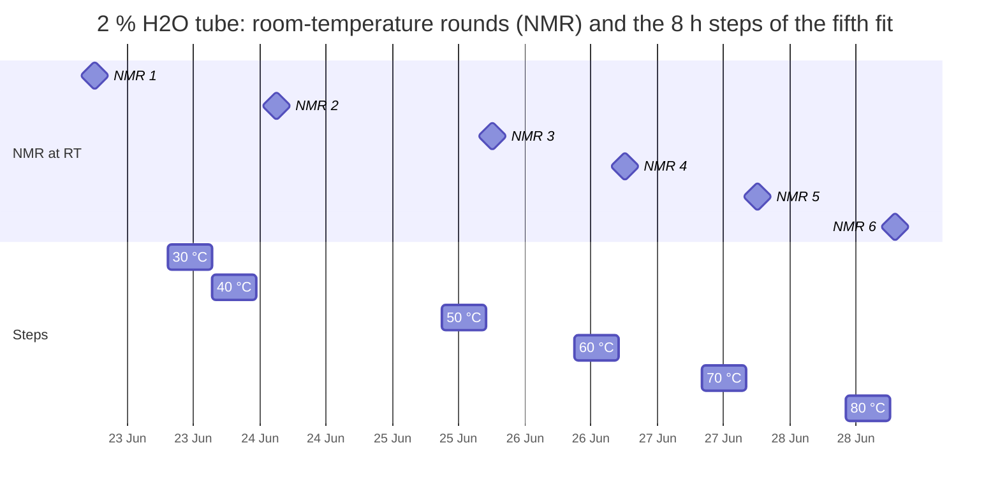

# Fit improvements: the fourth and fifth fits

| | |
|---|---|
| **Status** | Fourth fit: run on 2026-10-19/20, results in `notebooks/results/05_fit4/`. Fifth fit: prepared on 2026-10-20, ready to launch, not launched |
| **Source** | Y. Alcaraz Galván |
| **Scope** | What changes from one fit to the next, why, what each run cannot settle, and how to start it. The third fit is in `plan-fit_improvement.md` |
| **Applies to** | Branch `fit/first-fit`. Fourth fit: commit `b06be37` plus the patch the chain recorded (`code_vs_commit.patch`). Fifth fit: commit `d1125a2` plus the changes listed in `guide-commits.md` |
| **Evidence** | Third and fourth fits (`notebooks/results/05_fit3/`, `05_fit4/`); the raw NMR inventory (`.jdf` headers and file names); P. Broqvist's 2026-10-08 snapshot and `tmspa_reaction_network_model` notebook; Gogoi et al. 2022 (RXN-01) and 2024 (RXN-02) with the SI of RXN-02 |
| **Confidentiality** | Quotes numbers derived from the lab NMR spectra (private repository) |

Words used here, as in `plan-fit_improvement.md`: **age** (time from adding TMSPa, or TMSOH, to a tube's first acquisition; not recorded), **reading** (an assumption about the ages: 1 day, 7 days or free ages), **miss** (standardised residual), **χ²** (sum of squared misses), **step** (a period at a set temperature above room temperature).

---

## 1. Fourth fit: the reaction energies in EC/DEC

### 1.1 Summary

The model structures, the network, the barrier shape, the error model, the observables and the trace rule stay as in the third fit. Three things change:

| # | Change | Why |
|---|---|---|
| C1 | Reaction energies computed in EC/DEC 1:1 by volume: linear mixing (mole fractions 0.645 / 0.355) of the MD solvation in EC (338 K) and in DEC (298 K) of the 2026-10-08 snapshot | The tubes are EC/DEC 1:1; fits 1–3 used neat EC from the 2026-09-24 snapshot |
| C2 | Readings 1 day, 7 days and free ages; the 1 h reading is dropped | It failed in every fit (χ² 767 in the third) |
| C3 | No paper observation; E1 is dropped | Its "1 week" is not in the article text (1.3); leaving it out did not change the third fit (χ² 35.3 either way). The tube "TMSOH, probe" measures the same thing over 5.6 days |

Three sensitivities are added to the night stage: the covariance of the computed energies × 4, and the protocol of the article for the 2 % water tube in two readings (1.4).

### 1.2 What C1 does to the computed energies

ΔG_rxn at 298 K, eV (± standard error of the MD solvation):

| | EC, 2026-09-24 (fits 1–3) | EC/DEC linear, 2026-10-08 (fourth fit) | Third fit, free ages |
|---|---|---|---|
| R1 | −0.47 ± 0.26 | −0.25 ± 0.10 | −0.05 |
| R2 | −0.16 ± 0.25 | −0.18 ± 0.09 | +0.04 |
| R3 | −0.18 ± 0.24 | −0.06 ± 0.08 | +0.07 |
| R4 | +0.10 ± 0.34 | +0.10 ± 0.12 | −0.14 |

- The mixture covers about half of the shift the third fit needed in R1 and R3, none in R2 and R4. The numbers reproduce the table of P. Broqvist's notebook.
- The standard errors are 2.5 times smaller. The freed energies of M3 and M3-split pay (shift / σ)² in χ², so the R1–R4 values of the third fit now cost 9.4 in χ² instead of 4.4 (2.3 with the covariance × 4). The run can fit worse than the third; that would say the computed energies, at their stated precision, do not agree with the spectra.

### 1.3 What the articles fix and what they do not

| Question | RXN-02 (2024) | RXN-01 (2022) | Used how |
|---|---|---|---|
| Age | Not stated: "after the reaction" | Not stated | Readings kept |
| Before TMSPa | 2 vol% water in EC/DEC, stirred 24 h, left ≥ 12 h | Solvent dried, Karl Fischer ≈ 10 ppm | No effect: water does not react with the solvents in the network, and opens EC only from 40 °C |
| Heating | RT → 80 °C in 10 °C steps, 8 h at each, cooled to RT to record; in-situ spectra also recorded | — | Base: the minimum the files prove (18 min); 8 h as sensitivities |
| NMR | Coaxial: sample and DMSO-d6 apart; "qualitative assessment" | Sample mixed into DMSO-d6 (1:4) | Concentrations from the recipe; shares are our own integration |
| TMSOH at RT | "not involved in any recordable side reactions"; no time | — | E1 dropped |
| Purity | BMSPa in pure TMSPa, TMSOTMS traces in TMSPa and TMSOH | TMSPa ≥ 98 %, TMSOH 97.5 % | Trace rule unchanged; its 1 mM level is the realistic one |
| Solvation | MD in EC at 340 K only | — | The 338 K of the snapshot follows the article |

### 1.4 New sensitivities

| Variant | What changes | Reading |
|---|---|---|
| `covariance x4` | σ of the computed energies × 2 | About the gap between linear and preferential mixing (0.18 eV in R1) and the σ of the old snapshot |
| `article 8 h RT` | 2 % tube: 8 h at room temperature before the first spectrum, every heating step 8 h where the clock allows | The room-temperature step of the article |
| `article 8 h RT + 30 C` | The same with an 8 h step at 30 °C before the first spectrum | The first block is named "after 30 °C" and the 30 °C files are a second run |

These are readings of the article and the file names, not records.

### 1.5 Limitations of the run

1. **Ages.** Still unknown for every tube. Free ages remain the base reading; the 2 % tube has only a lower limit (≥ 9.4 h in the third fit).
2. **Solvation is an energy, not a free energy, and the mixture is ideal.** No solvation entropy. Linear mixing ignores preferential solvation; the preferential rule was left out (it depends on absolute solvation energies, which moved 0.2–0.9 eV between the 298 K and 338 K EC runs while the reaction energies agreed). The EC values come from a run at 338 K and are used at every temperature, as before.
3. **Standard errors are statistical only.** σ = 0.08–0.12 eV covers the MD averaging, not the force field, the mixing rule or the missing entropy. The `covariance x2` and `x4` variants show how much the result rests on it.
4. **Water in "TMSPa alone".** The third fit needed about 62 mM (≈ 1000 ppm), against ≈ 10 ppm for a dried solvent in RXN-01. The water parameter absorbs whatever converts TMSPa in that tube (water, a wetter solvent, impurities of the stock).
5. **The 0.5 % tube was made apart.** April 2022, locked on D2O, two unassigned ³¹P lines at −140.1 and −148.9 ppm (S/N 10 and 23 against 540 for TMSPA, outside the windows). Checked 2026-10-19: not PF6⁻ (no line at −144.5 ppm).
6. **Not in the network.** Water opening EC from 40 °C (RXN-02, Metzger 2016) would act only in the heated 2 % tube, whose room-temperature plateau does not move through the ramp.
7. **In-situ spectra are not used.** 1 s delay and NOE on; the article does not quantify them.

### 1.6 How it was started

```bash
tmux new -s fit4 bash notebooks/results/05_fit4/run_chain.sh
```

The first night stopped at the synthetic recovery (case C, seed 1, χ² 82.3 against 69.2 for the truth). Case C's truth was replaced by the fourth fit's free-age answer and every case got the search of the fits (`fit_config.json`, key `recovery`); the chain was restarted on 2026-10-19 at 17:51 and finished on 2026-10-20 at 05:03 (about 14.5 h of computing with 12 workers).

### 1.7 Outcome

- The synthetic recovery passed (no truth outside its 95 % interval).
- M3-split is the only structure that fits, in all three readings: χ² 50.1 (1 day), 50.1 (7 days), 39.7 (free ages); worst miss 2.96, 2.96, 2.14.
- The trace rule rejects every fit: with its parameters unchanged, 1 µM TMSOH at mixing gives a worst miss of 32 (1 day) and 31 (7 days); 1 mM gives 31 in every reading. Fitted again with the trace, 1 µM passes in all three readings and 1 mM only with free ages.
- Fitted ΔG_rxn (1 day): R1 −0.07, R2 +0.02, R3 +0.06, R4 −0.12 eV, that is shifts of +0.18, +0.20, +0.12 and −0.22 eV from the computed values (1.8, 2.2, 1.5 and 1.8 σ). The parameters `dG R1…R4` of the result files are these shifts, not the energies.
- Sensitivities that fail: `floor x0` (1 day and free ages) and `article 8 h RT` (1 day).
- The `ramp held 8 h` sensitivity (`heated_duration_h`) starts each step at its in-situ spectrum and lets it run 8 h, so NMR 3 and NMR 6 fall inside the 50 °C and 80 °C steps. It is not the protocol; the fifth fit replaces it (2.3).

---

## 2. Fifth fit: the heating protocol of the 2 % tube and the full network

### 2.1 Summary

Two changes. Everything else stays as in the fourth fit: structures, solvation medium (EC/DEC linear, 2026-10-08), readings (1 day, 7 days, free ages), error model, trace rule and recovery setup.

| # | Change | Why |
|---|---|---|
| C1 | The 2 % tube is heated **8 h at each step** of the ramp, with the six steps placed on the clock of the files by one rule (2.3) and written as explicit episodes in `fit_config.json` | The bench protocol (RXN-02 Methods) says 8 h per step; the fourth fit used the ~17 min that the in-situ spectra cover. Its 8 h sensitivity placed the steps over two spectra |
| C2 | The network takes **N10–N15** of P. Broqvist's generated network, with **no new free parameter** (2.4) | They are in the database network, so they belong in the model unless something rules them out. Two of them (N12, N15) are further hydrolyses; N15 turns out to be a second, faster start of the same avalanche (2.4) |

The approach behind both: follow the bench protocol (solvent and water stirred 24 h, left 12 h, TMSPa added at t = 0, NMR after an unknown age) and, where the files contradict it, take the reading that needs the fewest events nobody recorded.

### 2.2 Where this comes from

The review of section 2.2.1 of `05_fitting_rev04_(EC_DEC).ipynb` (concentrations in time, 1 day reading) on 2026-10-20 found that its figures run the fourth fit's parameters with 8 h steps placed by a third rule (`heated_hold_h`, which ends a step at the next spectrum when it would cross it). That is a model no fit made: it shows ring-opened EC in the last spectrum of the 2 % tube 2.4 errors above the measurement, and margins between the end of a step and the next spectrum of 0, 0.5, 2 and 0 h. Three different placements of the steps were in use (the fit, its sensitivity, the figures), and none was checked against the file times.

### 2.3 C1: the heating of the 2 % tube

**What each source says.**

| Source | What it says |
|---|---|
| File names and `.jdf` headers | Six room-temperature rounds named "22oC after 3oC … after 8oC", one a day from 22 to 28 June 2022, each followed by a 9.4 h ²⁹Si acquisition; six in-situ rounds at 30–80 °C (~17 min each) in a folder "Ramping Temperature" |
| RXN-02, Methods | 8 h at each temperature before recording; cooled to RT during the recording |
| RXN-02, Results and SI Fig. S2/S3 | Spectra at RT, then "in situ" at 30–80 °C; the ³¹P lines do not change through the ramp |
| Fourth fit | Each step lasts only the time its in-situ spectra cover; no heating before the first room-temperature round |

**Clock of the files** (start of the first acquisition of each round; RT = room temperature):

| Date (2022) | Round |
|---|---|
| 22 Jun 18:04 | RT, "after 3oC" (NMR 1) |
| 23 Jun 10:30 | in situ 30 °C (¹H and ¹³C numbered "-2-1") |
| 23 Jun 15:22 | in situ 40 °C |
| 24 Jun 03:04 | RT, "after 4oC" (NMR 2) |
| 25 Jun 11:22 → 18:03 | in situ 50 °C → RT, "after 5oC" (NMR 3) |
| 26 Jun 09:36 → 18:04 | in situ 60 °C → RT, "after 6oC" (NMR 4) |
| 27 Jun 07:57 → 18:04 | in situ 70 °C → RT, "after 7oC" (NMR 5) |
| 28 Jun 14:08 → 19:03 | in situ 80 °C → RT, "after 8oC" (NMR 6) |

**Where the sources disagree.**

1. NMR 1 is named "after 30 °C", but the only 30 °C spectra are of the next morning, and the tube was at 22 °C in the spectrometer until 03:43 on 23 June (the ²⁹Si of NMR 1). A 30 °C step before NMR 1 would have left no file at all.
2. Steps of 8 h that *end* at their in-situ spectrum do not fit the clock: the 40 °C step would start before the 30 °C spectrum, and the 60 °C and 70 °C steps would overlap the room-temperature ²⁹Si of the night before.
3. The article says both "cooled to RT to record" and "in situ". The files hold both kinds of spectra, so both happened.

**Reading taken.** NMR 1 is the room-temperature spectrum before the ramp (the "RT" trace of SI Fig. S2); "after 3oC" is taken as a slip in the name. The rule for the steps:

- each step lasts **8 h** (article) and **contains its in-situ spectrum** (files);
- it ends **1 h before the next room-temperature acquisition** (cooled to record), or where the next step starts when two steps follow each other with no room-temperature round between (30 → 40 °C);
- if that end would leave the in-situ spectrum before the step, the step starts at the in-situ spectrum instead.

| Step | Placed at (2022) | Hours after the first file (22 Jun 18:04:30) | In-situ spectrum | At RT before the next round |
|---|---|---|---|---|
| 30 °C | 23 Jun 07:23 → 15:23 | 13.302 | 10:30 | — (goes on to 40 °C) |
| 40 °C | 23 Jun 15:23 → 23:23 | 21.302 | 15:22 (starts at it) | 3.7 h |
| 50 °C | 25 Jun 09:04 → 17:04 | 62.989 | 11:22 | 1.0 h |
| 60 °C | 26 Jun 09:04 → 17:04 | 86.996 | 09:36 | 1.0 h |
| 70 °C | 27 Jun 07:58 → 15:58 | 109.888 | 07:57 (starts at it) | 2.1 h |
| 80 °C | 28 Jun 10:04 → 18:04 | 135.987 | 14:08 | 1.0 h |



Every step contains its in-situ spectrum, and none overlaps a room-temperature acquisition (²⁹Si included). The episodes go into `notebooks/results/05_fit5/fit_config.json` (`sample_overrides`), so the data file of the observables, and with it the fourth fit, stay as they are.

**What it moves.** The 30 °C and 40 °C steps change nothing measurable: with the fourth fit's barrier, 8 h at 40 °C open less than 0.1 mM of EC, and the phosphate and silanol equilibria come back on cooling. The 70 °C and 80 °C steps matter: run with the fourth fit's parameters they open about 90 mM of EC (CO₂) and 45 mM of the second ring-opening product, against a ¹³C window that sees almost none. With the fourth fit's 1 day parameters unchanged, the base heating alone takes χ² from 50.1 to 90.7 (worst miss 3.6, ring-opened EC in the last spectrum). The fit will have to raise the solvent-attack barrier or move other values; the misplaced fourth-fit sensitivity gave χ² 50.1 → 59.5 at 1 day after refitting, still fitting, with the R4 shift going from −0.22 to −0.28 eV.

### 2.4 C2: reactions N10–N15

P. Broqvist's notebook builds every atom-balanced step of one or two computed molecules into one or two others. Nine of its fifteen steps are our R1–R9 (same ΔG in EC/DEC linear). The other six are combinations of them:

| Peter | Step | Equals | Class here | Barrier |
|---|---|---|---|---|
| N10 | 2 BMSPA → MMSPA + TMSPA | R2 − R1 | exchange | fixed 1.15 eV |
| N11 | 2 TMSOEG → TMSOH + TMSOdiEG | R9 − R8 | exchange | fixed 1.15 eV |
| N12 | BMSPA + H₂O → H₃PO₄ + HMDSO | R2 + R7 | that of R2 | g of R2 (g_R23 in the split structures) |
| N13 | BMSPA + H₃PO₄ → 2 MMSPA | R2 − R3 | exchange | fixed 1.15 eV |
| N14 | BMSPA + MMSPA → H₃PO₄ + TMSPA | R3 − R1 | exchange | fixed 1.15 eV |
| N15 | TMSPA + H₂O → MMSPA + HMDSO | R1 + R6 | that of R1 | g of R1 (g_R1 in the split structures) |

- **No new species and no new end point.** The reaction energies follow from the species energies, so a combination keeps its exact sum, freed energies included; where R1–R9 are at equilibrium, so are N10–N15. They add routes, not equilibria.
- **Each route needs a barrier, and no measurement fixes one.** P. Broqvist uses 1.15 eV for all six (his class "other": "no data; the v1 value"). With that value N15 would run 10³–10⁷ times faster than our first hydrolysis (ΔG‡ 1.34–1.60 eV) and take over the start of the reaction on a number nobody measured.
- **So no new free parameter.** N15 and N12 are hydrolyses: each takes the barrier of the hydrolysis it starts from (R1 and R2). The four exchanges keep 1.15 eV fixed: at room temperature that is months to years for the amounts in our tubes, so they are present and inert; at 80 °C they only speed the approach to an equilibrium that R1–R9 already set. A direct phosphate-to-phosphate exchange was screened and withdrawn in the third fit (not needed, not found in the literature); here it is kept at that slow, fixed value.
- **They do not avoid the avalanche.** N15 and N12 release HMDSO instead of TMSOH, but their products give TMSOH back at once through R6 and R7 run backwards (transfer barriers of 0.6–0.7 eV). So they are further starts of the same avalanche, not a route around it (checked below).
- **Sensitivity `Peter barriers`**: all six at 1.15 eV, as in his notebook.

**Checked before the run** (the fourth fit's 1 day parameters run forward, one added step at a time):

| Added | χ² (fourth fit: 50.1) | Worst miss | ΔG‡ at 22.5 °C |
|---|---|---|---|
| N10, N11, N13 or N14 | 50.1–50.3 | 2.96 (unchanged) | 1.09–1.22 eV, fixed |
| N12 | 57.8 | −3.0, BMSPA of the 0.5 % tube | 0.93 eV (R2: 0.96) |
| N15 | 2204 | +47, BMSPA of the 0.5 % tube | 1.29 eV (R1: 1.34) |

N15 is the one that matters. With the barrier class of R1, its more negative ΔG gives it a barrier 0.05 eV lower, so it starts the reaction about seven times faster than R1; its products (MMSPA + HMDSO) give TMSOH back at once through R6 run backwards, which feeds the avalanche. The 0.5 % tube, which the fourth fit placed just before its fall, then falls before its spectrum. The fit compensates by raising g_R1 by about 0.05 eV. The fourth fit's 7 day reading already sat at g_R1 = 1.635 eV, so the search box of g_R1 now reaches 1.80 eV instead of 1.70; the other boxes are unchanged.

Neither network has water opening EC (RXN-02 cites it from 40 °C); it stays out, as in the fourth fit (1.5, point 6).

### 2.5 Kept as in the fourth fit, and why

| Point | Decision | Reason |
|---|---|---|
| Age of the 0.5 % tube | Counted to its first acquisition, as for every tube | That acquisition is a 9.4 h ²⁹Si started 18.9 h before the ³¹P and ¹³C. The unknown is the time until the tube first entered the spectrometer. Under the 1 day reading its ³¹P sits at 43 h; figure notes must say so |
| Heating of "TMSOH, probe" | 80 °C for the 9 min the files record | After 8 h at 80 °C the glovebox tube holds about 190 mM of silyl groups in the ring-opened window (TMSOEG); the probe holds 14 and 2 mM after heating, so its time at 80 °C was short |
| Preparation (24 h stirring, 12 h rest) | Not simulated | Nothing in the network reacts before TMSPa or TMSOH is added; the stage is drawn in the figures only |
| Folder names "AFTER 10 DAYS" ("TMSPa alone", A) | Not used | Their second spectra are 10.1 days after the first. If the 10 days count from preparation, the first spectra were taken within hours of mixing, against the 7 day and free readings; the names do not say from when they count |

### 2.6 Sensitivities of the night stage

Kept: `floor x0`, `floor x2`, `covariance x0.5`, `x2`, `x4`, `glovebox 4 h`, `glovebox 16 h`. Dropped: `ramp held 8 h`, `article 8 h RT`, `article 8 h RT + 30 C` (replaced by the base heating). New:

| Variant | What changes |
|---|---|
| `heating as recorded` | The 2 % tube heated only during its in-situ spectra (the fourth fit's base) |
| `30 C before NMR 1` | An extra 8 h at 30 °C ending 1 h before NMR 1 (the other reading of "after 3oC"); cut at mixing when the age is shorter |
| `cooling 3 h` | Every step of the 2 % tube ends at least 3 h before the next room-temperature round instead of 1 h (the 50, 60, 70 and 80 °C steps move 0.9–1.9 h earlier) |
| `Peter barriers` | N10–N15 all at 1.15 eV |

### 2.7 Limitations of the run

1. **The steps are a reading.** 8 h comes from the article, the 1 h cooling is declared, and NMR 1 as the room-temperature reference rests on the SI and on the absence of any 30 °C file before it. `heating as recorded`, `30 C before NMR 1` and `cooling 3 h` bound the choice. The cooling is not neutral: after a fast cool-down the ³¹P shares relax for about 2 h, and with the fourth fit's 1 day parameters χ² is 154, 91 and 76 for 0, 1 and 3 h at room temperature before the round.
2. **N12 and N15 share barriers by assumption.** The data cannot tell N15 from R1: both start TMSPa hydrolysis. The fitted g_R1 is now the barrier of both routes, and it will be about 0.05 eV higher than in the fourth fit for that reason alone; the two values are not comparable one to one.
3. Points 1–7 of 1.5 still hold, except that the heated 2 % tube now spends 48 h above room temperature.

### 2.8 How to start it

```bash
tmux new -s fit5 bash notebooks/results/05_fit5/run_chain.sh
```

The laptop must stay on its charger: on external power closing the lid does not suspend it and GNOME does not suspend it when idle. The chain runs 14 workers (12 in the fourth fit; 16 threads on 4 performance and 8 efficiency cores, two left free). Each worker takes about 100 MB.

The fourth fit's chain took about 14.5 h with 12 workers. Over the search box one evaluation costs 10–20 % more than in the fourth fit (the 8 h steps about 5 %, the six added steps the rest; details in `guide-commits.md`), the two extra workers save a little, and `cooling 3 h` adds two short fits, so the fifth chain should take about 15–16 h (14–18 h): started at 19:00, it ends the next morning around 10:00–11:00. A failed recovery check stops it at the night stage, as in the fourth fit. The chain writes `provenance.txt` and `code_vs_commit.patch` when it starts and stops at the first failed stage; `run.log` says where it is. Do not edit `kinetics/` or `scripts/run_fit.py` while it runs.

Afterwards, in this order: `fits_summary.csv` (does M3-split still fit, and with which reading), `sensitivities.csv` (`heating as recorded`, `30 C before NMR 1`, `Peter barriers`), `trace_verdict.csv`, `intervals.csv`. A notebook reads the run after `apply_fit_config('notebooks/results/05_fit5')`, which also sets the heating of the 2 % tube and the network.
