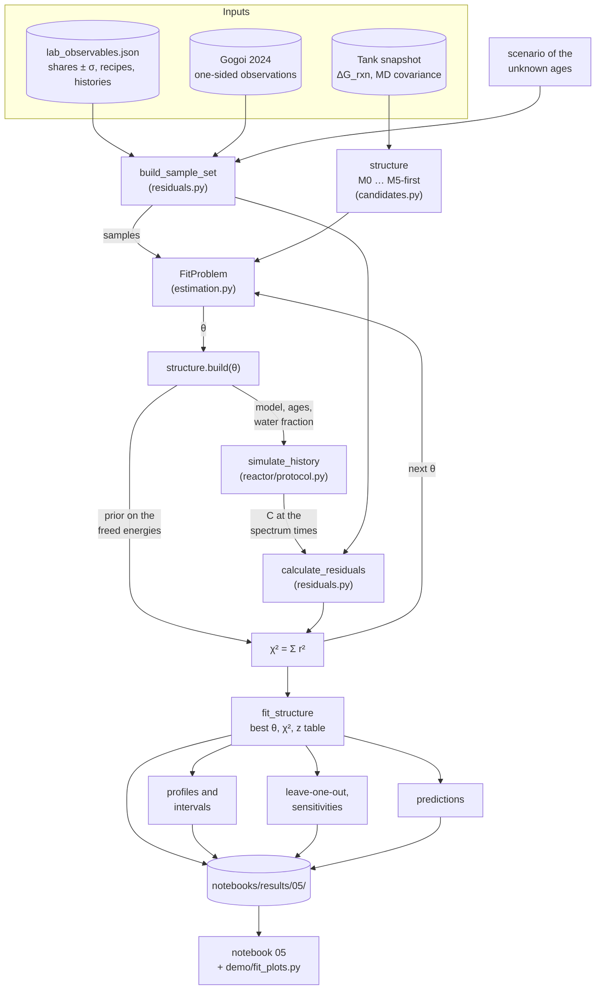
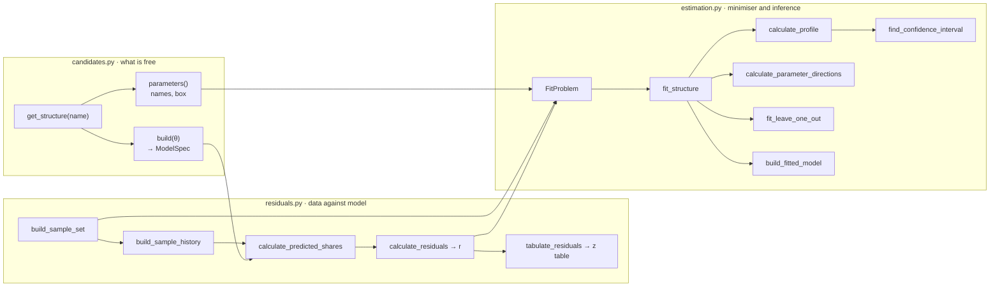
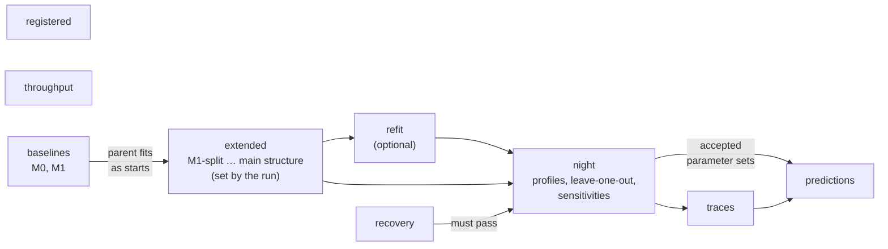
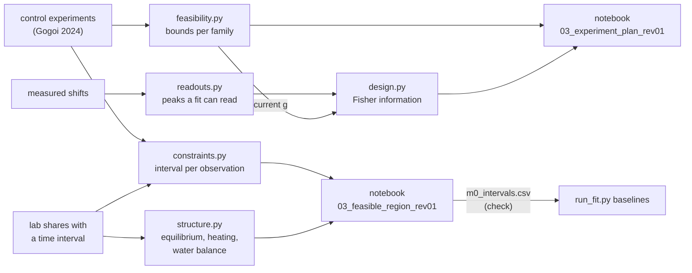

# Fitting system: how a fit runs, from the data to the result files

| | |
|---|---|
| **Status** | Draft |
| **Source** | Y. Alcaraz Galván |
| **Scope** | The fit of the kinetic models to the lab NMR data as one system: what is compared with what, what is minimised, which files take part, the stages of the runner and the files they write. Read from the code; no fit was run to write it. |
| **Applies to** | Branch `fit/first-fit`, revised 2026-10-22 (section 11: branch `fit/near-zero-ages`). Sections 1–7 describe the system as it stands; sections 8 to 11 list what the third, fifth, sixth and seventh fits changed |
| **See also** | [reference-models_summary.md](reference-models_summary.md) for the equations and free parameters of each model; [MODULES.md](../MODULES.md) §7 for every function with its input and output |

The work on the data has two parts, and they share the same models and reactors:

- **Before the fit** (notebook 03): which barriers the observations allow, and what to measure next. Section 6.
- **The fit** (notebook 05): the lab shares against candidate models. Sections 1 to 5.

## 1. Overall scheme



Read it as a loop. The minimiser proposes a parameter set θ. The structure turns θ into a model. The reactor simulates every sample with that model. The predicted shares are compared with the measured ones. The sum of squared residuals goes back to the minimiser.

## 2. What is fitted: definitions

### 2.1 Data side

| Term | Meaning | Where |
|---|---|---|
| **Sample** | One NMR tube: a composition at mixing, a temperature history, one or more spectra | `build_sample_set` |
| **Block** | The spectra of one nucleus of a sample. A tube recorded on ³¹P and ¹³C has two blocks; they share composition, history and age and are read off one simulation | `residuals.py` |
| **Share** | Fraction of the total peak area in one ppm window of one spectrum. The quantity the fit compares | `lab_observables.json` |
| **Role** | `fit` (enters χ²), `hold_out` (predicted afterwards, never fitted), `check` (a consistency check) | per block, in the observables file |
| **Age** | Time from mixing to a sample's first spectrum. Not recorded for any sample | scenario |
| **Paper observation** | A one-sided limit from Gogoi 2024 (E1) added to the lab samples. Its residual is zero inside the limit | `PAPER_OBSERVATIONS` |

### 2.2 The unknown ages: scenarios

Every result is computed under one scenario, because the ages are not known.

| Scenario | Every unknown age is |
|---|---|
| `short` | 1 h |
| `middle` | 1 day |
| `long` | 7 days |
| `free` | Between 1 h and 30 days. The age of the heated 2 % water sample is a fit parameter (`log10 age 2 % H2O`). The age of each unheated sample is the value that favours the model, found inside every evaluation |
| `0 min`, `5 min`, `10 min` | 0, 5 or 10 minutes: TMSPA added just before the first acquisition (seventh fit). Only a run whose `fit_config.json` lists them uses them; a folder without the file keeps the four above |

### 2.3 The error of a share

| Part | What it is |
|---|---|
| Noise | White noise of the spectrum, propagated to the share |
| Baseline spread | Half the spread of the share between three baselines |
| Floor | A declared minimum error |

The three add in quadrature. Repeated room-temperature spectra of one block count as one composition plus n − 1 measurements of "no drift": baseline and floor are common to them, the noise is independent. The K shares of a spectrum sum to one, so their residuals are scaled by √((K − 1)/K).

### 2.4 The objective

```
z   = (predicted share − measured share) / σ          one per measured quantity
χ²  = Σ z²  +  dᵀ · Σ_MD⁻¹ · d                         d = freed reaction energies (M3 and M5 models only)
```

A sample whose simulation fails contributes a fixed penalty for each of its values, so the minimiser moves away from that region.

### 2.5 The parameter vector θ

In this order, each with a declared search box:

| Parameters | Present in | Box |
|---|---|---|
| `g <family>` intrinsic barriers | every structure | 0.60–1.70 eV, narrower for some families; 0.80–1.80 eV for the first hydrolysis (fifth fit); 0.60–1.50 eV for `transfer_R5` and `transfer_R67` (sixth fit). The class `exchange` (N10, N11, N13, N14) is fixed at 1.15 eV, not fitted |
| `dG R1` … `dG R4` shifts of the reaction energies | M3 and M5 models | ±0.75 eV around the computed value, or ±k standard errors when the run sets `energy_box_sigma` (sixth fit: k = 3) |
| `dG R8`, `dG R9` | M5 models | as above |
| `water fraction` | names ending in `+W` | 0.05–1 |
| `c0 H2O TMSPa alone` | a sample with `unknown_M` (third to fifth fit; the sixth declares it instead) | 0–0.3 M |
| `log10 age 2 % H2O` | `free` scenario | 1 h to 30 days |

### 2.5a Model names

`MX-suffix`. X says which reaction energies are free: M0 and M1 none, M3 those of R1–R4, M5 those of every independent reaction (R1–R4, R8, R9). The suffix says how the barriers are grouped: none, one per family (M0: one for all); `-split`, R1 apart from R2 and R3; `-first`, the first step of TMSPA apart in every family (R1 with N15 in hydrolysis, R5 in transfer). `+W` adds the available-water fraction (M4 of notebook 03, hence no M4). `+BEP` replaces Marcus by P. Broqvist's barrier rule (capped BEP with α = 1; seventh fit). The models are listed in [reference-models_summary.md](reference-models_summary.md) §2.

### 2.6 Rules fixed before any fit

- **Fit rule.** A structure fits a scenario if no |z| exceeds 3. The pull of each freed energy counts as a residual.
- **Selection rule.** The first consistent parameter set is that of the smallest structure that fits and passes the trace rule, free ages before a common age (third fit on; the first two fits took the common age first).
- **Interval.** The range of a parameter over which its profile stays within Δχ² = 3.84 of the minimum. A side the data do not close stays open.
- **Two tolerances.** The search uses a loose solver tolerance (rtol 10⁻⁶); every reported χ², table and final polish uses rtol 10⁻⁸.

### 2.7 The measured spectrum in the plots

The spectra drawn against a fit (`plot_spectra_comparison`) are the raw lab spectra, processed only so that they can be compared with a model. They are not used by the fit, which sees only the shares.

| Step | What is done | Where |
|---|---|---|
| Load | The `.jdf` file is read. A raw signal (FID) is Fourier-transformed and phased automatically; a spectrum already processed on the spectrometer keeps its phase. The zero-order phase is then refined for the region drawn | `load_spectrum` |
| Cut and baseline | The spectrum is cut to the region of the windows. A cubic polynomial fitted to the points outside every window (± 0.3 ppm) is subtracted | `load_measured_spectra` |
| Normalise | The intensity is divided by the summed area of the windows: the total area is 1, so the area of each window is close to its share | `load_measured_spectra` |
| Smooth for display | Convolution with a unit-area Gaussian of 0.4 ppm FWHM (³¹P) or 0.06 ppm (¹³C), which keeps the areas, and scaling so that a line holding the whole area has height 1. The height of a line is then close to its share | `plot_spectra_comparison` |

The numbers printed over a window are the shares of the fit: the median over three baselines (§2.3). The curve uses only the cubic one, so a small difference between curve and number is possible where the baseline matters.

The model predicts areas, not line shapes. Each simulated line takes the position and the width at half height of the measured line in its window. If the window holds no line higher than 6 times the noise, it takes the centre of the window and the display width.

## 3. The fit core, in call order



| File | Role | Entry points |
|---|---|---|
| [candidates.py](../kinetics/fitting/candidates.py) | Declares the structures (nine, M0-BEP to M5-first, each also with `+W` or `+BEP`) and their search boxes. Turns θ into a self-contained model: own network (when a family is split) and own species shifts (when energies are freed) | `get_structure`, `FitStructure.parameters`, `FitStructure.build`, `embed_parent_theta`, `build_fitted_model` |
| [residuals.py](../kinetics/fitting/residuals.py) | Builds the sample set of a scenario, simulates each sample and whitens the difference with the error model | `build_sample_set`, `calculate_residuals`, `tabulate_residuals`, `find_free_age` |
| [estimation.py](../kinetics/fitting/estimation.py) | Holds the problem (structure + samples), searches the box, and then asks what the data determine | `FitProblem`, `fit_structure`, `calculate_profile`, `find_confidence_interval`, `calculate_parameter_directions`, `fit_leave_one_out`, `compare_structures` |

**How `fit_structure` searches.** A Sobol screen of the box at the loose tolerance. Bounded least squares from the best screen points, plus any starting points given (the fit of the smaller structure this one extends, mapped by `embed_parent_theta`). A final polish at the report tolerance. The result keeps the other local optima it found and the parameters that ended at a bound.

**How an interval is found.** `calculate_profile` fixes one parameter at each value of a grid and re-minimises the others. `extend_profile` repeats this from other local optima, so a second basin is not missed. `refine_profile_edges` adds points where the interval ends. `find_confidence_interval` reads the interval off the profile.

**Layers the core calls.** One evaluation goes through [reactor/protocol.py](../kinetics/reactor/protocol.py) (`simulate_history`), [reactor/engine.py](../kinetics/reactor/engine.py), [microkinetics/models.py](../kinetics/microkinetics/models.py) and [rates.py](../kinetics/microkinetics/rates.py), and, for freed energies, [thermo/uncertainty.py](../kinetics/thermo/uncertainty.py). They are described in [MODULES.md](../MODULES.md) §3 to §5.

## 4. The runner and its stages

[scripts/run_fit.py](../scripts/run_fit.py) runs one stage per call. Every job writes one file under the results folder and is skipped when that file exists, so a stage can be interrupted and started again. A new fit needs a new folder (`--results`): in a folder that holds results, the old fits are returned as they are.



| Stage | Does | Reads | Writes |
|---|---|---|---|
| `registered` | Evaluates the four registered models as they are, in the four scenarios | `lab_observables.json` | `registered.csv`, `registered_residuals.csv` |
| `throughput` | Measures evaluations per second, to size the long stages | — | `throughput.csv` |
| `recovery` | Refits synthetic data generated from known parameters, with the design and error model of the lab set. The check of the pipeline | — | `recovery/<case>_seed<n>.json`, `recovery_summary.csv` |
| `baselines` | Fits M0-BEP, M0-Marcus and M1 in the four scenarios | `lab_observables.json` | `fits/<structure>__<scenario>.json`, the four `fits_*.csv` tables |
| `extended` | Fits the extended structures (default M1-split, M3, M3-split; sixth fit M1-split, M3-split, M3-first, M5-first; seventh fit M1, M5, M5-first and their `+BEP` forms), each in every reading or in those the setup lists (`structures.readings`), starting from the fits of the smaller structures and, if the setup names one, from the fits of an earlier run. `--structures` limits one call to some of them | `fits/` of `baselines` | The fit files of those structures, the `fits_*.csv` tables again |
| `refit` | Re-checks M3 and M3-split at a tighter search tolerance. It repaired a solver setting of the first run; a new run can skip it | `fits/`, `profiles/` | Fits kept or replaced; a replaced one moves to `fits_first_pass/` |
| `night` | Profiles and intervals, leave-one-sample-out, structures the data cannot tell apart, sensitivity to the declared errors and times, all on the main structure (default M3-split). Runs `recovery` first and stops if it fails. The setup can limit it (`night`: which structures and readings are profiled, only where they fit; indistinguishability, tolerance check, trace refits off) | `fits/` | `profiles/`, `loo/`, tagged fits in `fits/`, `intervals.csv`, `barrier_bands.csv`, `leave_one_out.csv`, `indistinguishability.csv`, `sensitivities.csv`, `tolerance_check.csv`. A fit replaced by a lower profile minimum moves to `fits_before_profiles/` |
| `traces` | Tests a trace of TMSOH at mixing (0 to 1 mM) in the three tubes with TMSPA and no TMSOH: as fitted, and fitted again (the refit can be turned off) | `fits/` | `trace_sensitivity.csv`, `fits/<main structure>__<scenario>__TMSOH_<level>.json` |
| `predictions` | Hold-out samples, checks against samples and paper observations the fit did not use, storage at 25 °C, the bench protocol with its ΔS‡ band | `fits/`, `profiles/`, the trace refits | `hold_out.csv`, `check_tmspa_alone.csv`, `check_paper.csv`, `prediction_storage.csv`, `prediction_storage_traces.csv`, `prediction_protocol.csv`, `sample_trajectories.csv` |

Helpers of the runner worth knowing:

- `run_one` and `run_structure` run one cached fit and add the starts from the parent structures.
- `fit_tmsoh_block` fits condensation and solvent attack from the TMSOH-only samples first, to seed the screen.
- `select_consistent` applies the selection rule of section 2.6.
- `summarize_fits` writes `fits_summary.csv` and its companions.

## 5. Result files

All under the results folder (`notebooks/results/05/` by default).

| File or folder | Holds | Written by |
|---|---|---|
| `fits/<structure>__<scenario>[__tag].json` | One fit: θ, χ², z table, ages, local optima, barriers per reaction | `baselines`, `extended`, `night`, `traces` |
| `fits_summary.csv`, `fits_parameters.csv`, `fits_residuals.csv`, `fits_barriers.csv` | The main fits side by side: χ² and the fit rule; θ; every z; ΔG‡ per reaction | `summarize_fits` |
| `profiles/<structure>__<scenario>.json` | Profiles, intervals and the parameter combinations the data see | `night` |
| `intervals.csv`, `barrier_bands.csv` | The intervals as flat tables | `night` |
| `loo/<structure>__<scenario>.json`, `leave_one_out.csv` | The fit without each sample in turn | `night` |
| `indistinguishability.csv`, `sensitivities.csv`, `tolerance_check.csv` | Structures the data cannot separate; effect of the declared errors and times; effect of the solver tolerance | `night` |
| `recovery/`, `recovery_summary.csv` | The synthetic-data check | `recovery` |
| `registered.csv`, `registered_residuals.csv` | The registered models without fitting | `registered` |
| `trace_sensitivity.csv` | Effect of a trace of TMSOH | `traces` |
| `hold_out.csv`, `check_*.csv`, `prediction_*.csv`, `sample_trajectories.csv` | Predictions and checks on data the fit did not use | `predictions` |
| `run.log` | One line per job, with the fit rule verdict | every stage |

A fit result is turned into a model with `build_fitted_model(load_fit_result(path))`. The model is built at run time and is not written into the registry.

## 6. Before the fit

These modules do not minimise anything. They turn windowed observations into bounds and compare candidate experiments.



| File | Question it answers | Output | Notebook |
|---|---|---|---|
| [feasibility.py](../kinetics/fitting/feasibility.py) | Which family barriers do the control experiments allow? | Bounds `g ≥` or `g ≤` per family, also in the (ΔS‡, g) plane | `03_experiment_plan_rev01` |
| [readouts.py](../kinetics/fitting/readouts.py) | Which NMR peaks can a fit integrate? | Species and nuclei per measured peak | `03_experiment_plan_rev01` |
| [design.py](../kinetics/fitting/design.py) | What would a candidate experiment determine? | σ per parameter and experiment, from the Fisher information | `03_experiment_plan_rev01` |
| [constraints.py](../kinetics/fitting/constraints.py) | Which barrier values does each observation allow, when its time is only known as an interval? | Allowed interval per observation, and their intersection | `03_feasible_region_rev01` |
| [structure.py](../kinetics/fitting/structure.py) | What does a measurement imply whatever the barriers are? | Equilibrium locus, room-temperature equivalent of a heating, water needed | `03_feasible_region_rev01` |

Both notebooks write their tables to `notebooks/results/03/`.

## 7. Things to know when reading the code

- **Two words with two meanings.** A *structure* in `candidates.py` is a candidate model (`FitStructure`); `structure.py` holds tests of the model structure and is not used by the fit. *Observables* in `data/observables.py` are the lab shares; `reactor/observables.py` holds half-lives and tables of a run.
- **Stage names.** `night` and `refit` are named after how the first run was done, not after what they compute: `night` is the inference stage, `refit` a repair.
- **Search effort.** `EFFORT` in `run_fit.py` sets the size of the screen per structure; a setup can change it per structure or per structure and reading (`effort`, keys `structure` or `structure|scenario`). The first and the second fit use different values, so a results folder is only reproduced with the effort it was run with (each fit folder records its code state, and from the sixth fit its setup holds the effort).
- **Tests.** [test_estimation.py](../tests/test_estimation.py) covers the fit core, [test_fitting.py](../tests/test_fitting.py) the modules of section 6, [test_observables.py](../tests/test_observables.py) the observables file. They use [tests/synthetic_observables.py](../tests/synthetic_observables.py), so none needs the lab data.

## 8. Changes of the third fit (2026-10-07)

Reasons and limits are in [plan-fit_improvement.md](plan-fit_improvement.md). What changed in the system:

| Where | Change |
|---|---|
| [observables.py](../kinetics/data/observables.py) | "TMSPa alone" has role `fit` and `unknown_M = {'H2O': (0, 0.3)}`: the range in M a fit may give its water |
| [residuals.py](../kinetics/fitting/residuals.py) | A sample carries `unknown_M`. `calculate_residuals`, `tabulate_residuals`, `find_free_age` and `calculate_predicted_shares` take `added_M`: amounts at mixing on top of the recipe |
| [candidates.py](../kinetics/fitting/candidates.py) | New parameter kind `recipe`: `c0 H2O TMSPa alone` [M], added from the sample set like an age. `build` returns `added_M` |
| [estimation.py](../kinetics/fitting/estimation.py) | `FitProblem` and `simulate_synthetic_shares` pass `added_M`. A `recipe` parameter is profiled on multiples of its best value |
| [run_fit.py](../scripts/run_fit.py) | `select_consistent`: free ages first, and a fit rejected by the trace rule is skipped. `tabulate_trace_verdicts` writes `trace_verdict.csv`. Recovery case C (free ages, water unknown). Leave-one-out includes the tube. `registered` leaves the tube out |

- **Parameter vector.** Barriers, then `dG R1…R4`, `water fraction`, `c0 H2O TMSPa alone`, `log10 age <sample>`.
- **Values.** The lab sample set has 85 values (77 in the second fit): the tube adds two spectra of four shares.
- **Trace rule.** A fit is accepted only if its parameters, unchanged, still fit with 1 µM and with 1 mM TMSOH at mixing in the tubes whose recipe holds TMSPA and no TMSOH.
- **Earlier fits.** A fit made before these changes is reproduced by building the sample set with `exclude=('TMSPa alone',)`. The observables file of the second fit is kept in the data folder as `lab_observables_second_fit_261006.json`.

## 9. Changes of the fifth fit (2026-10-20)

Reasons and limits are in [reference-fitting_improvements.md](reference-fitting_improvements.md) §2; the list of changes against the commit before them is in [guide-commits.md](guide-commits.md). What changed in the system:

| Where | Change |
|---|---|
| [network.py](../kinetics/data/network.py) | `EXTRA_REACTIONS` N10–N15 and three variants (`R1-R9`, `R1-R9+N10-N15`, `R1-R9+N10-N15, Peter barriers`); the active one is set per run, like the solvation medium (`set_active_network_variant`) |
| [candidates.py](../kinetics/fitting/candidates.py) | A structure takes the active network. A step that `follows` a reaction takes that reaction's barrier class (N12 → R2, N15 → R1); the class `exchange` has the fixed barrier of `FIXED_BARRIERS_EV` (1.15 eV). No new parameter. The box of `g hydrolysis_R1` reaches 1.80 eV |
| [residuals.py](../kinetics/fitting/residuals.py) | Run-wide changes to the samples (`set_sample_overrides`), with the overrides of each call on top (`merge_sample_overrides`). New override keys: `heated_episodes` (explicit heating steps, replacing the recorded ones; `None` keeps them), `added_episodes` and `cooling_h` (at least that many hours at room temperature before every spectrum; a step that ends later is moved earlier). A step before the first spectrum lies inside the age and is cut at mixing |
| [config.py](../kinetics/fitting/config.py) | `fit_config.json` keys `network`, `sample_overrides` and `sensitivities`; `apply_fit_config` sets the network and the changes to the samples; `check_fit_setup` refuses to run a fit forward with another network or other run-wide changes |
| [reporting.py](../kinetics/fitting/reporting.py) | `evaluate_fit` and `calculate_parameter_correlation` call `check_fit_setup` |
| [run_fit.py](../scripts/run_fit.py) | Every fit records `network`, `sample_overrides` (the run's) and `variant_overrides` (its variant's). New sensitivities `heating as recorded`, `30 C before NMR 1`, `cooling 3 h`, `Peter barriers` (a variant may name its own network); the setup chooses which run (`None`: those of the fourth fit) |

- **Earlier fits.** A results folder without the new keys runs as before: R1–R9, the recorded heating, the fourth fit's sensitivities. With its own setup the fourth fit is reproduced exactly (χ² 50.1352 at 1 day, 39.6541 with free ages).
- **Speed.** One evaluation of the lab set at 1 day takes 0.79 s with fifteen reactions against 0.61 s with nine (search solver, one process).

## 10. Changes of the sixth fit (2026-10-22, not run yet)

Reasons, decisions and limits are in [reference-fit_results.md](reference-fit_results.md) §6.3; the list of changes is in [guide-commits.md](guide-commits.md). What changed in the system:

| Where | Change |
|---|---|
| [candidates.py](../kinetics/fitting/candidates.py) | Structures `M3-first` and `M5-first` (§2.5a): classes `transfer_R5` and `transfer_R67`, freed energies of R8 and R9 in M5. Run-wide energy box of ±k standard errors (`set_energy_box_sigma`); the Gaussian constraint stays inside it |
| [residuals.py](../kinetics/fitting/residuals.py) | Override key `unknown_M`: replaces the amounts at mixing that are fit parameters (`{}`: none). With `added_M` it declares the water of "TMSPa alone" |
| [config.py](../kinetics/fitting/config.py) | `fit_config.json` keys `energy_box_sigma` (set by `apply_fit_config`), and for the runner `structures` (`main`, `extended`, and `readings`: the readings of a structure when not all), `effort`, `start_from` (an earlier results folder), `night` |
| [run_fit.py](../scripts/run_fit.py) | Main and extended structures from the setup, each in all readings or in the listed ones (`READINGS`); search effort per structure or per structure and reading; the fits of an earlier run embedded as extra starts (`earlier_run_starts`: starting points only, they bound nothing); night parts optional; recovery cases replaceable (`recovery.cases`); sensitivity `water free`. Every fit records `energy_box_sigma` |

- **Earlier fits.** A results folder without the new keys runs as before.
- **Speed.** One evaluation of the lab set takes 0.74 s at 1 day and 0.94 s with free ages for M5-first (twelve and thirteen parameters).
- **The sixth fit's setup** (`notebooks/results/05_fit6/fit_config.json`): main structure M5-first in the readings 1 h, 1 day and free ages; M3-first and M3-split at 1 day and free ages; M3 left out; two recovery cases of M5-first (free ages, 1 day). Why each model is or is not fitted: [reference-fit_results.md](reference-fit_results.md) §6.3.12. `start_when_plugged.sh` in that folder waits for mains power, runs every stage on a tiny search in `/tmp/fit6_smoke` and starts `run_chain.sh` only if they all pass.

## 11. Changes of the seventh fit (2026-10-22, not run yet)

The decisions are in the meeting notes of 2026-10-22 ("Simple M1 fit at near-zero ages") and the `why` list of `notebooks/results/05_fit7/fit_config.json`; the list of changes is in [guide-commits.md](guide-commits.md). Everything is opt-in: a run that does not list the new readings or structures runs as before.

| Where | Change |
|---|---|
| [residuals.py](../kinetics/fitting/residuals.py) | Readings `0 min`, `5 min`, `10 min` (§2.2). `DEFAULT_SCENARIOS`: the four readings of a folder without `fit_config.json` |
| [config.py](../kinetics/fitting/config.py) | The default setup takes `DEFAULT_SCENARIOS`, so the new readings never enter a run by default |
| [candidates.py](../kinetics/fitting/candidates.py) | Structure `M5` (the barriers of M1, the energies of M5-first): M1 ⊂ M5 ⊂ M5-first. Suffix `+BEP` (`with_peter_bep`): capped BEP with α = 1 in every class, exchange steps included; a structure can carry shape parameters (`shape_params`) |
| [run_fit.py](../scripts/run_fit.py) | `M5` and the `+BEP` forms in the nesting (`PARENTS`); a `+BEP` fit also starts from its Marcus form. The near-zero readings run first (`SCENARIO_ORDER`) and count as a common age in the selection rule. The summary tables hold every structure of the run. The night, traces and predictions stages analyse every structure of `night.structures` (`ANALYSED`; default the main structure), with new `night` keys: `refined`, `loo_fitting_only`, `loo_effort`, `sensitivity_readings`, `tolerance_check` as `{structure: [reading, [two parameters]]}`, `recovery_required`. A recovery case can take the run's own fit as truth (`"truth": "fit"`, kept in `recovery/<case>_truth.json`). Covariance sensitivities are skipped for a structure without freed energies. `trace_sensitivity.csv`, `sensitivities.csv` and `tolerance_check.csv` gain a `structure` column; `sample_trajectories.csv` starts at 36 s and adds "TMSPa alone" and tube A. `--structures` limits one call of extended, recovery, night, traces and predictions to some structures |

- **Earlier fits.** With none of the new keys, every stage does what it did; the readings a run does not have are skipped instead of raising (the sixth fit's smoke run stopped on that, `KeyError: ('M5-first', 'free')`).
- **Speed.** One evaluation of the lab set at 0 min takes about 0.2 s for M1 and M1+BEP (search solver, one process).
- **The seventh fit's setup** (`notebooks/results/05_fit7/fit_config.json`): M1, M5 and M5-first, each with Marcus and `+BEP`, in the readings 0, 5 and 10 min (18 fits); the rest of the setup as in the sixth fit. Every structure is analysed: recovery with its own fit as truth, profiles, leave-one-out and ten sensitivities in every reading, solver tolerance at 0 min, traces and predictions. `run_chain.sh` runs every stage for M1 and M1+BEP first (phase 1; `run_chain.sh M1` stops there), then for the rest (phase 2), from the worktree of branch `fit/near-zero-ages`.
