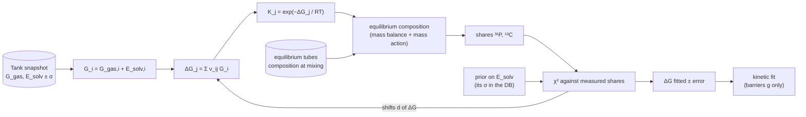

# Thermodynamic fit: reaction energies from the equilibrium data

| | |
|---|---|
| **Status** | Draft, 2026-10-28. Nothing in this document is programmed yet |
| **Source** | Y. Alcaraz Galván |
| **Scope** | How the reaction energies ΔG_rxn are fitted to the tubes whose reaction has finished, before and apart from the kinetic fit: the model (how ΔG, K and the equilibrium composition are computed), what is free (E_solv with or without its error), the data, the objective, and the hand-over to the kinetic fit. It is the specification for the code |
| **See also** | [reference-fitting_system.md](reference-fitting_system.md) (the kinetic fit this one precedes), [reference-models_summary.md](reference-models_summary.md) (M3/M5 free the same energies inside the kinetic fit), [MODULES.md](../MODULES.md) §3 (thermo) |

## 1. The idea

The data are of two kinds, and they do not need each other:

- **Equilibrium**: the tubes whose reaction has finished. The composition no longer changes, so *when* the first NMR was taken does not matter, and neither do the barriers. Only K = exp(−ΔG/RT) matters.
- **Reaction**: the few tubes caught while changing (0.5 % water, TMSPa alone at its first spectrum, the TMSOH tubes). Their ages are unknown and they depend on ΔG and on the barriers.

So the energies are fitted first, from the equilibrium tubes alone, with an algebraic model (no reactor, no ages). The kinetic fit then fits only the barriers.



## 2. The model

### 2.1 Free energy of a species and of a reaction

Each species has a stored gas-phase Gibbs energy (ωB97M-V, 298.15 K, RRHO) and a solvation energy from MD (`dE_solv_eV`; an energy, not a free energy):

```
G_i    = G_gas,i + E_solv,i                         (kinetics/thermo/solution.py)
ΔG_j   = Σ_i ν_ij · G_i        (ν > 0 products, < 0 reactants)
K_j    = exp(−ΔG_j / RT)
```

- Every reaction of the network is 2 → 2, so the shift from the 1 bar gas to the 1 M solution cancels and is not applied.
- Concentrations are in mol/L with a 1 M standard state, no activity coefficients, and EC enters as a concentration (7.1 M at mixing). This is the convention of the reactor (`k_r = k_f / K`), and the equilibrium solver must use the same one, or the two fits disagree.
- The reactions are not independent. The network has 11 species and its stoichiometric matrix S has rank 6, so six ΔG fix all the others (Wegscheider). For the equilibria that matters here: **R1–R4**, and R5 = R1 + R4, R6 = R2 + R4, R7 = R3 + R4. R8 and R9 (EC ring opening, CO₂ is produced) are not known to reach equilibrium in any tube; they keep their computed values.

### 2.2 Temperature

All equilibrium spectra were taken at 22–23 °C. The stored energies are for 298.15 K, and from the stored enthalpies the change of K over those 3 K is at most 3 % (R1–R4), so the fit uses ΔG(298.15 K) as it is. Keep in mind for the hand-over:

- In the code today (`thermo_mode='wb97mv'`) ΔG does not change with T, so K(80 °C) differs from K(25 °C) only through RT.
- Using the stored H and G (ΔG(T) = ΔH − T·ΔS) would move ΔG at 80 °C by −4.4, −3.4, −1.9, +2.9 kJ/mol for R1–R4. The entropy comes from gas-phase RRHO, and E_solv has none. Equilibria at one temperature cannot tell which part of a fitted shift is enthalpy and which entropy: the shifts are treated as temperature independent.

### 2.3 Equilibrium composition of a closed tube

Unknowns: the extents ξ_j of R1–R4 (the independent reactions of the species present). With c0 the composition at mixing:

```
C = c0 + S · ξ                                   mass balance
ln K_j = Σ_i ν_ij · ln C_i        j = R1…R4     mass action
```

Solved by Newton on ξ (in ln C, so that C > 0 always). TMSPA is far below detection at equilibrium in any wet tube, which a solver must handle without dividing by zero. It costs microseconds to milliseconds, against seconds for a reactor simulation: profiles and sampling of the posterior become cheap.

The check of the solver: the reactor run long enough (all sample histories at their temperature) must end at the same composition.

### 2.4 What is compared

The shares of the kinetic fit, unchanged (`SHARE_SPECIES` in [residuals.py](../kinetics/fitting/residuals.py)):

```
³¹P   share_k = C_k / (C_TMSPA + C_BMSPA + C_MMSPA + C_H3PO4)
¹³C   share_k = n_k C_k / Σ n C,   n = silyl groups per molecule (HMDSO 2; P-silyl: TMSPA 3, BMSPA 2, MMSPA 1)
z     = (predicted − measured) / σ,    errors and whitening as in reference-fitting_system §2.3
```

## 3. What is free: E_solv

Only differences of species energies appear in ΔG, so a shift δ_i of E_solv,i moves a reaction by

```
d = Sᵀ δ        d_j = Σ_i ν_ij δ_i          ΔG_j = ΔG_j,computed + d_j
```

Of the 11 shifts δ_i only six combinations act (rank S = 6) and the equilibria can see four. **The unknowns of the fit are therefore d = (d_R1 … d_R4)**, not the 11 δ_i: the rest has no effect. When the reactor needs species energies, the smallest δ that gives d is used (`calculate_species_shifts`, already in the code), which keeps every Wegscheider cycle closed.

Two ways to treat them:

| | **A. Free** | **B. With its error** |
|---|---|---|
| Statement | E_solv is unknown; the data decide | E_solv is the DB value with the standard error of the DB; the data pull it |
| Objective | χ²_A(d) = Σ z² | χ²_B(d) = Σ z² + dᵀ Σ⁻¹ d |
| Prior | none | δ_i ~ N(0, σ_i²) |
| Gives | what the equilibria alone say about each ΔG: a value, or only a bound | the most probable ΔG given the computation and the data |

The prior of B in reaction space is the one the kinetic fit already uses ([uncertainty.py](../kinetics/thermo/uncertainty.py), `calculate_solvation_covariance`):

```
Σ_jk = Σ_i ν_ij ν_ik σ_i²  +  (Σ_i ν_ij)(Σ_i ν_ik) σ_ref²
```

σ_i is the solute-in-box and gas-phase standard error of species i (independent); σ_ref the standard error of the pure-solvent box, the same run for every species, which enters only through the net change in the number of solutes and cancels in 2 → 2 steps. In the medium of the current fit (EC:DEC 1:1, 2026-10-08 snapshot) the standard errors of R1–R4 are 0.10, 0.09, 0.08 and 0.12 eV, with correlations up to −0.66 (R3, R4).

**A is B with an infinite covariance, so there is one code**: `prior_scale` (the factor on Σ already in `FitProblem`) goes from 1 (B) to very large (A).

### 3.1 Proposal

**Base: B. A as the diagnostic that goes with it.**

- The data may not pin all four. In the 2 % tube TMSPA is below detection at equilibrium, so it only bounds K1 (and K5 = K1·K4) from below. The tubes that keep some TMSPA (TMSPa alone, A) could pin it, but only through an unknown water or an equilibrium that is not yet confirmed (§4). Without a prior, A may leave d_R1 open on one side; B fills it with the computed value, weighted by its error.
- Only two or three tubes are at equilibrium, and one of them (TMSPa alone) also has its water unknown. With a free E_solv the fit could absorb a mistake of the model or of the data (a tube that is not at equilibrium, ¹³C against ³¹P) in an energy and report it as a measurement. In B the same mistake shows up as a large pull z_j = d_j / σ_j (the fifth fit pulled R1–R4 by 2.2–2.7 σ with this kind of prior) and the question becomes whether it is the model or the energy.
- A is cheap to run (§2.3) and its profile tells where the prior matters: per direction, compare the interval A gives with σ_prior. If the data interval is much narrower, A and B give the same answer there; if wider, the prior is carrying that energy.

Known weakness of B: σ_i has only the MD sampling error. The DFT functional and the solvent model (mixing rule, EC and DEC at different temperatures) are not in it. Two options, both a sensitivity and not the base: `prior_scale` > 1 (covariance × 2, × 4, as in the fifth fit), or an extra independent σ_sys added to every σ_i. This is the decision of §7.

## 4. The data

| Tube | Equilibrium? | Composition at mixing | Role in the thermo fit |
|---|---|---|---|
| 2 % H2O (³¹P + ¹³C, 6 rounds at 22–23 °C) | Yes, from the first round | TMSPA, H2O recipe | One equilibrium; the six rounds share a common σ (one composition + "no drift"). Fixes d_R2, d_R3, d_R4 and bounds d_R1 |
| TMSPa alone, last spectrum | Yes, according to its ³¹P (to be confirmed) | TMSPA only; **water unknown** | Nuisance parameter `c0 H2O TMSPa alone` (0–0.3 M), as in the kinetic fit |
| TMSPa + TMSOH (A) | Final state (reference-fit_results §2.1) | TMSPA + TMSOH, no water added | Equilibrium of the transfer steps, TMSPA still measurable |
| TMSPa + TMSOH (B) | Same recipe as A, 16 scans | as A | Hold-out: predicted, not fitted |
| 0.5 % H2O, TMSPa alone at its first spectrum, TMSOH probe and glovebox | No | | **Not used here.** They go to the kinetic fit, with the energies held |

The age of the first NMR drops out of every row used. What replaces it is the assumption that the tube had reached equilibrium, and the repeated room-temperature spectra of the 2 % tube (no drift) are its check. For each other tube that check does not exist: a second spectrum or the sign of the residuals decides.

## 5. Procedure

1. Equilibrium solver (§2.3) and its check against the reactor.
2. Fit d with `prior_scale` = 1 (B): Sobol screen plus bounded least squares, as `fit_structure`. Parameters: d_R1 … d_R4 (box ±3 σ of the prior, as `energy_box_sigma`) and the water of TMSPa alone.
3. Fit d with a very large `prior_scale` (A). Compare with B: χ², d, and the pulls z_j.
4. Profiles of every d for A and B (`calculate_profile`, Δχ² = 3.84). Where A has a bound and not an interval, say so.
5. Leave one tube out (2 %, TMSPa alone, A): how much each d depends on one tube.
6. Recovery: generate equilibria with known d, the error model of the lab set, refit with A and B. The check of the pipeline, as in the kinetic fit.
7. Output: d̂, the covariance of the fit (inverse of the Hessian of χ²_B at the minimum, or samples of the posterior, now cheap), the pulls, and a table of ΔG and K for R1–R9 and N10–N15 (all follow from d̂ through the species).

## 6. Hand-over to the kinetic fit

The kinetic fit takes ΔG from the thermo fit and fits g (and what is left: ages, water). Two ways, in order of simplicity:

- **Held (base).** d = d̂, no energy is free. The equilibrium states of the tubes of §4 stay in the kinetic fit as *checks*: once the energies are held, the reactor must end at those shares, which tests whether the reactions reach equilibrium in the time of the experiment.
- **With the error.** d free with the Gaussian of the thermo fit (mean d̂, covariance of §5.7) as its prior. The end states of the equilibrium tubes must then be taken out of the kinetic χ², or they count twice.

Do not free the energies in the kinetic fit with the original MD prior *and* keep those tubes: that is the M3/M5 of the earlier fits, where the equilibrium tubes and the switch times pulled the same parameters.

## 7. To decide

1. **Base B, A as diagnostic** (§3.1), or A as the base.
2. **σ of the prior**: DB value only (base proposed), or with `prior_scale` 2 as a second run. A systematic DFT/solvent term would be a new input and is left out until the first run shows how far the pulls go.
3. **R8 and R9**: kept at their computed values (proposed). Freed only if a TMSOH tube is accepted as near equilibrium for ring opening, which the glovebox tube (8 h at 80 °C) does not establish.
4. **Tube A and TMSPa alone** as equilibria: confirm, or keep them out of the first run and use the 2 % tube alone.
5. **Hand-over**: held (proposed) or with the error.

## 8. What to program

| Piece | Where | Reuses |
|---|---|---|
| Equilibrium solver `calculate_equilibrium(c0, dG_rxn, T, network)` | `kinetics/thermo/equilibrium.py` | `build_stoichiometric_matrix`, `calculate_reaction_thermo` |
| Equilibrium samples and residuals (shares, whitening, replicate σ) | `kinetics/fitting/thermo_fit.py` | `_shares_from_state`, `_whiten`, the sample set of `build_sample_set` filtered to the §4 rows |
| Parameters d_R1…d_R4, prior | same | `_energy_tools`, `scale_energy_prior`, `calculate_solvation_covariance`, `calculate_species_shifts` |
| Fit, profiles, leave-one-out, recovery | same, or a `FitProblem` whose `residuals` calls the solver | `fit_structure`, `calculate_profile`, `fit_leave_one_out` |
| Tests | `tests/test_thermo_fit.py` | solver against the reactor at long time; closure of the cycles; recovery on synthetic data |
