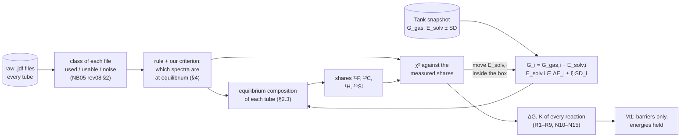
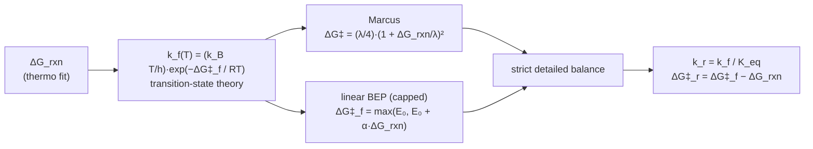

# Thermodynamic fit: reaction energies from the spectra at equilibrium

| | |
|---|---|
| **Status** | Programmed 2026-10-29, not run. The run is prepared in `notebooks/results/thermo1_steps/` (§5) |
| **Source** | Y. Alcaraz Galván; the problem as set out in `notebooks/06_fitting_thermo_rev01.ipynb` §1 and §5, and the handwritten notes of 4 Nov 2026 (error model, thermo model, boundary ξ, K and k) |
| **Scope** | How the reaction energies are fitted to the tubes whose reaction has finished, before and apart from the kinetic fit: which spectra are at equilibrium, the model (ΔG, K, the equilibrium composition), what is free (E_solv inside ±ξ standard errors), the steps, and the hand-over to M1. It is the specification of the code of §9 |
| **See also** | [reference-fitting_system.md](reference-fitting_system.md) (the kinetic fit this one precedes), notebook `05_fitting_rev08_(M1_steps)` §2 (every spectrum of every tube: used, usable, noise) |

## 1. The idea

The data are of two kinds, and they do not need each other:

- **Equilibrium**: spectra of a tube whose reaction has finished. The composition no longer changes, so *when* the first NMR was taken does not matter, and neither do the barriers. Only K = exp(−ΔG/RT) matters.
- **Reaction**: the spectra caught while the tube changes. They depend on ΔG and on the barriers, and their ages are unknown.

So the energies are fitted first, from the spectra at equilibrium alone, with an algebraic model (no reactor, no ages). The kinetic fit (M1) then takes them and fits the barriers.



## 2. The model

### 2.0 The error model

The fit minimises the residuals of the model against the lab data, each divided by its own uncertainty:

```
e_k = (Y_model,k − Y_NMR,k) / σ_TOT,k          Y_NMR: raw lab data (mM or share), Y_model: predicted
σ_TOT = √(σ²_noise + σ²_baseline)
```

Y_NMR is what was measured; nothing in it is corrected. In the code the shares are the compared quantity and σ also carries a floor (§2.4); the notes write σ_TOT without it (open point, §8).

### 2.1 Free energy of a species and of a reaction

Each species i has a stored gas-phase energy ΔE_DFT,i (ωB97M-V, 298.15 K, RRHO: one value per species) and a solvation energy ΔE_solv,i from MD (`dE_solv_eV`; an energy, not a free energy), in the medium of the run (EC:DEC 1:1, linear mixing, 2026-10-08 snapshot). The solvation energy is a computed value with an uncertainty, σ_solv,i, the standard error (SD) of the solvent calculation:

```
ΔG_i   = ΔE_DFT,i + ΔE_solv,i                        (kinetics/thermo/solution.py: G_gas,i + E_solv,i)
ΔE_solv,i = ΔE_solv,computed,i ± σ_solv,i
ΔG_rxn,j = Σ_i ν_ij · ΔG_i      (j reaction, i species; ν > 0 products, < 0 reactants)
K_eq,j = exp(−ΔG_rxn,j / RT)
```

(ΔG_rxn is taken at the DFT temperature only: no T_DFT dependence for now, §2.2.)

- Every reaction of the network is 2 → 2, so the shift from the 1 bar gas to the 1 M solution cancels and is not applied.
- Concentrations are in mol/L with a 1 M standard state, no activity coefficients, and EC enters as a concentration (7.1 M at mixing). This is the convention of the reactor (`k_r = k_f / K`): the two fits use the same K.

### 2.2 Temperature

All spectra used were taken at 22–23 °C; RT is that of each tube (mean of its spectra). In the code (`thermo_mode='wb97mv'`) ΔG does not change with T, so the fitted shifts are treated as temperature independent: equilibria at one temperature cannot tell enthalpy from entropy. Using the stored H and G instead would move ΔG at 80 °C by −4.4, −3.4, −1.9, +2.9 kJ/mol for R1–R4: keep in mind for the hand-over.

### 2.3 Equilibrium composition of a closed tube

All fifteen reactions of the network are at equilibrium (R1–R9, N10–N15). Six of them are independent (11 species, rank 6: R1–R4, R8, R9); the other nine are combinations of these and need no parameter of their own, but they are in the equilibrium all the same (`list_equilibrium_reactions`). With the computed energies, R8 and R9 at equilibrium open about 0.6 M of EC in the 2 % tube and the probe (TMSOdiEG and CO₂): the fit has to move the energies of EC, CO₂, TMSOEG and TMSOdiEG to keep the ring closed where the spectra show it closed.

The composition is the minimum of the Gibbs energy of the solution under the amounts these reactions conserve:

```
min  Σ_i C_i (μ_i + RT ln C_i − RT)     subject to   Aᵀ C = Aᵀ c0       (A: null space of the stoichiometry)
dual: C_i = exp(−μ_i/RT + (Aλ)_i),  λ by Newton on  Σ_i C_i − λ·Aᵀc0   (convex)
```

- Every C stays positive, so a species far below detection (TMSPA in a wet tube, 10⁻¹⁰ M) is computed without dividing by zero.
- A species no reaction can make from the composition at mixing stays at zero.
- About 1 ms per tube, against seconds for a reactor run.
- Checked (`tests/test_thermo_fit.py`): Q = K to 10⁻⁶ in ln for every reaction in the span of R1–R4, phosphorus and silyl conserved, on the recipes of the tubes. The solver stops at 10⁻⁸ of the largest conserved amount (EC, 7 M, sets that scale).

### 2.4 What is compared

The shares and the error model of the kinetic fit, unchanged (`SHARE_SPECIES` and `_lab_block` in [residuals.py](../kinetics/fitting/residuals.py)):

```
³¹P   share_k = C_k / (C_TMSPA + C_BMSPA + C_MMSPA + C_H3PO4)
¹³C   share_k = n_k C_k / Σ n C,   n = silyl groups per molecule (HMDSO 2; P-silyl: TMSPA 3, BMSPA 2, MMSPA 1)
²⁹Si  as ¹³C (one Si per silyl group), read by height          ¹H  silyl on phosphate / free silyl
z     = (predicted − measured) / σ;  σ = noise ⊕ baseline ⊕ floor; three spectra or more of one nucleus at room
        temperature share their baseline and floor (one composition and "no drift", as the 2 % tube in the kinetic fit)
```

The model predicts one composition per tube, so a block of repeated spectra gives one "mean" residual per window and its "drift" residuals (which no parameter moves).

## 3. What is free: E_solv,i within ±ξ standard errors

As in notebook 06 §5 and the notes. The DFT energy is one value per species and is not touched; the solvation energy is the only thing the fit may correct, and only within what its own error allows:

```
ΔE_solv,fit,i ∈ [ΔE_solv,computed,i − ξ·σ_solv,i ,  ΔE_solv,computed,i + ξ·σ_solv,i]      ξ = 1, 2, 3
```

Sketch of the notes (axis y: species A, B, C; axis x: energy from DFT; ● corrected value, □ not corrected, bars = ± σ_solv,i): the corrected point of each species may sit anywhere along its bar; it is not pulled towards the computed one.

| | |
|---|---|
| **Variables** | E_solv,i of every species of the reactions: TMSPA, BMSPA, MMSPA, H₃PO₄, H₂O, TMSOH, HMDSO, EC, TMSOEG, CO₂, TMSOdiEG. Parameter `dE_solv <species>` = shift δ_i from the computed value |
| **Parameters** | ΔE_DFT,i (G_gas,i), σ_solv,i, ν_ij, T, c0 |
| **Boundary** | δ_i ∈ [−ξ·σ_solv,i, +ξ·σ_solv,i], σ_solv,i the standard error of the MD run of the species. No E_solv moves without this limit. ξ is a specification of the fit: x times the σ_solv,i |
| **Objective** | min χ² = Σ_k ((s_k^model − s_k^NMR)/σ_TOT,k)², nothing else: inside the box every value is allowed alike |
| **ξ** | 1, 2 and 3, each fitted |

**What the data can see.** Only differences of species energies enter ΔG, so the data see at most six combinations of the eleven δ_i (one per independent reaction). The other directions are flat inside the box. The result to read is ΔG_j and K_j of every reaction; a single E_solv,i is determined only where its profile says so. Outputs: the profile of each δ_i across its box, and for every reaction the lowest and highest ΔG over the profile points within Δχ² = 3.84 of the best fit (an envelope, `calculate_energy_ranges`).

**What a window counts** (`SHARE_SPECIES`): ³¹P one phosphate per window; ¹³C, ²⁹Si and ¹H count silyl groups, so HMDSO counts twice, the TMSOEG window holds TMSOEG + TMSOdiEG, and P-silyl (¹H: P-bound silyl) is 3 TMSPA + 2 BMSPA + MMSPA; ¹H free silyl is TMSOH + 2 HMDSO + TMSOEG + TMSOdiEG. Every usable nucleus is fitted.

## 4. The data: which spectra are at equilibrium

Two criteria, kept apart in the setup: the **rule** (automatic) and **our criterion** (written into the setup as `overrides`, file by file).

### 4.1 The rule

Every usable spectrum of every tube (not noise, NB05 rev08 §2; `kinetics/data/lab_spectra.py`) is a **candidate** if it was taken at room temperature (< 25 °C), is quantitative (³¹P with the NOE off and d1 ≥ 5 s; ²⁹Si not INEPT) and has two windows or more. The candidates of one tube and one nucleus are at equilibrium from the first one on which every later one agrees: at least 2 spectra, at least 24 h apart, each within |z| ≤ 3 of the mean of the others (σ: noise ⊕ baseline, no floor).

### 4.2 Our criterion (overrides)

A spectrum that has moved away from the composition at mixing (some share more than 3 σ off, σ as one spectrum in the fit) has seen the reaction run, and is taken as at equilibrium, **also alone**: one ³¹P that shows no TMSPA left is read as the end state. **Unless a later spectrum of the same tube and nucleus differs from it** (|z| > 3, noise ⊕ baseline): an early spectrum away from the later ones was taken before the end, and the model cannot go through it and through the line. The steps (§5.2) show where the reading fails. `find_departed_spectra` lists them; the ones the rule leaves out are written into `overrides` (notebook 06 §5, 29 Oct):

| Tube | By the rule | Added by our criterion | Left out |
|---|---|---|---|
| `2 % H2O` | ³¹P, ¹³C, ¹H × 6; ²⁹Si × 3 from 96.6 h | — | the six hot rounds; ²⁹Si at 0.2, 33.6, 72.6 h (apart from the later ones, \|z\| 10, 7, 6) |
| `TMSOH, probe` | ¹³C × 2 (both at the mixing composition: TMSOH 0.96, 0.93) | ²⁹Si at 144 h | ¹³C at 80 °C; ¹H one window; ³¹P noise |
| `TMSOH, glovebox` | — | ¹³C, ²⁹Si | ¹H one window |
| `TMSPa + TMSOH (A)` | — | ³¹P (0.06 h), ¹³C (234 h), ¹H (265 h) | ¹H at 0 and 234 h (apart from the later ones, \|z\| 20 and 3.3); ²⁹Si INEPT |
| `TMSPa + TMSOH (B)` | — | ³¹P (2 h) | ¹H at the mixing composition; ²⁹Si INEPT |
| `TMSPa alone` | — | ³¹P and ¹H at 243 h | ³¹P and ¹H at 0 h (at the mixing composition) |
| `0.5 % H2O` | — | ³¹P (18.9 h) | ¹³C and ²⁹Si (at the mixing composition); the second ³¹P (d1 1 s) |

### 4.3 Tubes of the same recipe

Two tubes mixed from the same recipe must end at the same shares. If their spectra at equilibrium agree (|z| ≤ 3 between the noise-weighted means, nucleus by nucleus, `compare_replicates`), they are fitted together; if they do not, one model cannot sit between them, and they are **two solutions**: the steps split (§5.2). On 29 Oct:

| Tubes | Nucleus | max \|z\| | |
|---|---|---|---|
| `TMSPa + TMSOH (A)` / `(B)` | ³¹P | 2.1 | together |
| `TMSOH, probe` / `TMSOH, glovebox` | ¹³C, ²⁹Si | 18.7, 11.8 | apart: two solutions |

The probe and the glovebox differ in history (the glovebox 8 h at 80 °C, the probe minutes), but at room temperature the same recipe has one equilibrium: one of the two did not reach it.

### 4.4 Earlier check (R1–R4 only, 29 Oct)

Fitted alone with R1–R4, `2 % H2O` asked for ΔG(R4) −0.09 to −0.14 eV and `TMSOH, probe` for +0.15 to +0.20 eV: the probe may have stopped rather than reached equilibrium (no phosphate, slow condensation). With every reaction and every nucleus the steps test it again (T1 and the scores of the later steps).

## 5. Procedure

### 5.1 Run

```
python scripts/run_thermo_fit.py points --results notebooks/results/thermo1_steps   # again after changing the rule or the overrides
python scripts/run_thermo_fit.py steps  --results notebooks/results/thermo1_steps   # the steps at ξ = 1, 2, 3
```

The specs are set in notebook 06 §5 (`# Specs`), which writes them into `fit_config.json` of the results directory under `thermo`; the medium, network and sample changes are those of `fit8_M1-steps_S1-tube` (the water of `TMSPa alone` at 65.6 mM). Each job writes one file and is skipped when that file exists: a new setup needs a new directory. 

### 5.2 The steps: cumulative, one tube added at a time

The tubes are added in the order of the setup (`order`): probe, glovebox, tube A, tube B, `TMSPa alone`, `0.5 % H2O`, `2 % H2O`. Each step fits **every tube added so far together**, from the step before, and frees every species present in those tubes: nothing fitted is dropped, and the step where the fit starts to fail names the tube that breaks it. When a tube disagrees with a tube of the same recipe already in the chain (§4.3), the chain splits: one goes on with the earlier tube, the other with the new one in its place, starting from the last step without the earlier one (`build_cumulative_steps`). With the data of 29 Oct:

| Step | Chain a (probe) | Chain b (glovebox) |
|---|---|---|
| T1 | probe | — |
| T2 | — | glovebox (from the computed values) |
| T3 … T7 | + A, + B, + `TMSPa alone`, + `0.5 % H2O`, + `2 % H2O` | the same |

After every step each tube is scored with the step's parameters: a tube not added yet is a prediction. A smoke run (`--quick`) of the twelve steps at three ξ takes 5.5 minutes. The three ξ and the two chains are independent: `notebooks/results/thermo1_steps/run_parallel.sh` runs them as six processes (`--xi`, `--chain`) and then writes the tables from the fits on disk; `cloud.sh` there runs it on a 64-vCPU Spot VM (6 × 10 workers).

### 5.3 Output (in the results directory; lab-derived, never in git)

| File | Content |
|---|---|
| `spectra_shares.csv` | shares of every usable spectrum, one row per window |
| `replicates.csv` | tubes of the same recipe against each other: together or two solutions |
| `equilibrium_points.csv` | one row per spectrum: candidate, by rule, at equilibrium, decided by (rule / setup), plateau, max \|z\|, reason |
| `steps/thermo__<step>__xi<ξ>.json` | the fit: θ, χ², residual table, `species_shifts_eV` (the hand-over), setup |
| `step_profiles/…json` | the profile of every free parameter |
| `steps_summary.csv` | per step and ξ: χ², worst miss, fits, at bounds, θ |
| `steps_scores.csv` | per step, ξ and tube: χ² and worst miss; fitted here, before, or not used |
| `steps_intervals.csv` | per free parameter: interval, bound or not determined |
| `steps_energies.csv` | per step, ξ and reaction (R1–R9, N10–N15): computed and fitted ΔG and K, the envelope low–high |

## 6. From the energies to the rate constants

The thermo fit gives ΔG_rxn and hence K_eq. The kinetic fit needs k_f and k_r. The two are tied by

```
K_eq,j(T) = exp(−ΔG_rxn,j / RT) = k_f,j(T) / k_r,j(T)
```

The notes record a confusion here between the two expressions, which must not be mixed: **K_eq is a function of ΔG_rxn; a rate constant is a function of a barrier ΔG‡, not of ΔG_rxn** (k_f = exp(−ΔG_rxn/RT) as first written is not a rate law). The barrier is the part the thermo fit does not see; the model chosen for it is what links the two.

### 6.1 Barrier model (forward direction)



- **TST**: k(T) = exp(−ΔG‡/RT) with ΔG‡ the free-energy barrier. The notes strike out the factor k_B T/h; the code keeps it (Eyring prefactor, `kinetics/microkinetics/rates.py`). Open point (§8).
- **Marcus**: ΔG‡ = (λ/4)(1 + ΔG_rxn/λ)². In the code λ = 4g (g = intrinsic barrier, the fitted `g <family>`), i.e. ΔG‡ = g(1 + ΔG_rxn/4g)², one g per family in M1.
- **Linear BEP**: ΔG‡_f = max(E₀, E₀ + α·ΔG_rxn). In the code α = 0.5 (M0-BEP) or α = 1 (`+BEP`, P. Broqvist's rule).

### 6.2 Strict detailed balance

The reverse step is not an independent choice: given the forward barrier and ΔG_rxn,

```
k_r(T)  = k_f(T) / K_eq(T)
ΔG‡_r   = ΔG‡_f − ΔG_rxn
```

Both barrier models respect it (Marcus: ΔG‡_r = (λ/4)(1 − ΔG_rxn/λ)²). This is what keeps every Wegscheider cycle closed and makes the kinetic fit end at the equilibrium the thermo fit found.

**Choice (Y. Alcaraz, 4 Nov 2026): Marcus.** The BEP forms stay available as the `+BEP` suffix for comparison.

## 7. Hand-over to the kinetic fit

The fit stores `species_shifts_eV` ({species: eV}), the form the model already takes (`ModelSpec.species_shifts_eV`, applied by `build_shifted_species_database`). M1 then runs with the energies held at the thermo fit and fits the barriers alone. Because the shifts are per species, every Wegscheider cycle stays closed: N10–N15 follow without a parameter. The spectra at equilibrium stay in the kinetic fit as checks: once the energies are held, the reactor must end at those shares in the time of the experiment.

## 8. To decide

Settled by the notes: **ξ** is multiplicative, ±ξ·σ_solv,i with ξ = 1, 2, 3 (as in the code; the ±(SD_i + ξ) of NB06 §1 is dropped), and the barrier model is **Marcus**.

1. **The water of `TMSPa alone`**: declared at 65.6 mM as in M1 (¹H OH line), or free (0–0.3 M).
2. **σ_TOT**: the notes write √(σ²_noise + σ²_baseline); the code adds a floor (§2.4). Keep the floor, or drop it for this fit.
3. **Eyring prefactor k_B T/h**: struck out in the notes, present in the code. Confirm which, since it shifts every g by a constant.
4. **T_DFT**: ΔG_rxn without T dependence for now (§2.2); the −4.4 … +2.9 kJ/mol at 80 °C is the cost.

## 9. Code

| Piece | Where | Reuses |
|---|---|---|
| Class and shares of every spectrum | `kinetics/data/lab_spectra.py` | the rules of NB05 rev08 §2, `calculate_area_shares`, the observables' shares of the fitted spectra |
| Equilibrium solver | `kinetics/thermo/equilibrium.py` (`calculate_equilibrium`, `list_equilibrium_reactions`) | `build_stoichiometric_matrix`, `calculate_solution_gibbs` |
| Rule, samples, problem, energies | `kinetics/fitting/thermo_fit.py` (`find_equilibrium_points`, `build_equilibrium_samples`, `ThermoProblem`, `tabulate_reaction_energies`, `calculate_energy_ranges`) | `_lab_block`, `_whiten`, `_rows_of_block`, `_shares_from_state` (residuals.py); `FitParameter`; the run's sample changes |
| Fit, profiles, intervals | `ThermoProblem` has the interface of `FitProblem` | `fit_structure`, `calculate_profile`, `find_confidence_interval`, `write_fit_result` (estimation.py) |
| Runner | `scripts/run_thermo_fit.py` (`points`, `steps`) | the step logic of `scripts/run_fit.py steps`; `apply_fit_config` |
| Shares of ¹H and ²⁹Si | `SHARE_SPECIES` in residuals.py | the windows of NB05 rev08 §2 |
| Tests | `tests/test_thermo_fit.py` | solver closure and conservation; recovery on invented spectra |
