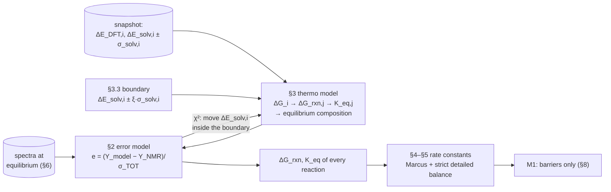
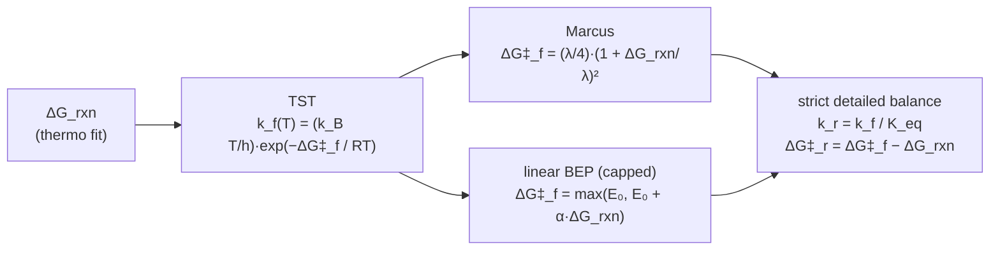

# Thermodynamic fit: reaction energies from the spectra at equilibrium (rev02)

| | |
|---|---|
| **Status** | Programmed 2026-10-29, not run. The run is prepared in `notebooks/results/thermo1_steps/` (§7) |
| **Source** | Y. Alcaraz Galván, handwritten notes of 4 Nov 2026 (the skeleton of this document: §2–§5); `notebooks/06_fitting_thermo_rev01.ipynb` §1 and §5; [reference-fitting_thermo.md](reference-fitting_thermo.md) (the data, the procedure and the code, §6–§10) |
| **Scope** | The definition of the thermodynamic fit: the error model, the thermodynamic model, the boundary of the free energies, and the link from the fitted energies to the rate constants of the kinetic fit. Then the data, the procedure and the code that carry it out |
| **See also** | [reference-fitting_system.md](reference-fitting_system.md) (the kinetic fit this one precedes), notebook `05_fitting_rev08_(M1_steps)` §2 (every spectrum of every tube: used, usable, noise) |

## 1. Overview

The lab data are of two kinds, and they do not need each other:

- **Equilibrium**: spectra of a tube whose reaction has finished. The composition no longer changes, so the time of the first NMR and the barriers do not matter. Only the equilibrium constants matter.
- **Reaction**: spectra taken while the tube is changing. They depend on the reaction energies and on the barriers, and their ages are unknown.

The reaction energies are therefore fitted first, to the spectra at equilibrium alone. The model is algebraic, with no reactor and no ages. The kinetic fit (M1) then holds these energies and fits the barriers.



## 2. Thermo fit: the error model

The fit compares the model with the lab data point by point. Each difference is divided by its own uncertainty:

```
e_k = (Y_model,k − Y_NMR,k) / σ_TOT,k

σ_TOT,k = √(σ²_noise,k + σ²_baseline,k)
```

| Symbol | Meaning |
|---|---|
| Y_NMR,k | the raw lab value of point k (a window of a spectrum), with no correction |
| Y_model,k | the value the model predicts for the same point |
| σ_noise,k | the spectral noise of the window |
| σ_baseline,k | the spread of the window area over the baseline readings |

The fit minimises χ² = Σ_k e_k². In the code the compared quantity is the **share** of each window, not its concentration in mM (§3.5), and σ also carries the declared floor of the kinetic fit (`kinetics/fitting/residuals.py`): σ = noise ⊕ baseline ⊕ floor. The notes leave the floor out (open point, §9).

## 3. Thermo model

### 3.1 Reaction free energy

```
ΔG_rxn,j = Σ_i ν_ij · ΔG_i
```

| Symbol | Meaning |
|---|---|
| j | reaction (R1–R9, N10–N15) |
| i | compound (molecule) |
| ν_ij | stoichiometric number of i in j: > 0 product, < 0 reactant, 0 absent |

### 3.2 Free energy of a compound

```
ΔG_i = ΔE_DFT,i + ΔE_solv,i
```

- **ΔE_DFT,i**: the gas-phase free energy from DFT (ωB97M-V, 298.15 K, RRHO). It has one value per compound and the fit does not change it. In the code it is `G_gas,i` (`kinetics/thermo/solution.py`).
- **ΔE_solv,i**: the solvation energy from MD in the medium of the run (EC:DEC 1:1, linear mixing, 2026-10-08 snapshot; `dE_solv_eV`, an energy, not a free energy). It is a computed value with an uncertainty:

```
ΔE_solv,i = ΔE_solv,computed,i ± σ_solv,i
```

where σ_solv,i is the standard error (SD) of the solvation calculation of compound i (`calculate_solvation_sigma_components`).

Conventions, shared with the reactor so that both fits use the same K:

- Every reaction of the network is 2 → 2, so the shift from the 1 bar gas to the 1 M solution cancels and is not applied.
- Concentrations are in mol/L with a 1 M standard state and no activity coefficients. EC enters as a concentration (7.1 M at mixing).

### 3.3 Boundary for fitting

The figure in the notes shows each compound (A, B, C on the y axis) with its energy from DFT on the x axis. The computed value is □ and the corrected value is ●, with an error bar of ± σ_solv,i:

```
        energy from DFT  →
  A     ●───┼───            □           the corrected value may lie away from the computed one ...
  B          ─┼●─  ─┼□─                 ... or close to it,
  C     □             ───┼───●          ... on either side
```

So the true solvation energy is taken to lie in ΔE_solv,i ∈ [ΔE_solv,computed,i ± σ_solv,i]. The fit may move it only inside a boundary of ξ times that error:

```
ΔE_solv,fit,i ∈ [ ΔE_solv,computed,i − ξ·σ_solv,i ,  ΔE_solv,computed,i + ξ·σ_solv,i ]        ξ = 1, 2, 3
```

ξ is a specification of the fit, and each value is fitted separately. Inside the boundary every value is equally allowed: χ² has no penalty term pulling the corrected value back to the computed one.

| | |
|---|---|
| **Variables** | δ_i = ΔE_solv,fit,i − ΔE_solv,computed,i of every compound of the reactions: TMSPA, BMSPA, MMSPA, H₃PO₄, H₂O, TMSOH, HMDSO, EC, TMSOEG, CO₂, TMSOdiEG (parameter `dE_solv <species>`) |
| **Fixed** | ΔE_DFT,i, σ_solv,i, ν_ij, T, initial composition c0 |
| **Boundary** | δ_i ∈ [−ξ·σ_solv,i, +ξ·σ_solv,i] |
| **Objective** | min χ² = Σ_k e_k² (§2), nothing else |

**What the data can see.** ΔG_rxn contains only differences of compound energies. The 15 reactions have rank 6 over the 11 compounds, so the data see at most six combinations of the eleven δ_i. The other directions are flat inside the boundary. The result to read is therefore ΔG_rxn,j and K_eq,j of every reaction. A single ΔE_solv,i counts as determined only where its profile shows it. The outputs are the profile of each δ_i across its boundary and, for each reaction, the lowest and highest ΔG_rxn over the profile points within Δχ² = 3.84 of the best fit (`calculate_energy_ranges`).

### 3.4 Equilibrium constant and composition

```
K_eq,j = exp( −ΔG_rxn,j(T_DFT) / RT )
```

For now ΔG_rxn has no temperature dependence: it is taken at T_DFT (`thermo_mode='wb97mv'`). Every spectrum used was taken at 22–23 °C, and RT is that of each tube. Equilibria at a single temperature cannot separate enthalpy from entropy. The stored H and G would move ΔG_rxn at 80 °C by −4.4, −3.4, −1.9 and +2.9 kJ/mol for R1–R4, which matters at the hand-over (§8).

Each tube is closed, so its composition at equilibrium is the minimum of the Gibbs energy of the solution under the amounts the reactions conserve. At that minimum every reaction satisfies Q = K_eq:

```
min  Σ_i C_i (μ_i + RT ln C_i − RT)      subject to   Aᵀ C = Aᵀ c0       (A: null space of the stoichiometry)
dual: C_i = exp(−μ_i/RT + (Aλ)_i),  λ by Newton (convex)
```

- All fifteen reactions are at equilibrium. Six are independent (R1–R4, R8, R9). The other nine are combinations of these and need no parameter of their own.
- Every C_i stays positive, so a compound far below detection (TMSPA in a wet tube, 10⁻¹⁰ M) causes no division by zero. A compound that no reaction can make from c0 stays at zero.
- One tube takes about 1 ms. `tests/test_thermo_fit.py` checks that Q = K holds to 10⁻⁶ in ln and that phosphorus and silyl are conserved.
- With the computed energies, R8 and R9 open about 0.6 M of EC in the 2 % tube and in the probe. The fit has to move EC, CO₂, TMSOEG and TMSOdiEG to keep the ring closed where the spectra show it closed.

### 3.5 What is compared

The equilibrium composition is turned into the shares that the spectra measure. The definitions are those of the kinetic fit (`SHARE_SPECIES`, `_lab_block` in `kinetics/fitting/residuals.py`):

```
³¹P   share_k = C_k / (C_TMSPA + C_BMSPA + C_MMSPA + C_H3PO4)                      one phosphate per window
¹³C   share_k = n_k C_k / Σ n C       n = silyl groups (HMDSO 2; TMSPA 3, BMSPA 2, MMSPA 1)
²⁹Si  as ¹³C (one Si per silyl group), read by height
¹H    P-silyl = 3 TMSPA + 2 BMSPA + MMSPA;  free silyl = TMSOH + 2 HMDSO + TMSOEG + TMSOdiEG
```

The TMSOEG window holds TMSOEG + TMSOdiEG. Every usable nucleus is fitted. Three or more spectra of one nucleus at room temperature share their baseline and floor. Since the model predicts one composition per tube, such a block gives one mean residual per window plus drift residuals that no parameter moves.

## 4. From the reaction energy to the rate constants

The thermo fit gives ΔG_rxn and therefore K_eq. The kinetic fit needs k_f and k_r. The notes link them through

```
K_eq,j(T) = exp( −ΔG_rxn,j(T_DFT) / RT ) = k_f,j(T) / k_r,j(T)
```

The notes then write k_f(T) = exp(−ΔG_rxn/RT), with the factor k_B T/h struck out, and mark it as unclear: how do the two expressions relate, and how does this connect to strict detailed balance?

**Clarification.** The two expressions describe different things and cannot be swapped:

| | Depends on | Says |
|---|---|---|
| K_eq = exp(−ΔG_rxn/RT) | the reaction energy ΔG_rxn (product − reactant) | **where** the reaction ends |
| k_f = (k_B T/h)·exp(−ΔG‡_f/RT) | the barrier ΔG‡_f (transition state − reactant) | **how fast** it gets there |

So k_f = exp(−ΔG_rxn/RT) is not a rate law: it puts the reaction energy where the barrier belongs. The thermo fit sees only ΔG_rxn. The barrier is the extra quantity the kinetic fit needs, and a barrier model (§5.1) ties it to ΔG_rxn. Strict detailed balance (§5.2) then fixes the reverse rate so that the ratio k_f/k_r equals K_eq exactly. That ratio is the only point where the two expressions meet.

## 5. Barrier model and strict detailed balance



### 5.1 Forward barrier

- **Transition-state theory (TST)**: k_f(T) = (k_B T/h)·exp(−ΔG‡_f/RT), where ΔG‡_f is the free-energy barrier. The notes strike out the factor k_B T/h, but the code keeps it as the Eyring prefactor (`kinetics/microkinetics/rates.py`). Open point (§9).
- **Marcus**: ΔG‡_f = (λ/4)·(1 + ΔG_rxn/λ)², where λ is the reorganisation energy. In the code λ = 4g, with g the intrinsic barrier (the fitted `g <family>`, one per family in M1): ΔG‡_f = g·(1 + ΔG_rxn/4g)².
- **Linear BEP (capped)**: ΔG‡_f = max(E₀, E₀ + α·ΔG_rxn). In the code α = 0.5 (M0-BEP) or α = 1 (`+BEP`, P. Broqvist's rule).

### 5.2 Strict detailed balance

Once the forward barrier and ΔG_rxn are given, the reverse step is fixed:

```
k_r(T)  = k_f(T) / K_eq(T)
ΔG‡_r   = ΔG‡_f − ΔG_rxn
```

Both barrier models satisfy it (Marcus: ΔG‡_r = (λ/4)·(1 − ΔG_rxn/λ)²). This keeps every Wegscheider cycle closed, and it makes the reactor of the kinetic fit end at the equilibrium the thermo fit found.

### 5.3 Choice

**Marcus** (Y. Alcaraz, 4 Nov 2026). The BEP forms remain available as the `+BEP` suffix for comparison.

## 6. The data: which spectra are at equilibrium

Two criteria are kept apart in the setup: the **rule**, which is automatic, and **our criterion**, which is written into the setup file by file as `overrides`.

**The rule.** A usable spectrum (not noise; NB05 rev08 §2, `kinetics/data/lab_spectra.py`) is a candidate if it was taken at room temperature (< 25 °C), is quantitative (³¹P with the NOE off and d1 ≥ 5 s; ²⁹Si not INEPT) and has two windows or more. The candidates of one tube and nucleus are at equilibrium from the first one that every later one agrees with. The conditions are ≥ 2 spectra, ≥ 24 h apart, each within |z| ≤ 3 of the mean of the others (σ = noise ⊕ baseline, no floor).

**Our criterion.** A spectrum that has moved away from the mixing composition (some share more than 3σ off) has seen the reaction run. It is taken as at equilibrium, even on its own, *unless* a later spectrum of the same tube and nucleus differs from it (|z| > 3). In that case it was taken before the end (`find_departed_spectra`).

| Tube | By the rule | Added by our criterion | Left out |
|---|---|---|---|
| `2 % H2O` | ³¹P, ¹³C, ¹H × 6; ²⁹Si × 3 from 96.6 h | — | the six hot rounds; ²⁹Si at 0.2, 33.6, 72.6 h (\|z\| 10, 7, 6 from the later ones) |
| `TMSOH, probe` | ¹³C × 2 (at the mixing composition) | ²⁹Si at 144 h | ¹³C at 80 °C; ¹H one window; ³¹P noise |
| `TMSOH, glovebox` | — | ¹³C, ²⁹Si | ¹H one window |
| `TMSPa + TMSOH (A)` | — | ³¹P (0.06 h), ¹³C (234 h), ¹H (265 h) | ¹H at 0 and 234 h (\|z\| 20, 3.3); ²⁹Si INEPT |
| `TMSPa + TMSOH (B)` | — | ³¹P (2 h) | ¹H at the mixing composition; ²⁹Si INEPT |
| `TMSPa alone` | — | ³¹P and ¹H at 243 h | ³¹P and ¹H at 0 h (at the mixing composition) |
| `0.5 % H2O` | — | ³¹P (18.9 h) | ¹³C and ²⁹Si (at the mixing composition); the second ³¹P (d1 1 s) |

**Tubes of the same recipe.** At room temperature one recipe has one equilibrium. Replicates whose spectra at equilibrium agree (|z| ≤ 3 between noise-weighted means, `compare_replicates`) are fitted together. Replicates that disagree are never averaged; they become two solutions. On 29 Oct, A and B agreed (³¹P, max |z| 2.1). The probe and the glovebox did not (¹³C 18.7, ²⁹Si 11.8), so one of them did not reach equilibrium. An earlier check with R1–R4 only had already pointed to the probe. Fitted alone, it wanted ΔG(R4) of +0.15 to +0.20 eV, against −0.09 to −0.14 eV from `2 % H2O`.

## 7. Procedure

```
python scripts/run_thermo_fit.py points --results notebooks/results/thermo1_steps   # again after changing the rule or the overrides
python scripts/run_thermo_fit.py steps  --results notebooks/results/thermo1_steps   # the steps at ξ = 1, 2, 3
```

Notebook 06 §5 (`# Specs`) sets the specs and writes them into `fit_config.json` under `thermo`. The medium, network and sample changes are those of `fit8_M1-steps_S1-tube` (water of `TMSPa alone` at 65.6 mM). A job is skipped when its output file already exists, so a new setup needs a new directory.

**Cumulative steps.** The tubes enter in the order probe, glovebox, A, B, `TMSPa alone`, `0.5 % H2O`, `2 % H2O`. Each step fits every tube added so far, starting from the previous step, and frees every compound present in those tubes. The first step that fails names the tube that breaks the fit. When a new tube disagrees with an earlier replicate, the chain splits (`build_cumulative_steps`):

| Step | Chain a (probe) | Chain b (glovebox) |
|---|---|---|
| T1 | probe | — |
| T2 | — | glovebox (from the computed values) |
| T3 … T7 | + A, + B, + `TMSPa alone`, + `0.5 % H2O`, + `2 % H2O` | the same |

After each step, every tube is scored with that step's parameters. A tube not yet added is therefore a prediction. The two chains and the three ξ are independent: `thermo1_steps/run_parallel.sh` runs them as six processes and then writes the tables, and `cloud.sh` runs the same on a 64-vCPU Spot VM. A smoke run (`--quick`) takes 5.5 min.

**Output** (in the results directory; derived from lab data, never in git): `spectra_shares.csv`, `replicates.csv`, `equilibrium_points.csv` (candidate, by rule, at equilibrium, decided by, reason), `steps/thermo__<step>__xi<ξ>.json` (θ, χ², residuals, `species_shifts_eV`), `step_profiles/`, `steps_summary.csv`, `steps_scores.csv` (per tube: fitted, before, or not used), `steps_intervals.csv`, `steps_energies.csv` (per reaction: computed and fitted ΔG_rxn and K_eq, envelope low–high).

## 8. Hand-over to the kinetic fit

The fit stores `species_shifts_eV` ({compound: eV}), which is the form the model already takes (`ModelSpec.species_shifts_eV`, applied by `build_shifted_species_database`). M1 then holds the energies and fits only the barriers with the Marcus model (§5). The shifts are per compound, so every Wegscheider cycle stays closed and N10–N15 follow without a parameter. The spectra at equilibrium remain in the kinetic fit as checks: with the energies held, the reactor must reach those shares within the time of the experiment.

## 9. To decide

Settled by the notes: ξ is multiplicative, ±ξ·σ_solv,i with ξ = 1, 2, 3 (the ±(SD_i + ξ) of NB06 §1 is dropped), and the barrier model is Marcus.

1. **σ_TOT**: the notes write √(σ²_noise + σ²_baseline), while the code adds a floor (§2). Keep the floor, or drop it for this fit.
2. **Eyring prefactor k_B T/h**: struck out in the notes but present in the code. Since it shifts every g by a constant, confirm which to use.
3. **T_DFT**: ΔG_rxn has no T dependence for now (§3.4). The cost is −4.4 … +2.9 kJ/mol at 80 °C.
4. **Water of `TMSPa alone`**: declared at 65.6 mM as in M1 (¹H OH line), or free (0–0.3 M).

## 10. Code

| Piece | Where |
|---|---|
| Class and shares of every spectrum | `kinetics/data/lab_spectra.py` |
| Equilibrium solver (§3.4) | `kinetics/thermo/equilibrium.py` (`calculate_equilibrium`, `list_equilibrium_reactions`) |
| Rule, samples, problem, energies (§2, §3.3, §6) | `kinetics/fitting/thermo_fit.py` (`find_equilibrium_points`, `build_equilibrium_samples`, `ThermoProblem`, `tabulate_reaction_energies`, `calculate_energy_ranges`) |
| Shares and error model (§2, §3.5) | `kinetics/fitting/residuals.py` (`SHARE_SPECIES`, `_lab_block`) |
| Fit, profiles, intervals | `kinetics/fitting/estimation.py` (`ThermoProblem` has the interface of `FitProblem`) |
| Rate constants (§5) | `kinetics/microkinetics/rates.py` |
| Runner (§7) | `scripts/run_thermo_fit.py` (`points`, `steps`) |
| Tests | `tests/test_thermo_fit.py` |
