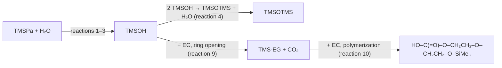
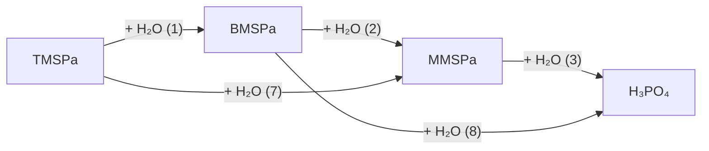

# Reaction Mechanism

**Source:** RXN-02 — Gogoi, Wahyudi, Mindemark, Hernández, Broqvist, Berg, "Reactivity of Organosilicon Additives with Water in Li-ion Batteries", *J. Phys. Chem. C* 2024, 128, 1654−1662. Main text (reactions 1–10, Scheme 1, Figures 1–6) and SI Figure S3. SI Figures S1, S2, S4, S5 and Table S2 are cited but not included here.

All reactions of the paper:

| # | Reaction | Section |
|---|---|---|
| 1 | TMSPa + H₂O → BMSPa + TMSOH | 4 |
| 2 | BMSPa + H₂O → MMSPa + TMSOH | 4 |
| 3 | MMSPa + H₂O → H₃PO₄ + TMSOH | 4 |
| 4 | TMSOH + TMSOH → TMS-O-TMS + H₂O | 1 |
| 5 | TMSPa + TMSOH → BMSPa + TMS-O-TMS | 2 |
| 6 | BMSPa + TMSOH → MMSPa + TMS-O-TMS | 2 |
| 7 | TMSPa + H₂O → MMSPa + TMS-O-TMS | 4 |
| 8 | BMSPa + H₂O → H₃PO₄ + TMS-O-TMS | 4 |
| 9 | EC + TMSOH → CO₂ + TMS-EG | 1 |
| 10 | TMS-EG + EC → HO–C(=O)–O–CH₂CH₂–O–CH₂CH₂–O–SiMe₃ | 1 |

Species:

- **TMSPa**: tris(trimethylsilyl)phosphate, OP(O–SiMe₃)₃
- **BMSPa**: bis(trimethylsilyl)phosphate, "TMSPa that has lost one TMS unit", OP(OH)(O–SiMe₃)₂
- **MMSPa**: mono(trimethylsilyl)phosphate, "TMSPa that lost two TMS units", OP(OH)₂(O–SiMe₃)
- **H₃PO₄**: phosphoric acid
- **xMSPa**: TMSPa, BMSPa and MMSPa together in ²⁹Si (not distinguished)
- **TMSOH**: trimethylsilanol, Me₃Si–OH
- **TMSOTMS** (TMS-O-TMS in the equations): hexamethyldisiloxane, Me₃Si–O–SiMe₃
- **TMS-EG**: "TMS derivative with EG", HO–CH₂CH₂–O–SiMe₃

---

# 0. Methods

## 0.1 Sample preparation

| Item | Paper |
|---|---|
| Solvents | Battery-grade EC and DEC (Sigma-Aldrich), introduced into an Ar glovebox "as received from the suppliers" |
| Glovebox | Ar, "O2, H2O content <1 ppm" |
| DEC | Dried with molecular sieves |
| EC | Heated to 45 °C to melt, then mixed with DEC |
| EC/DEC | 1:1 volume ratio "unless otherwise stated" |
| Water | EC/DEC "deliberately contaminated with 2 vol % H2O"; stored at RT, magnetically stirred 24 h; then left "for at least 12 h for it to equilibrate" |
| TMSPa | 5 vol % (Sigma-Aldrich), added after the equilibration |
| TMSOTMS, TMSOH | Sigma-Aldrich, "used as-received from suppliers" |
| After reaction | "the solution was extracted for visual inspection and qualitative assessment of the resulting compounds under NMR" |

## 0.2 NMR

| Item | Paper |
|---|---|
| Spectrometer | JEOL ECZ 400S; ¹H 400 MHz, ³¹P 162 MHz, ²⁹Si 376 MHz (as printed) |
| Tube | FEP liner (OD 5 mm, Wilmad-LabGlass) with 300 μL anhydrous DMSO-d₆ (99.9 %, VWR), PTFE plug; placed inside a glass NMR tube (ID 5 mm) with 150 μL of sample solution; glass tube closed with a PTFE stopper |
| Separation | "Any interaction between the deuterated solvent and reaction mixtures that could result in an undesirable reaction was strictly prohibited." |
| Glovebox | "The solution storage and sample preparation were done in the glovebox, and the H2O content inside it was kept below 1 ppm." |
| Processing | MestReNova 6.0.2−5475 |
| Referencing | ¹H and ¹³C internally referenced to DMSO-d₆ at 2.46 and 39.6 ppm |

## 0.3 Temperature

The paper describes it in two places:

| Where | Text |
|---|---|
| Methods | "Temperature variation in the mixture from RT to 80 °C (steps every 10 °C) in the NMR tube was performed to accelerate the chemical reactions. The mixture was held at each stated temperature for 8 h before recording the spectra. During the spectrum recording, the temperature was brought back to RT to not have any effect on the overall chemical shifts of the NMR signals." |
| Results | "The effect of the temperature on the chemical reactions was investigated in-situ by ramping the temperature during the NMR experiments up to 80 °C, with the aim to accelerate the chemical reactions." The 2 vol % H₂O sample "was heated to 80 °C, and NMR spectra were recorded in-situ to track the evolution of the stable reaction products." |

## 0.4 GC−MS

"A few of the selected samples were then extracted and analyzed with GC−MS."

| Item | Paper |
|---|---|
| Injection | Liquid, 0.1 μL |
| Instrument | Shimadzu GC−MS QP2020 NX W/O RP 230 V, AOC-20i Plus auto injector |
| Column | SH-200MS; 0.25 mm ID; 1.00 μm df; 30 m |
| Library | NIST 11 |
| Carrier | He (99.999 %), 1.16 mL min⁻¹ column flow, 3 mL min⁻¹ purge flow |
| Oven | 100 °C for 1 min; 30 °C min⁻¹ to 280 °C; 280 °C for 1 min; total 11 min |
| MS | m/z 25–700; event time 0.1 s, scan mode; electron impact; ion source 220 °C; interface 250 °C; filament 70 V; detector relative to tuning |
| Intensities | Relative to the highest peak in the measurement, "i.e., the DEC peak" |

---

# 1. TMSOH

## 1.1 Reactions

| # | Reaction | Paper's wording |
|---|---|---|
| 1–3 | xMSPa + H₂O → … + TMSOH (section 4) | TMSOH is "the eliminated reaction product (formed from reactions 1−3)" |
| 4 | TMSOH + TMSOH → TMS-O-TMS + H₂O | Results "point toward an alternative reaction pathway between TMSPa and H2O, where TMSOTMS is one of the most stable end products"; "One way to explain this" is that TMSOH "further dimerizes to give TMSOTMS and water (reaction 4)". "If this is the case, then H2O is regenerated, which, in turn, could hypothetically again react with TMSPa." |
| 9 | EC + TMSOH → CO₂ + TMS-EG | "ring-opening reaction of the surrounding EC molecule triggered by TMSOH"; "also leads to the formation of carbon dioxide" |
| 10 | TMS-EG + EC → HO–C(=O)–O–CH₂CH₂–O–CH₂CH₂–O–SiMe₃ | "further polymerization reaction of the surrounding EC solvent molecule induced by the TMS-EG"; "The ring-opened EC with retained carbonate is likely to form as a result, contributing to the signal at 19.08 ppm." |

Reaction 4 is later ruled out by the paper (section 1.3).

The paper calls TMSOH "a rather reactive intermediate during the hydrolysis of TMSPa".

### EC ring opening (Scheme 1, "EC Ring-Opening Reaction Pathways Triggered by TMSOH")

| Pathway | Bond broken first | Then |
|---|---|---|
| 1 | C−O ether bond between the ethylene and carbonate units | C−O ether bond between the carbonate C and ether O |
| 2 | C−O bond between the carbonate C and ether O | C−O bond between the carbonate and ethylene unit |

"In either case, the resulting products are the same": CO₂ + TMS-EG. Scheme 1 draws each pathway through a bracketed intermediate (pathway 1: H–O–C(=O)–O–CH₂CH₂–O–SiMe₃; pathway 2: HO–CH₂CH₂–O–C(=O)–O–SiMe₃).

## 1.2 Experiments

Temperature protocol: section 0.3.

### Experiment: 5 vol % TMSOH in EC/DEC (Figures 5 and 6)

Aim: "elucidate an alternative fate" of TMSOH, "which potentially affects practical cell performance".

| Step | Condition | Spectra |
|---|---|---|
| (i) | 5 vol % TMSOH in EC/DEC, RT | ¹³C (5a i), ¹H (5b i), ²⁹Si (5c i); GC−MS (6b) |
| (ii) | Same mixture, heated to 80 °C, brought back to RT, then recorded | ¹³C (5a ii), ¹H (5b ii), ²⁹Si (5c ii); GC−MS (6c) |

Figure 5 caption and trace labels for (ii): "at (ii) 80 °C", "5v% TMSOH in EC:DEC@80°C". Figure 6 caption: "5 vol % TMSOH in EC/DEC at 80 °C".

#### (i) RT

| Nucleus | Observation |
|---|---|
| ¹³C | TMSOH at 0.25 ppm; TMSOTMS "present at the level of impurity", small signal at 0.86 ppm |
| ¹H | TMSOH at −0.23 ppm; the TMSOTMS signal "could not be separated from the intense TMSOH signal" |
| ²⁹Si | TMSOH at 14.26 ppm |

Conclusion stated: TMSOH "is not involved in any recordable side reactions with the carbonate solvents at RT".

#### (ii) After 80 °C

| Nucleus | Observation |
|---|---|
| ¹³C | TMSOTMS still present; TMSOH signal decreases; new signal at −1.64 ppm → TMS-EG |
| ¹H | −0.23 ppm: TMS group of TMS-EG; group of peaks centred around 3.3 ppm: alkyl chain protons of TMS-EG |
| ²⁹Si | TMSOH still present; two new signals at 18.01 and 19.08 ppm |

²⁹Si assignments:

- **18.01 ppm** (intense): TMS-EG.
- **19.08 ppm**: "could not be exactly identified"; believed to come from species formed by EC polymerization induced by TMS-EG (reaction 10).
- **TMSOTMS**: not detected in ²⁹Si, "due to its low sensitivity" (low amount).

#### GC−MS (Figure 6)

"To further corroborate our results, GC−MS on the same samples was performed."

| Trace | Sample | Labelled peaks |
|---|---|---|
| (a) | EC:DEC, baseline | DEC (2.74 min), EC (5.79 min) |
| (b) | TMSOH in EC:DEC, RT | TMSOH, TMSOTMS, DEC, EC |
| (c) | TMSOH in EC:DEC, 80 °C | TMSOH, TMSOTMS, DEC, TMS-EG, EC |

| Species | Retention time | m/z | Paper |
|---|---|---|---|
| TMSOH | 1.68 min | — | observed at RT and 80 °C |
| TMSOTMS | 1.75 min | 147, 73 | "confirmed in both samples" |
| TMS-EG | 2.87 min | 75, 73, 103, 119 (SI S5) | "confirmed for the reaction mixture at elevated temperatures (Figure 6c)" |

## 1.3 Conclusions stated on TMSOH

- "Contrary to our previous result where TMSOTMS is found to be the most likely product of the TMSPa and H2O reaction, TMSOTMS is not found to be the end product here. This rules out that TMSOTMS forms through the TMSOH dimerization reaction (reaction 4) but rather points into the direction that TMSOTMS is the adduct of TMSPa and TMSOH reaction (reaction 5)."
- "The result here is also in agreement with the finding that H2O reacts with EC more favorably than TMSOH does."
- "while the formation of TMS-EG at the expense of EC is in principle an unwanted parasitic reaction in a Li-ion cell, it should be noted that this reaction is only substantially activated at elevated temperatures in comparison to EC ring-opening catalyzed by H2O, which proceeds substantially already at ≥40 °C" (ref. 24, Metzger et al. 2016).
- Abstract: TMSOH "can also activate ethylene carbonate (EC) ring-opening reactions at elevated temperatures (≥80 °C)".
- Conclusions: TMSOH "performs a nucleophilic attack on and ring-opens EC to form TMS-EG, albeit at a very low rate at RT. The activation energy required to open up the EC ring by TMSOH is much higher than the energy required by the significantly more mobile H2O." "This also hints in the direction that H2O is a stronger nucleophile than TMSOH."

## 1.4 Purity and contamination

| Sample | Impurity | Where it shows |
|---|---|---|
| 5 vol % TMSOH in EC/DEC, RT (Fig. 5 i) | TMSOTMS "present at the level of impurity" | ¹³C: small signal at 0.86 ppm (Fig. 5a i, dashed line); ¹H: not separable from TMSOH |
| Same, after 80 °C (Fig. 5 ii) | TMSOTMS, "low amount" | ¹³C: still present; ²⁹Si: not detected "due to its low sensitivity" |
| TMSOH in EC:DEC, RT and 80 °C (Fig. 6 b, c) | TMSOTMS | GC−MS, 1.75 min |
| Pure TMSOH (Fig. S3 c) | TMSOTMS, "trace amounts" | ²⁹Si: peak at ∼7 ppm |

TMSOH used "as-received" (section 0.1). Pure TMSPa (Fig. S3 b) and the text on both pure compounds: section 3.

---

# 2. TMSPa + TMSOH

## 2.1 Reactions

| # | Reaction | Paper's wording |
|---|---|---|
| 5 | TMSPa + TMSOH → BMSPa + TMS-O-TMS | "Another possibility": instead of H₂O (OH⁻) "attacking the additive molecule further on", the TMSOH formed during the reaction "attacks TMSPa in a subsequent step with its TMSO- unit, breaking TMSPa's O−Si bond"; TMSOTMS "is the most likely reaction product along with BMSPa" |
| 6 | BMSPa + TMSOH → MMSPa + TMS-O-TMS | "the TMSO-group of the excess TMSOH molecules could attack the BMSPa in the following reaction step, resulting in the formation of TMSOTMS and MMSPa as final products" |

Statements:

- Mechanism: "The Si−O bond of TMSPa undergoes cleavage owing to the high affinity of Si toward nucleophiles (O⁻, OH⁻, F⁻, and OCH₃⁻). This would eventually result in the TMSOTMS and BMSPa."
- Literature: "Yim et al. and Winter et al. showed the formation of TMSOTMS due to the O-silylation of TMSPi triggered by TMSOH" (refs. 3, 22, 23).
- Abstract: "Similar to water, the Lewis base TMSOH can undergo reaction with TMSPa at room temperature to form hexamethyldisiloxane".
- Conclusions: "TMSOH reacts subsequently with unreacted TMSPa to form the less reactive TMSOTMS dimer."

## 2.2 Experiments

### Experiment: 5 vol % TMSPa added to EC/DEC containing 2 vol % TMSOH (Figure 3)

Aim: "to confirm which reaction dominates".

| Nucleus | Figure labels | Observation (text) |
|---|---|---|
| ²⁹Si (main panel) | TMSOTMS | "indeed confirms the formation of TMSOTMS"; TMSPa and TMSOH "could not be detected in the spectrum" |
| ³¹P (inset) | MMSPa, BMSPa, TMSPa | "shows the formation of BMSPa"; "A very weak signal for residual TMSPa"; signal of MMSPa present |

Conclusions stated:

- TMSPa and TMSOH not detected in ²⁹Si "indicates that TMSPa and the TMSOH have been consumed in the chemical reaction".
- "this experiment confirms that TMSOTMS and BMSPa are formed due to the reaction of TMSPa and TMSOH" (reaction 5).
- Reaction 6 "explain[s] the presence of a signal of MMSPa in the ³¹P NMR spectrum, as seen in the inset of Figure 3".

### Evidence from the 2 vol % H₂O sample (Figure 2, section 4.2)

"The fact that the signal for TMSOTMS in the TMSPa-added EC/DEC mixture containing 2 vol % H2O grows as the temperature increases in the ²⁹Si NMR spectrum as seen in Figure 2 while that for TMSOH and TMSPa disappears indicates that the reaction of TMSOH with TMSPa forming TMSOTMS is further enhanced at elevated temperature."

---

# 3. TMSPa alone

## 3.1 Purity and contamination

| Sample | Impurity | Where it shows |
|---|---|---|
| Pure TMSPa | TMSOTMS, "trace amounts" | ²⁹Si, peak at ∼7 ppm (Fig. S3 b) |
| Pure TMSPa | BMSPa | ³¹P (Fig. S4, not included here) |

Statements:

- "Interestingly, TMSOTMS is also detected in trace amounts in pure TMSPa and TMSOH according to NMR analysis (Figure S3)." (pure TMSOH: section 1.4)
- "The peak at ∼7 ppm in ²⁹Si NMR spectra denotes the presence of TMSOTMS."
- "based on spectroscopic evidence, it can be said that TMSPa is very sensitive toward impurities, even if those impurities are present in very low amounts."
- "BMSPa was indeed observed in the ³¹P NMR spectrum for the pure TMSPa (figure S4)."

¹H of TMSPa (SI Figure S1, DMSO-d₆, 25 °C): "The TMSPa methyl protons give rise to a singlet at −0.02 ppm."

---

# 4. TMSPa + H₂O

## 4.1 Reactions

| # | Reaction | Paper's wording |
|---|---|---|
| 1 | TMSPa + H₂O → BMSPa + TMSOH | BMSPa "represents TMSPa that has lost one TMS unit, formed from reaction 1" |
| 2 | BMSPa + H₂O → MMSPa + TMSOH | MMSPa "represents TMSPa that lost two TMS units), e.g., as formed from reaction 2" |
| 3 | MMSPa + H₂O → H₃PO₄ + TMSOH | H₃PO₄ "e.g., as formed from chemical reaction 3" |
| 7 | TMSPa + H₂O → MMSPa + TMS-O-TMS | Reactions 7 and 8 "are basically the direct chemical reaction steps that take into account the formation and subsequent reaction of BMSPa (/MMSPa) with TMSOH leading to MMSPa (/H3PO4) and dimer formation. These reactions are represented as red lines in the energy diagram in Figure 4." |
| 8 | BMSPa + H₂O → H₃PO₄ + TMS-O-TMS | (same) |

Each of reactions 1–3 releases one TMSOH (section 1); reactions 7 and 8 release TMSOTMS.

Statements:

- "H3PO4 is the proposed end product of the reaction between TMSPa and H2O when all TMS units left in the TMSPa molecule."
- "The highly electrophilic TMS group likely acts as an anion receptor, accepting OH− and forming TMSOH. Therefore, in a practical Li-ion cell, TMSPa is expected to scavenge H2O and therefore eliminate the undesired side reactions triggered by H2O."
- "TMSPa readily establishes an equilibrium with TMSOH and BMSPa (/MMSPa) in solution in the presence of 2 vol % H2O."
- More water (5 vol % TMSPa in EC/DEC with 5 vol % H₂O) "forces the equilibrium of reaction 1 to further right, favoring the formation of TMSPa molecule, which has lost at least one of its TMS units and hence TMSOH."
- Less water ("5 vol % TMSPa in EC/DEC contaminated with 1 vol % H2O", as written) "shows that the reaction stops at BMSPa, while most of TMSPa remains unreacted in the solution."
- "the TMSPa decomposition products are not as reactive toward electrolyte solvents as the water with the virtually stable TMSOTMS as the end product."
- "no observable alteration in the color of the solutions upon the introduction of either water or TMSPa was observed."
- Abstract: "the main reaction products are trimethylsilanol (TMSOH) and phosphoric acid (H3PO4); however, various P−O−Si-containing intermediates were also found."
- Conclusions: "Si−O bonds within TMSPa react with residual H2O in the presence of carbonate solvents to form TMSOH and H3PO4." "In a practical scenario, it is highly desirable to let TMSPa scavenge H2O to form less reactive TMS-based compounds." "TMSPa scavenges the residual H2O and therefore prevents the EC solvent decomposition and several subsequent harmful side reactions."

Background given in the introduction:

- Previous study (ref. 9): TMSPa scavenges H₂O in EC/DEC (1:1 v/v), "forming TMSOH"; calculations of the first step showed "the hydrolysis of TMSPa is slightly exothermic. However, the later steps in the H2O and TMSPa reaction mechanism were not clarified."
- "Reduction of H2O leads to evolution of H2 and LiOH formation, whereby the latter ring-opens the cyclic carbonate solvent, such as EC."
- Hypothesis: "TMSPa scavenges H2O to form less harmful silyl-group-containing compounds other than TMSOH as previously postulated."

## 4.2 Experiments

### Experiment: 5 vol % TMSPa in EC/DEC with 0.5, 2 and 5 vol % H₂O, ³¹P (Figure 1)

Caption: "TMSPa chemically reacts with H2O in a carbonate-based solvent system to form BMSPa, MMSPa, and H3PO4."

| H₂O | Figure labels | Signals (text) | Statement |
|---|---|---|---|
| 0.5 vol % (1a) | TMSPa, BMSPa | −24.60 ppm strong: TMSPa; −13.90 ppm weak: BMSPa | "a significant amount of unreacted TMSPa left in the solution" |
| 2 vol % (1b) | H₃PO₄, MMSPa, BMSPa | "three signals at −15.16, −6.36, and 1.95 ppm"; −15.16: BMSPa; −6.36: MMSPa; "the strong signal at −0.33 ppm is identified as phosphoric acid" (as written) | "There are no peaks corresponding to TMSPa, indicating that TMSPa was mostly consumed during the chemical reactions." |
| 5 vol % (1c) | H₃PO₄, MMSPa | −0.33 ppm: H₃PO₄; −8.00 ppm very weak: MMSPa | — |

Statements:

- "These chemical shifts are in close agreement to those reported in our previous paper, where we have observed these intermediates formed during the reaction between LiOH and TMSPa in carbonate solvent mixtures."
- "chemical shifts are influenced by the concentrations, solvation structures, and hydrogen bonding of the chemical species, which could explain the slight variations in the chemical shifts of the species."

### ¹H (SI Figure S1, not included here)

DMSO-d₆, 25 °C. TMSPa methyl protons: singlet at −0.02 ppm. "Due to the similar structure of TMSPa and BMSPa (/MMSPa), the methyl protons appear close to each other at −0.02 ppm and the −OH resonance appears at 5.09 ppm."

### Experiment: 2 vol % H₂O + 5 vol % TMSPa, 30 → 80 °C (Figures 2, S2, S3)

Temperature protocol: section 0.3.

| Nucleus | Figure | Observation (text) |
|---|---|---|
| ³¹P | S2 (not included here) | "No change in the signal of TMSPa, BMSPa, and MMSPa was observed […], except for a slight broadening of all of the signals." |
| ²⁹Si | 2a, 2b | "In order to further confirm the proposed reaction products (TMSOH, BMSPa, and MMSPa), ²⁹Si NMR spectra of the mixture at varying temperatures (from 30 to 80 °C) were analyzed. The spectra for the sample recorded at RT after heating to 30 and 80 °C are presented in Figure 2a,b" |
| ²⁹Si | S3 d–i | intermediate temperature steps |

Figure 2 caption: "²⁹Si NMR of 2 vol % H2O in EC/DEC with 5 vol % TMSPa at (a) 30 and (b) 80 °C."

| Trace | Figure labels |
|---|---|
| (a) 30 °C | xMSPa, TMSOH, TMSOTMS |
| (b) 80 °C | TMSOTMS |

²⁹Si assignments (text):

- **∼15 ppm** (30 °C): TMSOH.
- **∼25 ppm**: "The reaction intermediates BMSPa and MMSPa however cannot be differentiated from the TMSPa signal observed at ∼25 ppm" (xMSPa). "It is assumed that these products (TMSPa, BMSPa, and MMSPa) have very similar chemical shifts and, due to the low sensitivity of the ²⁹Si NMR, could not be distinguished in the ²⁹Si spectra."
- **∼7 ppm**: "the strongest peak at ∼7 ppm observed for the mixtures is assigned to TMSOTMS."

Interpretation given by the paper: TMSOTMS growing while TMSOH and TMSPa disappear → reaction 5 enhanced at elevated temperature (section 2.2).

SI Figure S3 caption: "²⁹Si of pure (a) TMSOTMS, (b) TMSPa, (c) TMSOH, (d)-(i) In-situ ²⁹Si NMR of 5v% TMSPa in EC:DEC contaminated with 2v% H2O mixture."

| Trace | Sample | Labelled signals |
|---|---|---|
| (a) | Pure TMSOTMS | TMSOTMS |
| (b) | Pure TMSPa | TMSPa, TMSOTMS (small) |
| (c) | Pure TMSOH | TMSOH, TMSOTMS (small) |
| (d) | 30 °C | TMSPa, TMSOH, TMSOTMS |
| (e) | 40 °C | TMSPa, TMSOH, TMSOTMS |
| (f) | 50 °C | TMSPa, TMSOH, TMSOTMS |
| (g) | 60 °C | TMSOTMS |
| (h) | 70 °C | TMSOTMS |
| (i) | 80 °C | TMSOTMS |

## 4.3 Purity and contamination

| Item | Paper |
|---|---|
| Water added | EC/DEC "deliberately contaminated with 2 vol % H2O" (Methods); 0.5, 2 and 5 vol % in Figure 1; 1 vol % in the text on low water; S3 caption "contaminated with 2v% H2O" |
| Glovebox | Ar, "O2, H2O content <1 ppm"; "The solution storage and sample preparation were done in the glovebox, and the H2O content inside it was kept below 1 ppm." |
| Solvents | Battery-grade EC and DEC as received; DEC dried with molecular sieves |
| DMSO-d₆ | Anhydrous (99.9 %), in a separate FEP liner; contact with the sample "strictly prohibited" |
| Reagents | TMSPa (Sigma-Aldrich); TMSOTMS and TMSOH as received |
| TMSPa itself | TMSOTMS and BMSPa traces (section 3) |

---

# 5. General: computed reaction energies

## 5.1 Computational method

| Item | Paper |
|---|---|
| Previous study (ref. 9) | vdW-corrected hybrid DFT for gas-phase reactions of TMSPa with Lewis bases; "demonstrated the importance of including solvation effects in order to find a correlation between the computational and experimental observations"; "the electrostatic interaction between the solvated molecules was very different, leading to larger lowering for the reaction products, and thereby lowering the reaction free energy" |
| Protocol | "a combination of static hybrid-DFT calculations and machine learning (ML)-accelerated long-time-scale molecular dynamics simulations (MD) of solvated reactants and products" |
| 0 K reaction energies | Hybrid DFT, Gaussian09; B3LYP; aug-cc-pVDZ; Grimme D3; optimized until forces < 0.00077 eV/Å |
| Solvation correction | Relative solvation energies from ML-accelerated MD; PiNN model (PiNet graph convolutional network) trained on GFN2-xTB; adaptive learning-on-the-fly workflow (Shao et al.); 5 elements (H, C, O, Si, P); error vs reference "smaller than 0.02 and 2.00 eV/Å for energies and forces" (as printed) |
| MD | NPT, Berendsen thermostat, 340 K, ASE; 40 MD simulations of reactants and products solvated in EC for training; PackMol, solvated molecule in 15 EC molecules, periodic boundary conditions; production runs total 512 ps, same box sizes; time step 1 fs |
| Solvation energy | "averaging total energies from the last 200 ps for each solvated species" |

## 5.2 Results

| Step | Statement |
|---|---|
| Scope | "In a first attempt, in our simulations of hydrolysis of TMSPa forming BMSPa, MMSPa, H3PO4, TMSOTMS, and TMSOH according to reactions 1−8, we used gas phase molecules to compute the energy of reaction." |
| Gas phase (Fig. 4 solid lines) | "the energy of reaction ΔE was always found to be endothermic (ΔE > 0). The lowest ΔE for the various reactions is schematically illustrated in Figure 4" |
| Explicit EC (Fig. 4 dashed lines) | "if we allow for intermolecular interactions between the reactants and the products with the electrolyte solvent, here explicitly treated through our scheme described in the computational section, the ΔE for the reactions becomes negative, which implies that the reactions are exothermic and spontaneous" |
| Conclusion | "in order to obtain theoretical results that correlate with the experimental observations, it is important to account for explicit noncovalent interactions to stabilize the product side." |
| Reason | "the increased electrostatic interaction between the EC and OH groups on the remaining BMSPa and TMSOH compared to the methyl-EC and water-EC interaction on the reactant side" |

Conclusions stated:

| Reactions | Conclusion |
|---|---|
| 1 | "TMSPa spontaneously reacts with H₂O to form BMSPa" |
| 2, 3 | Formation of MMSPa and H₃PO₄ "in the subsequent step" is "less energetically favorable compared to the first step (reaction 1)" |
| 5, 6 | TMSPa (/BMSPa) + TMSOH → TMSOTMS "slightly exothermic, which matches the experimental observations reported earlier" |
| General | "the ability of the reaction product to form energetically favorable intermolecular interactions (primarily hydrogen bonding) is important for an efficient breakage of the O−Si bond of TMSPa" |

## 5.3 Figure 4

Caption:

- "Reaction energy diagram with energies in eV for the TMSPa decomposition to H₃PO₄ using water as reagent."
- Reactions "numbered sequentially as they appear in the paper". In addition to reactions 1–6, reactions 7 and 8 are computed (section 4.1).
- Solid lines: "reaction energies computed using noninteracting reactants and products (gas phase)".
- Dashed lines: "energies computed involving an explicit EC solvent molecule to ensure that all hydrogen bonds are accounted for (see the Computational Method section for details)".
- Inset: molecular structures of TMSPa, BMSPa, MMSPa, H₃PO₄, TMSOTMS, TMSOH and H₂O. P orange, Si beige, C gray, O red, H white.

Diagram: x axis TMSPA → BMSPA → MMSPA → H₃PO₄; y axis reaction energy (eV); TMSPA is the reference (0).

| Column | Solid lines (gas phase) | Dashed lines (explicit EC), eV |
|---|---|---|
| TMSPA | reference | reference |
| BMSPA | 1, 5 (above 0, no value given) | 5: −0.20 · 1: −0.74 |
| MMSPA | 2 and 7, 6 (above 0, no value given; 2 drawn above 7, 6) | 7, 6: −0.37 · 2: −0.90 |
| H₃PO₄ | 3 and 8, 4 (above 0, no value given; 3 drawn above 8, 4) | 8, 4: −0.63 · 3: −1.17 |

Arrow labels:

| Step | Labels |
|---|---|
| TMSPA → BMSPA | "H₂O" (to solid 1, 5); "TMSOH" (to dashed 5); "H₂O" (to dashed 1) |
| BMSPA → MMSPA | "H₂O" (solid lines) |
| MMSPA → H₃PO₄ | "H₂O" (dashed lines) |

Legend "Reaction products": TMSOTMS (red frame), TMSOH (blue frame), H₂O (green frame); arrows and reaction numbers are drawn in these colours. Text: reactions 7 and 8 "are represented as red lines".
